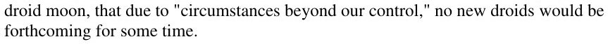
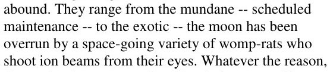
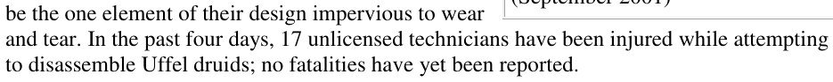
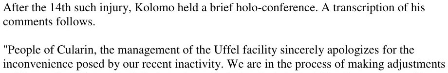
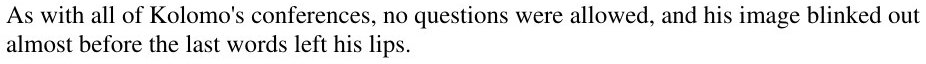
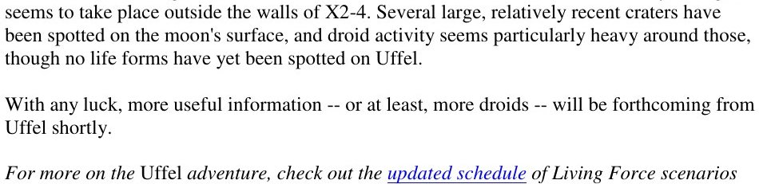
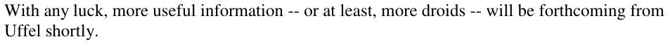

# Owner Material 037 — Star Wars D20 Drive folder (Core, Revised Core and Saga Edition): Living Force Campaign/Articles/Year 1/09:27:01 - No Droids for You!.pdf [Star Wars Roleplaying Game Revised Core (d20, 2002)]

- **Source:** Wizards of the Coast Star Wars Roleplaying Game books, web enhancements, Living Force campaign modules and articles (2000–2010), from the owner's "Star Wars D20" Drive folder (only the three edition subfolders; "General" was not read, as instructed). Secondary source (licensed Legends reference). Scan OCR'd on the box; the scan stays box-only and is **not** published.
- **Method:** every scanned page was OCR'd and machine-screened sentence by sentence for power-relevant statements (fights, kills, defeats, Force feats, rankings, superweapons) that name a character on our roster; each kept sentence is quoted verbatim from the OCR text and has a crop of the printed passage directly under it. Pages with nothing power-relevant are still listed with what is on them.
- **Citation:** "*09:27:01 - No Droids for You!* (SWRPG d20 Revised Core), p.X" by printed page ("scan p.X" where no printed number applies). **Weight:** Licensed RPG material: a secondary source. Narrative text sums up Legends lore; game statistics are rules for players, not canon power levels, and rank lowest.

## scan p.1 (scan page 1)

Page contents: Production halt news, theories, economic effects, adventure box (hand-read)

- **No single roster character (rules/setting/general)** — entry/section: Uffel: "DROID PRODUCTION ON UFFEL HALTED!" Source: *09:27:01 - No Droids for You!* (SWRPG d20 Revised Core), scan p.1
  
- **No single roster character (rules/setting/general)** — entry/section: Gor Kolomo: "that due to "circumstances beyond our control," no new droids would be forthcoming for some time." Source: *09:27:01 - No Droids for You!* (SWRPG d20 Revised Core), scan p.1
  
- **No single roster character (rules/setting/general)** — entry/section: Uffel: "to the exotic -- the moon has been overrun by a space-going variety of womp-rats who shoot ion beams from their eyes." Source: *09:27:01 - No Droids for You!* (SWRPG d20 Revised Core), scan p.1
  
- **No single roster character (rules/setting/general)** — entry/section: Uffel: "In the past four days, 17 unlicensed technicians have been injured while attempting to disassemble Uffel druids; no fatalities have yet been reported." Source: *09:27:01 - No Droids for You!* (SWRPG d20 Revised Core), scan p.1
  

## scan p.2 (scan page 2)

Page contents: Kolomo transcript; orbital monitoring; craters (hand-read)

- **No single roster character (rules/setting/general)** — entry/section: Gor Kolomo: ""People of Cularin, the management of the Uffel facility sincerely apologizes for the inconvenience posed by our recent inactivity." Source: *09:27:01 - No Droids for You!* (SWRPG d20 Revised Core), scan p.2
  
- **No single roster character (rules/setting/general)** — entry/section: Gor Kolomo: "As with all of Kolomo's conferences, no questions were allowed, and his image blinked out almost before the last words left his lips." Source: *09:27:01 - No Droids for You!* (SWRPG d20 Revised Core), scan p.2
  
- **No single roster character (rules/setting/general)** — entry/section: Uffel: "Several large, relatively recent craters have been spotted on the moon's surface, and droid activity seems particularly heavy around those, though no life forms have yet been spotted on Uffel." Source: *09:27:01 - No Droids for You!* (SWRPG d20 Revised Core), scan p.2
  
- **No single roster character (rules/setting/general)** — entry/section: Uffel: "With any luck, more useful information -- or at least, more droids -- will be forthcoming from Uffel shortly." Source: *09:27:01 - No Droids for You!* (SWRPG d20 Revised Core), scan p.2
  
