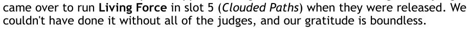
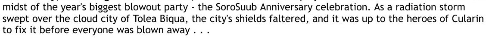
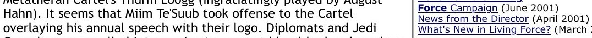
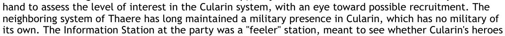
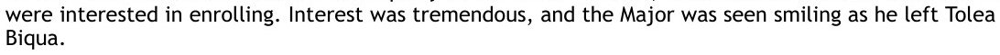
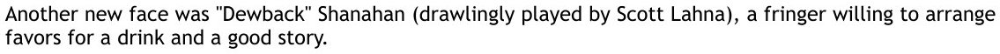

# Owner Material 037 — Star Wars D20 Drive folder (Core, Revised Core and Saga Edition): Living Force Campaign/Articles/Year 1/09:27:01 - The Force Is Strong in This Con.pdf [Star Wars Roleplaying Game Revised Core (d20, 2002)]

- **Source:** Wizards of the Coast Star Wars Roleplaying Game books, web enhancements, Living Force campaign modules and articles (2000–2010), from the owner's "Star Wars D20" Drive folder (only the three edition subfolders; "General" was not read, as instructed). Secondary source (licensed Legends reference). Scan OCR'd on the box; the scan stays box-only and is **not** published.
- **Method:** every scanned page was OCR'd and machine-screened sentence by sentence for power-relevant statements (fights, kills, defeats, Force feats, rankings, superweapons) that name a character on our roster; each kept sentence is quoted verbatim from the OCR text and has a crop of the printed passage directly under it. Pages with nothing power-relevant are still listed with what is on them.
- **Citation:** "*09:27:01 - The Force Is Strong in This Con* (SWRPG d20 Revised Core), p.X" by printed page ("scan p.X" where no printed number applies). **Weight:** Licensed RPG material: a secondary source. Narrative text sums up Legends lore; game statistics are rules for players, not canon power levels, and rank lowest.

## scan p.1 (scan page 1)

Page contents: Gen Con 2001 report; Blown Away interactive (hand-read)

- **No single roster character (rules/setting/general)** — entry/section: Living Force: "We couldn't have done it without all of the judges, and our gratitude is boundless." Source: *09:27:01 - The Force Is Strong in This Con* (SWRPG d20 Revised Core), scan p.1
  
- **No single roster character (rules/setting/general)** — entry/section: Blown Away: "As a radiation storm swept over the cloud city of Tolea Biqua, the city's shields faltered, and it was up to the heroes of Cularin to fix it before everyone was blown away..." Source: *09:27:01 - The Force Is Strong in This Con* (SWRPG d20 Revised Core), scan p.1
  
- **No single roster character (rules/setting/general)** — entry/section: Miim Te'Suub: "It seems that Miim Te'Suub took offense to the Cartel overlaying his annual speech with their logo." Source: *09:27:01 - The Force Is Strong in This Con* (SWRPG d20 Revised Core), scan p.1
  
- **No single roster character (rules/setting/general)** — entry/section: Kurth San: "The neighboring system of Thaere has long maintained a military presence in Cularin, which has no military of its own." Source: *09:27:01 - The Force Is Strong in This Con* (SWRPG d20 Revised Core), scan p.1
  
- **No single roster character (rules/setting/general)** — entry/section: Kurth San: "Interest was tremendous, and the Major was seen smiling as he left Tolea Biqua." Source: *09:27:01 - The Force Is Strong in This Con* (SWRPG d20 Revised Core), scan p.1
  
- **No single roster character (rules/setting/general)** — entry/section: Dewback Shanahan: "a fringer willing to arrange favors for a drink and a good story." Source: *09:27:01 - The Force Is Strong in This Con* (SWRPG d20 Revised Core), scan p.1
  
