# Owner Material 037 — Star Wars D20 Drive folder (Core, Revised Core and Saga Edition): Living Force Campaign/Articles/Year 1/10:01:01 - News from the Living Force Campaign.pdf [Star Wars Roleplaying Game Revised Core (d20, 2002)]

- **Source:** Wizards of the Coast Star Wars Roleplaying Game books, web enhancements, Living Force campaign modules and articles (2000–2010), from the owner's "Star Wars D20" Drive folder (only the three edition subfolders; "General" was not read, as instructed). Secondary source (licensed Legends reference). Scan OCR'd on the box; the scan stays box-only and is **not** published.
- **Method:** every scanned page was OCR'd and machine-screened sentence by sentence for power-relevant statements (fights, kills, defeats, Force feats, rankings, superweapons) that name a character on our roster; each kept sentence is quoted verbatim from the OCR text and has a crop of the printed passage directly under it. Pages with nothing power-relevant are still listed with what is on them.
- **Citation:** "*10:01:01 - News from the Living Force Campaign* (SWRPG d20 Revised Core), p.X" by printed page ("scan p.X" where no printed number applies). **Weight:** Licensed RPG material: a secondary source. Narrative text sums up Legends lore; game statistics are rules for players, not canon power levels, and rank lowest.

## scan p.1 (scan page 1)

Page contents: Metagaming certs, stickers, rules intro, retirement at 13th level (hand-read)

- **No single roster character (rules/setting/general)** — entry/section: Living Force: "We are, first and foremost, telling a story. It's a story that depends on the heroes for the plot to advance, but our focus is on story, not power." Source: *10:01:01 - News from the Living Force Campaign* (SWRPG d20 Revised Core), scan p.1
  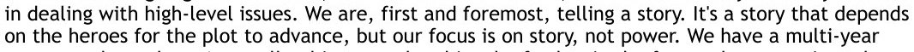
- **No single roster character (rules/setting/general)** — entry/section: Living Force: "and it doesn't include groups of Jedi Masters careening around the galaxy looking for something tough enough to challenge them." Source: *10:01:01 - News from the Living Force Campaign* (SWRPG d20 Revised Core), scan p.1
  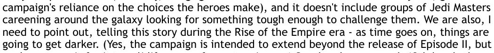
- **No single roster character (rules/setting/general)** — entry/section: Living Force: "telling this story during the Rise of the Empire era - as time goes on, things are going to get darker." Source: *10:01:01 - News from the Living Force Campaign* (SWRPG d20 Revised Core), scan p.1
  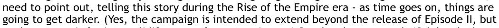

## scan p.2 (scan page 2)

Page contents: Retirement cont.; Wookiee Jedi rage DSP; Move Object disarm; lightsaber creation; Law and Order intro (hand-read)

- **No single roster character (rules/setting/general)** — entry/section: Living Force: "Living Force isn't D&D, and it's not an exercise in accounting/dice rolling. We don't award experience based on how much you kill or damage. We reward accomplishing goals, and we reward cinematic roleplaying." Source: *10:01:01 - News from the Living Force Campaign* (SWRPG d20 Revised Core), scan p.2
  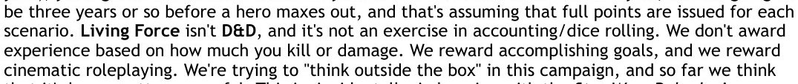
- **No single roster character (rules/setting/general)** — entry/section: Wookiee Jedi: "Wookiee Jedi who use their racial ability to rage will receive a Dark Side Point for doing so." Source: *10:01:01 - News from the Living Force Campaign* (SWRPG d20 Revised Core), scan p.2
  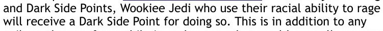
- **No single roster character (rules/setting/general)** — entry/section: Wookiee Jedi: "Giving in to fear and rage is something no Jedi can allow, regardless of his or her heritage or physiology." Source: *10:01:01 - News from the Living Force Campaign* (SWRPG d20 Revised Core), scan p.2
  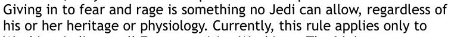
- **No single roster character (rules/setting/general)** — entry/section: Living Force: "However, since we don't allow dark side characters, don't look for much from the book to be approved for the campaign." Source: *10:01:01 - News from the Living Force Campaign* (SWRPG d20 Revised Core), scan p.2
  
- **No single roster character (rules/setting/general)** — entry/section: Almas Jedi Academy: "All Jedi in the Living Force Campaign are Padawan learners at the Almas Jedi Academy. These Jedi create their lightsabers between 6th and 7th levels, completing the process at the time they advance to the level of Jedi Knight (the 7th level)." Source: *10:01:01 - News from the Living Force Campaign* (SWRPG d20 Revised Core), scan p.2
  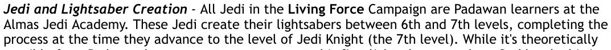
- **No single roster character (rules/setting/general)** — entry/section: Mexal: "with the addition of Mexal, we also discovered we had acquired a wonderfully devious and creative mind." Source: *10:01:01 - News from the Living Force Campaign* (SWRPG d20 Revised Core), scan p.2
  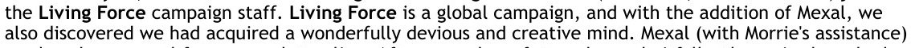

## scan p.3 (scan page 3)

Page contents: Law and Order storyline; Trade War trilogy blurbs (hand-read)

- **No single roster character (rules/setting/general)** — entry/section: Mexal: "Mexal tackled and defeated some ferocious deadlines to bring the first trilogy in on time." Source: *10:01:01 - News from the Living Force Campaign* (SWRPG d20 Revised Core), scan p.3
  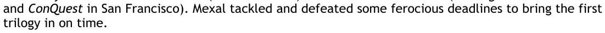
- **No single roster character (rules/setting/general)** — entry/section: Trade War: "At this stage, the characters see only the tip of the iceberg, and various events that show that all is not well within the commercial sector." Source: *10:01:01 - News from the Living Force Campaign* (SWRPG d20 Revised Core), scan p.3
  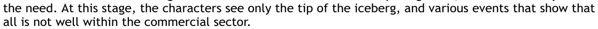
- **No single roster character (rules/setting/general)** — entry/section: Living Force: "Throughout the next year, the story will unfold, challenging the heroes to choose a path between the darkness and the light." Source: *10:01:01 - News from the Living Force Campaign* (SWRPG d20 Revised Core), scan p.3
  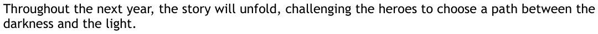
