# Owner Material 037 — Star Wars D20 Drive folder (Core, Revised Core and Saga Edition): Living Force Campaign/Articles/Year 1/10:04:01 - Over Thaere.pdf [Star Wars Roleplaying Game Revised Core (d20, 2002)]

- **Source:** Wizards of the Coast Star Wars Roleplaying Game books, web enhancements, Living Force campaign modules and articles (2000–2010), from the owner's "Star Wars D20" Drive folder (only the three edition subfolders; "General" was not read, as instructed). Secondary source (licensed Legends reference). Scan OCR'd on the box; the scan stays box-only and is **not** published.
- **Method:** every scanned page was OCR'd and machine-screened sentence by sentence for power-relevant statements (fights, kills, defeats, Force feats, rankings, superweapons) that name a character on our roster; each kept sentence is quoted verbatim from the OCR text and has a crop of the printed passage directly under it. Pages with nothing power-relevant are still listed with what is on them.
- **Citation:** "*10:04:01 - Over Thaere* (SWRPG d20 Revised Core), p.X" by printed page ("scan p.X" where no printed number applies). **Weight:** Licensed RPG material: a secondary source. Narrative text sums up Legends lore; game statistics are rules for players, not canon power levels, and rank lowest.

## scan p.1 (scan page 1)

Page contents: Errata; Thaere history; sidebar; Blen sisters; Tramsig (hand-read)

- **No single roster character (rules/setting/general)** — entry/section: Thaere: "during the era in which the Living Force campaign is set, there is no Republic Military." Source: *10:04:01 - Over Thaere* (SWRPG d20 Revised Core), scan p.1
  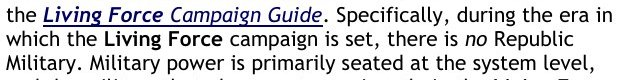
- **No single roster character (rules/setting/general)** — entry/section: Thaere: "The pirates of Cularin learned quickly that there was no easy bounty from their neighbors." Source: *10:04:01 - Over Thaere* (SWRPG d20 Revised Core), scan p.1
  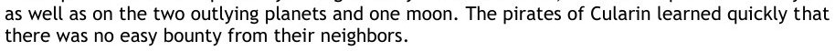
- **No single roster character (rules/setting/general)** — entry/section: Mala Blen: "Rumor has it that their private personas were the exact opposite, with Mala sometimes traveling to Riboga's court for extended visits for which she would bring all manner of delicacies to feed Riboga by hand." Source: *10:04:01 - Over Thaere* (SWRPG d20 Revised Core), scan p.1
  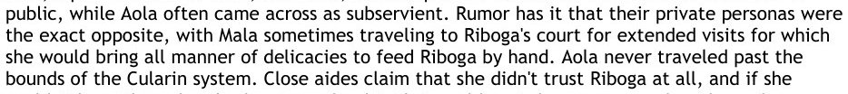
- **No single roster character (rules/setting/general)** — entry/section: Aola Blen: "if she couldn't be within a hundred meters of a ship that could go to hyperspace and get her a few parsecs away, she wouldn't even see him." Source: *10:04:01 - Over Thaere* (SWRPG d20 Revised Core), scan p.1
  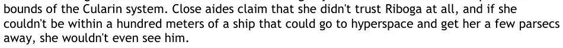
- **No single roster character (rules/setting/general)** — entry/section: Riboga: "Both of them amused Riboga to no end. He would offer support to one, and then the other, watching the balance of power shift in Thaere." Source: *10:04:01 - Over Thaere* (SWRPG d20 Revised Core), scan p.1
  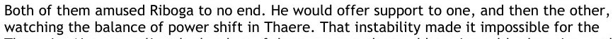

## scan p.2 (scan page 2)

Page contents: Tramsig rescue; Nirama era; Bal Ferensil; current presence (hand-read)

- **No single roster character (rules/setting/general)** — entry/section: Jir Tramsig: "Later, when he thought no one was listening and he'd had far too much wine, Tramsig would sometimes be heard wondering aloud whether Riboga had set the whole thing up." Source: *10:04:01 - Over Thaere* (SWRPG d20 Revised Core), scan p.2
  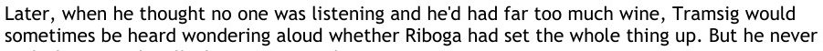
- **No single roster character (rules/setting/general)** — entry/section: Thaere: "They are present for the good of Cularin, to ensure fair, free trade through Thaere Privo." Source: *10:04:01 - Over Thaere* (SWRPG d20 Revised Core), scan p.2
  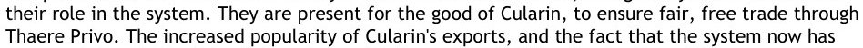
- **No single roster character (rules/setting/general)** — entry/section: Thaere: "Thaere has invested in Cularin, and the military protects that investment." Source: *10:04:01 - Over Thaere* (SWRPG d20 Revised Core), scan p.2
  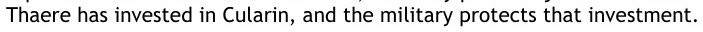
- **No single roster character (rules/setting/general)** — entry/section: Thaere: "Thaere has always been a quiet neighbor. Not necessarily peaceful or friendly -- just quiet." Source: *10:04:01 - Over Thaere* (SWRPG d20 Revised Core), scan p.2
  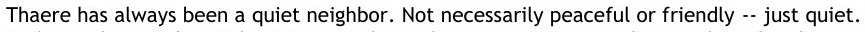
- **No single roster character (rules/setting/general)** — entry/section: Thaere: "More is going on than anyone in Cularin has yet figured out." Source: *10:04:01 - Over Thaere* (SWRPG d20 Revised Core), scan p.2
  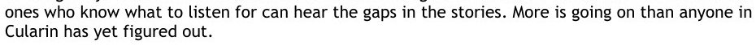
- **No single roster character (rules/setting/general)** — entry/section: Thaere: "And it's happening right over Thaere." Source: *10:04:01 - Over Thaere* (SWRPG d20 Revised Core), scan p.2
  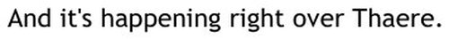
