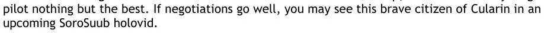
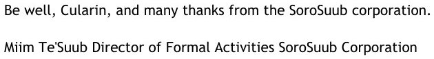
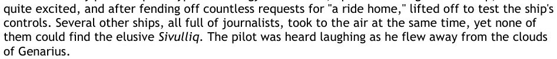

# Owner Material 037 — Star Wars D20 Drive folder (Core, Revised Core and Saga Edition): Living Force Campaign/Articles/Year 1/10:04:01 - The Sivulliq is Out There -- Somewhere.pdf [Star Wars Roleplaying Game Revised Core (d20, 2002)]

- **Source:** Wizards of the Coast Star Wars Roleplaying Game books, web enhancements, Living Force campaign modules and articles (2000–2010), from the owner's "Star Wars D20" Drive folder (only the three edition subfolders; "General" was not read, as instructed). Secondary source (licensed Legends reference). Scan OCR'd on the box; the scan stays box-only and is **not** published.
- **Method:** every scanned page was OCR'd and machine-screened sentence by sentence for power-relevant statements (fights, kills, defeats, Force feats, rankings, superweapons) that name a character on our roster; each kept sentence is quoted verbatim from the OCR text and has a crop of the printed passage directly under it. Pages with nothing power-relevant are still listed with what is on them.
- **Citation:** "*10:04:01 - The Sivulliq is Out There -- Somewhere* (SWRPG d20 Revised Core), p.X" by printed page ("scan p.X" where no printed number applies). **Weight:** Licensed RPG material: a secondary source. Narrative text sums up Legends lore; game statistics are rules for players, not canon power levels, and rank lowest.

## scan p.1 (scan page 1)

Page contents: SoroSuub press release; addendum; OOC note (hand-read)

- **No single roster character (rules/setting/general)** — entry/section: Miim Te'Suub: "is pleased to announce that the gratitude of SoroSuub and all of her subsidiaries is upon the brave citizens of Cularin." Source: *10:04:01 - The Sivulliq is Out There -- Somewhere* (SWRPG d20 Revised Core), scan p.1
  
- **No single roster character (rules/setting/general)** — entry/section: Miim Te'Suub: "Much was our shame at such a theft, and much was our joy at the return of the freighter, designation Sivulliq, class RK-720 light transport." Source: *10:04:01 - The Sivulliq is Out There -- Somewhere* (SWRPG d20 Revised Core), scan p.1
  
- **No single roster character (rules/setting/general)** — entry/section: Miim Te'Suub: "If negotiations go well, you may see this brave citizen of Cularin in an upcoming SoroSuub holovid." Source: *10:04:01 - The Sivulliq is Out There -- Somewhere* (SWRPG d20 Revised Core), scan p.1
  
- **No single roster character (rules/setting/general)** — entry/section: Miim Te'Suub: "Be well, Cularin, and many thanks from the SoroSuub corporation." Source: *10:04:01 - The Sivulliq is Out There -- Somewhere* (SWRPG d20 Revised Core), scan p.1
  
- **No single roster character (rules/setting/general)** — entry/section: Sivulliq: "Several other ships, all full of journalists, took to the air at the same time, yet none of them could find the elusive Sivulliq. The pilot was heard laughing as he flew away from the clouds of Genarius." Source: *10:04:01 - The Sivulliq is Out There -- Somewhere* (SWRPG d20 Revised Core), scan p.1
  
- **No single roster character (rules/setting/general)** — entry/section: Sivulliq: "Other ships will be made available within the campaign early next year, but none will be quite like the Sivulliq." Source: *10:04:01 - The Sivulliq is Out There -- Somewhere* (SWRPG d20 Revised Core), scan p.1
  
