# Owner Material 037 — Star Wars D20 Drive folder (Core, Revised Core and Saga Edition): Living Force Campaign/Articles/Year 1/10:11:01 - Shades of Meaning.pdf [Star Wars Roleplaying Game Revised Core (d20, 2002)]

- **Source:** Wizards of the Coast Star Wars Roleplaying Game books, web enhancements, Living Force campaign modules and articles (2000–2010), from the owner's "Star Wars D20" Drive folder (only the three edition subfolders; "General" was not read, as instructed). Secondary source (licensed Legends reference). Scan OCR'd on the box; the scan stays box-only and is **not** published.
- **Method:** every scanned page was OCR'd and machine-screened sentence by sentence for power-relevant statements (fights, kills, defeats, Force feats, rankings, superweapons) that name a character on our roster; each kept sentence is quoted verbatim from the OCR text and has a crop of the printed passage directly under it. Pages with nothing power-relevant are still listed with what is on them.
- **Citation:** "*10:11:01 - Shades of Meaning* (SWRPG d20 Revised Core), p.X" by printed page ("scan p.X" where no printed number applies). **Weight:** Licensed RPG material: a secondary source. Narrative text sums up Legends lore; game statistics are rules for players, not canon power levels, and rank lowest.

## scan p.1 (scan page 1)

Page contents: Skintone language intro; light green, light brown, other greens/browns, white, black start (hand-read)

- **No single roster character (rules/setting/general)** — entry/section: Tarasin: "One of the most baffling of "languages" in the Cularin system is the skintone language utilized by the Tarasin." Source: *10:11:01 - Shades of Meaning* (SWRPG d20 Revised Core), scan p.1
  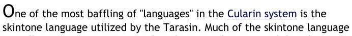
- **No single roster character (rules/setting/general)** — entry/section: Tarasin: "A skintone change to light green typically indicates that the Tarasin is at ease with his or her surroundings." Source: *10:11:01 - Shades of Meaning* (SWRPG d20 Revised Core), scan p.1
  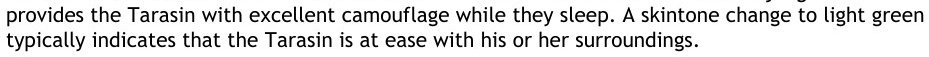
- **No single roster character (rules/setting/general)** — entry/section: Tarasin: "A change to white on the part of a Tarasin is typically an expression of joy." Source: *10:11:01 - Shades of Meaning* (SWRPG d20 Revised Core), scan p.1
  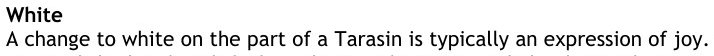
- **No single roster character (rules/setting/general)** — entry/section: Tarasin: "However, children often turn white, with many other colors visible, while they are at play." Source: *10:11:01 - Shades of Meaning* (SWRPG d20 Revised Core), scan p.1
  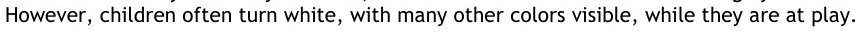

## scan p.2 (scan page 2)

Page contents: Black, orange, purple, yellow, blue, pink, other; summation by Jorus Trass (hand-read)

- **No single roster character (rules/setting/general)** — entry/section: Tarasin: "A wall is being erected, and the Tarasin is functionally done communicating." Source: *10:11:01 - Shades of Meaning* (SWRPG d20 Revised Core), scan p.2
  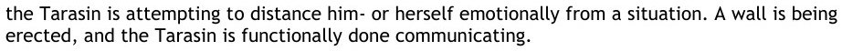
- **No single roster character (rules/setting/general)** — entry/section: Tarasin: "but only the gargrell-orange truly says, "You are ticking me off; get out of my face."" Source: *10:11:01 - Shades of Meaning* (SWRPG d20 Revised Core), scan p.2
  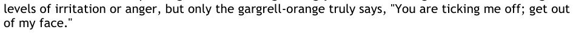
- **No single roster character (rules/setting/general)** — entry/section: Tarasin: "In some ways, purple is the silent Tarasin equivalent of laughter." Source: *10:11:01 - Shades of Meaning* (SWRPG d20 Revised Core), scan p.2
  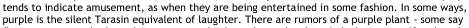
- **No single roster character (rules/setting/general)** — entry/section: Tarasin: "If such a plant exists, the Tarasin have been careful to prevent its exportation." Source: *10:11:01 - Shades of Meaning* (SWRPG d20 Revised Core), scan p.2
  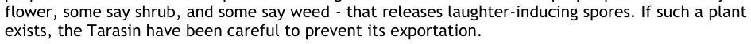
- **No single roster character (rules/setting/general)** — entry/section: Tarasin: "That aching dread in the pit of your stomach when something is beyond your control, when you feel like you just might throw up? That's arrgrar yellow." Source: *10:11:01 - Shades of Meaning* (SWRPG d20 Revised Core), scan p.2
  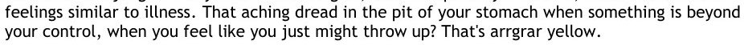
- **No single roster character (rules/setting/general)** — entry/section: Tarasin: "At those times when a Tarasin resorts to groveling, the deferential blue is tinged with wary brown." Source: *10:11:01 - Shades of Meaning* (SWRPG d20 Revised Core), scan p.2
  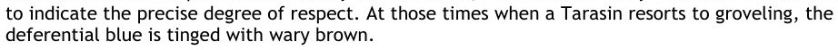
- **No single roster character (rules/setting/general)** — entry/section: Jorus Trass: "But the general patterns, the trends, are there, and utilizing this knowledge, we can understand our jungle friends on Cularin all the better." Source: *10:11:01 - Shades of Meaning* (SWRPG d20 Revised Core), scan p.2
  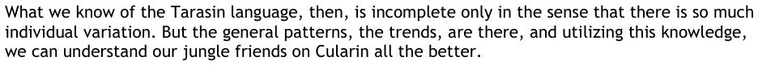

## scan p.3 (scan page 3)

Page contents: (blank page) (hand-read)

