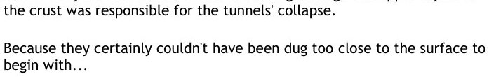
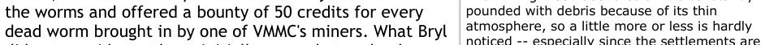
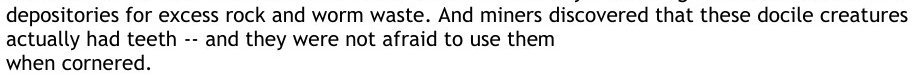
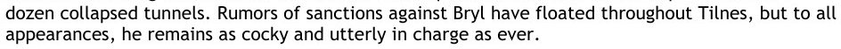

# Owner Material 037 — Star Wars D20 Drive folder (Core, Revised Core and Saga Edition): Living Force Campaign/Articles/Year 1/10:25:01 - Yri Worms Wreak Havoc for Miners.pdf [Star Wars Roleplaying Game Revised Core (d20, 2002)]

- **Source:** Wizards of the Coast Star Wars Roleplaying Game books, web enhancements, Living Force campaign modules and articles (2000–2010), from the owner's "Star Wars D20" Drive folder (only the three edition subfolders; "General" was not read, as instructed). Secondary source (licensed Legends reference). Scan OCR'd on the box; the scan stays box-only and is **not** published.
- **Method:** every scanned page was OCR'd and machine-screened sentence by sentence for power-relevant statements (fights, kills, defeats, Force feats, rankings, superweapons) that name a character on our roster; each kept sentence is quoted verbatim from the OCR text and has a crop of the printed passage directly under it. Pages with nothing power-relevant are still listed with what is on them.
- **Citation:** "*10:25:01 - Yri Worms Wreak Havoc for Miners* (SWRPG d20 Revised Core), p.X" by printed page ("scan p.X" where no printed number applies). **Weight:** Licensed RPG material: a secondary source. Narrative text sums up Legends lore; game statistics are rules for players, not canon power levels, and rank lowest.

## scan p.1 (scan page 1)

Page contents: Tilnes cave-ins; bounty; worm behavior; adventure box (hand-read)

- **No single roster character (rules/setting/general)** — entry/section: Tilnes: "Because they certainly couldn't have been dug too close to the surface to begin with..." Source: *10:25:01 - Yri Worms Wreak Havoc for Miners* (SWRPG d20 Revised Core), scan p.1
  
- **No single roster character (rules/setting/general)** — entry/section: Hiem Bryl: "offered a bounty of 50 credits for every dead worm brought in by one of VMMC's miners." Source: *10:25:01 - Yri Worms Wreak Havoc for Miners* (SWRPG d20 Revised Core), scan p.1
  
- **No single roster character (rules/setting/general)** — entry/section: Yri worm: "And miners discovered that these docile creatures actually had teeth -- and they were not afraid to use them when cornered." Source: *10:25:01 - Yri Worms Wreak Havoc for Miners* (SWRPG d20 Revised Core), scan p.1
  
- **No single roster character (rules/setting/general)** — entry/section: Hiem Bryl: "Rumors of sanctions against Bryl have floated throughout Tilnes, but to all appearances, he remains as cocky and utterly in charge as ever." Source: *10:25:01 - Yri Worms Wreak Havoc for Miners* (SWRPG d20 Revised Core), scan p.1
  
- **No single roster character (rules/setting/general)** — entry/section: Yri worm: "The worms wait -- and grow hungrier by the hour." Source: *10:25:01 - Yri Worms Wreak Havoc for Miners* (SWRPG d20 Revised Core), scan p.1
  

## scan p.2 (scan page 2)

Page contents: Yri worm stats and combat (hand-read)

- **No single roster character (rules/setting/general)** — entry/section: Yri worm: "Clearly, this makes yri worms somewhat more dangerous to face on their home ground than anywhere else." Source: *10:25:01 - Yri Worms Wreak Havoc for Miners* (SWRPG d20 Revised Core), scan p.2
  

### Stat block notes (game mechanics, not feats)

- Yri worm: Yri worm: Subterranean scavenger 2; Init +1; Def 16; Spd 5m (burrow through rock 15m); VP/WP 12/14; Atk +3 melee (2d4+2, bite); SV Fort +4, Ref +2, Will +0; Str 15, Dex 13, Con 14, Int 8, Wis 8, Cha 4; CL B; Hide +4, Move Silently +4 (Source: *10:25:01 - Yri Worms Wreak Havoc for Miners* (SWRPG d20 Revised Core), scan p.2)
