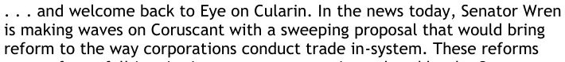
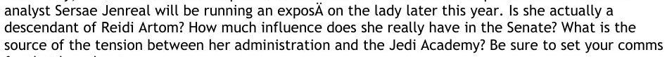

# Owner Material 037 — Star Wars D20 Drive folder (Core, Revised Core and Saga Edition): Living Force Campaign/Articles/Year 1/12:06:01 - Cularin's Lady Senator, Lavina Wren.pdf [Star Wars Roleplaying Game Revised Core (d20, 2002)]

- **Source:** Wizards of the Coast Star Wars Roleplaying Game books, web enhancements, Living Force campaign modules and articles (2000–2010), from the owner's "Star Wars D20" Drive folder (only the three edition subfolders; "General" was not read, as instructed). Secondary source (licensed Legends reference). Scan OCR'd on the box; the scan stays box-only and is **not** published.
- **Method:** every scanned page was OCR'd and machine-screened sentence by sentence for power-relevant statements (fights, kills, defeats, Force feats, rankings, superweapons) that name a character on our roster; each kept sentence is quoted verbatim from the OCR text and has a crop of the printed passage directly under it. Pages with nothing power-relevant are still listed with what is on them.
- **Citation:** "*12:06:01 - Cularin's Lady Senator, Lavina Wren* (SWRPG d20 Revised Core), p.X" by printed page ("scan p.X" where no printed number applies). **Weight:** Licensed RPG material: a secondary source. Narrative text sums up Legends lore; game statistics are rules for players, not canon power levels, and rank lowest.

## scan p.1 (scan page 1)

Page contents: Eye on Cularin news brief on Lavina Wren (hand-read)

- **No single roster character (rules/setting/general)** — entry/section: Lavina Wren: "Senator Wren is making waves on Coruscant with a sweeping proposal that would bring reform to the way corporations conduct trade in-system." Source: *12:06:01 - Cularin's Lady Senator, Lavina Wren* (SWRPG d20 Revised Core), scan p.1
  
- **No single roster character (rules/setting/general)** — entry/section: Lavina Wren: "Personally, Senator Wren leads a quiet life and little is known about her private affairs." Source: *12:06:01 - Cularin's Lady Senator, Lavina Wren* (SWRPG d20 Revised Core), scan p.1
  
- **No single roster character (rules/setting/general)** — entry/section: Lavina Wren: "Is she actually a descendant of Reidi Artom? How much influence does she really have in the Senate? What is the source of the tension between her administration and the Jedi Academy?" Source: *12:06:01 - Cularin's Lady Senator, Lavina Wren* (SWRPG d20 Revised Core), scan p.1
  
