# Owner Material 037 — Star Wars D20 Drive folder (Core, Revised Core and Saga Edition): Living Force Campaign/Articles/Year 1/12:06:01 - Troop Movements.pdf [Star Wars Roleplaying Game Revised Core (d20, 2002)]

- **Source:** Wizards of the Coast Star Wars Roleplaying Game books, web enhancements, Living Force campaign modules and articles (2000–2010), from the owner's "Star Wars D20" Drive folder (only the three edition subfolders; "General" was not read, as instructed). Secondary source (licensed Legends reference). Scan OCR'd on the box; the scan stays box-only and is **not** published.
- **Method:** every scanned page was OCR'd and machine-screened sentence by sentence for power-relevant statements (fights, kills, defeats, Force feats, rankings, superweapons) that name a character on our roster; each kept sentence is quoted verbatim from the OCR text and has a crop of the printed passage directly under it. Pages with nothing power-relevant are still listed with what is on them.
- **Citation:** "*12:06:01 - Troop Movements* (SWRPG d20 Revised Core), p.X" by printed page ("scan p.X" where no printed number applies). **Weight:** Licensed RPG material: a secondary source. Narrative text sums up Legends lore; game statistics are rules for players, not canon power levels, and rank lowest.

## scan p.1 (scan page 1)

Page contents: Thaereian maneuvers; Eelo Begraas bio; Dicer; Shootfirst (hand-read)

- **No single roster character (rules/setting/general)** — entry/section: Thaereian military: ""To protect the citizens of Cularin from domestic disturbances localized in the asteroid belt."" Source: *12:06:01 - Troop Movements* (SWRPG d20 Revised Core), scan p.1
  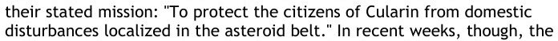
- **No single roster character (rules/setting/general)** — entry/section: Eelo Begraas: "Begraas, of course, is the ranking pilot, chief flight instructor, and overall tactical advisor to the Thaereian military." Source: *12:06:01 - Troop Movements* (SWRPG d20 Revised Core), scan p.1
  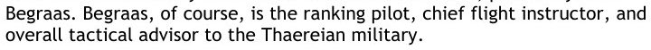
- **No single roster character (rules/setting/general)** — entry/section: Eelo Begraas: "he also possessed a flair for the dramatic -- and an addiction to adrenaline." Source: *12:06:01 - Troop Movements* (SWRPG d20 Revised Core), scan p.1
  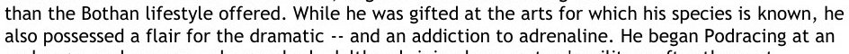
- **No single roster character (rules/setting/general)** — entry/section: Eelo Begraas: "He doesn't come cheap, but he is capable of such remarkable stealth and precision in his ship that many systems - and more than a few Hutts - have found his services more than worth the price." Source: *12:06:01 - Troop Movements* (SWRPG d20 Revised Core), scan p.1
  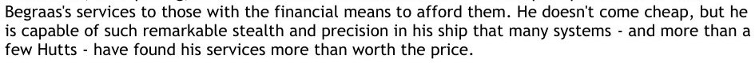
- **No single roster character (rules/setting/general)** — entry/section: Eelo Begraas: "His quick temper and short attention span are such that the Thaereian military recognizes the necessity of keeping him "entertained" by loaning him out." Source: *12:06:01 - Troop Movements* (SWRPG d20 Revised Core), scan p.1
  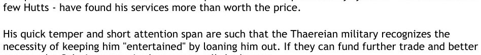
- **No single roster character (rules/setting/general)** — entry/section: Dicer: "The ship itself is black, designed to blend in with the starfield when he attacks, and highlighted in blood red. His personal insignia, a clenched fist, is found on either side of the cockpit." Source: *12:06:01 - Troop Movements* (SWRPG d20 Revised Core), scan p.1
  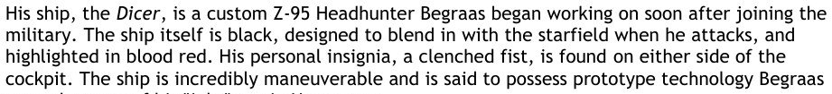
- **No single roster character (rules/setting/general)** — entry/section: Eelo Begraas: "Few things are more terrifying than Begraas in his ship. It is said that frequently, the mere sight of his vessel sends opposing pilots into hysterics as they hurry to jump to hyperspace. It is also said that they only make that jump if Begraas allows it." Source: *12:06:01 - Troop Movements* (SWRPG d20 Revised Core), scan p.1
  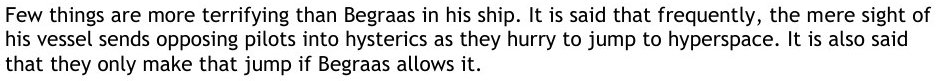
- **No single roster character (rules/setting/general)** — entry/section: Eelo Begraas: "He is one of the scrawniest Bothans in the galaxy, all bones and sinew with hardly a muscle on him." Source: *12:06:01 - Troop Movements* (SWRPG d20 Revised Core), scan p.1
  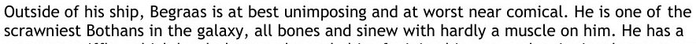
- **No single roster character (rules/setting/general)** — entry/section: Eelo Begraas: "Unless you plan never to leave the ground again, though, it's bad to pick a fight with Begraas." Source: *12:06:01 - Troop Movements* (SWRPG d20 Revised Core), scan p.1
  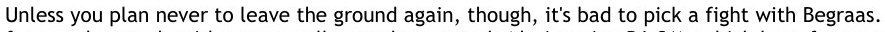
- **No single roster character (rules/setting/general)** — entry/section: Shootfirst: "He frequently travels with a very well-armed astromech (designation R6-S1), which he refers to as "Shootfirst."" Source: *12:06:01 - Troop Movements* (SWRPG d20 Revised Core), scan p.1
  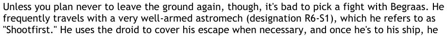
- **No single roster character (rules/setting/general)** — entry/section: Eelo Begraas: "After the second time he did a strafing run over an unfriendly city, people began to catch on." Source: *12:06:01 - Troop Movements* (SWRPG d20 Revised Core), scan p.1
  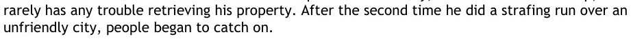

## scan p.2 (scan page 2)

Page contents: Begraas, Dicer, R6 stat blocks (hand-read)

- **No single roster character (rules/setting/general)** — entry/section: Eelo Begraas: "One thing is certain, though - it can't be good news that Begraas is here." Source: *12:06:01 - Troop Movements* (SWRPG d20 Revised Core), scan p.2
  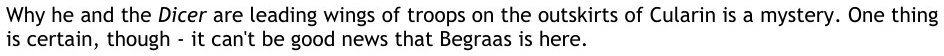

### Stat block notes (game mechanics, not feats)

- Eelo Begraas: Eelo Begraas: Male Bothan Scout 2/Soldier 5/Starfighter Ace 9; Init +9; Def 27; VP/WP 63/15; Atk +17/+12/+7 (3d6, blaster pistol) or +21/+16/+11 (ship's weapons); SQ Starfighter Defense, Familiarity +4 (Dicer), Improved Starfighter Evasion, Frightful Presence; SV Fort +13, Ref +14, Will +7; FP 3; DSP 3; Rep 5; Str 8, Dex 20, Con 8, Int 14, Wis 10, Cha 15; Pilot +29 (+33 in Dicer), Astrogate +23 (Source: *12:06:01 - Troop Movements* (SWRPG d20 Revised Core), scan p.2)
- Dicer: Dicer: Customized Incom/Subpro Z-95 Headhunter; Def 26 (32 piloted by Begraas); SP 60; HP 150; DR 10; Blaster Cannons +25/+20/+15 (5d10x2); proton torpedoes 10 (10d10x2); hyperdrive rumored x1/2 (Source: *12:06:01 - Troop Movements* (SWRPG d20 Revised Core), scan p.2)
- Shootfirst: R6-A1 [sic; R6-S1 in text]: Tracked Astromech Droid Expert 3/Soldier 5; Init +6; Def 18; WP 40/17; Atk +8/+3 ranged (3d6, mounted blaster pistols), +6/+1 melee (2d6, arc welder); Str 10, Dex 14, Con 13, Int 18, Wis 10, Cha 10 (Source: *12:06:01 - Troop Movements* (SWRPG d20 Revised Core), scan p.2)
