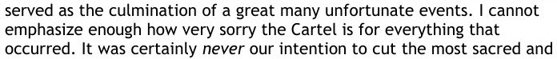
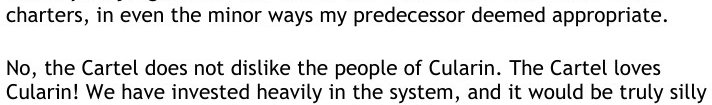
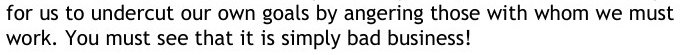
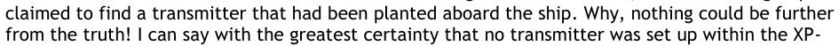
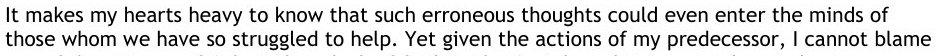
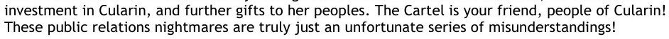
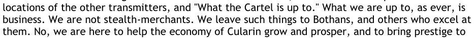
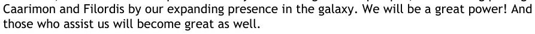
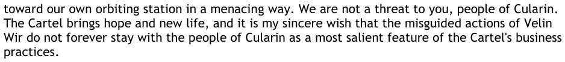
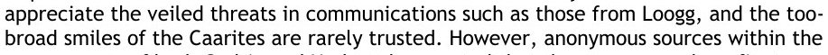

# Owner Material 037 — Star Wars D20 Drive folder (Core, Revised Core and Saga Edition): Living Force Campaign/Articles/Year 1/12:20:01 - The Cartel's Gift.pdf [Star Wars Roleplaying Game Revised Core (d20, 2002)]

- **Source:** Wizards of the Coast Star Wars Roleplaying Game books, web enhancements, Living Force campaign modules and articles (2000–2010), from the owner's "Star Wars D20" Drive folder (only the three edition subfolders; "General" was not read, as instructed). Secondary source (licensed Legends reference). Scan OCR'd on the box; the scan stays box-only and is **not** published.
- **Method:** every scanned page was OCR'd and machine-screened sentence by sentence for power-relevant statements (fights, kills, defeats, Force feats, rankings, superweapons) that name a character on our roster; each kept sentence is quoted verbatim from the OCR text and has a crop of the printed passage directly under it. Pages with nothing power-relevant are still listed with what is on them.
- **Citation:** "*12:20:01 - The Cartel's Gift* (SWRPG d20 Revised Core), p.X" by printed page ("scan p.X" where no printed number applies). **Weight:** Licensed RPG material: a secondary source. Narrative text sums up Legends lore; game statistics are rules for players, not canon power levels, and rank lowest.

## scan p.1 (scan page 1)

Page contents: Thurm Loogg letter (hand-read)

- **No single roster character (rules/setting/general)** — entry/section: Thurm Loogg: "I cannot emphasize enough how very sorry the Cartel is for everything that occurred." Source: *12:20:01 - The Cartel's Gift* (SWRPG d20 Revised Core), scan p.1
  
- **No single roster character (rules/setting/general)** — entry/section: Thurm Loogg: "No, the Cartel does not dislike the people of Cularin. The Cartel loves Cularin!" Source: *12:20:01 - The Cartel's Gift* (SWRPG d20 Revised Core), scan p.1
  
- **No single roster character (rules/setting/general)** — entry/section: Thurm Loogg: "You must see that it is simply bad business!" Source: *12:20:01 - The Cartel's Gift* (SWRPG d20 Revised Core), scan p.1
  
- **No single roster character (rules/setting/general)** — entry/section: Thurm Loogg: "Why, nothing could be further from the truth!" Source: *12:20:01 - The Cartel's Gift* (SWRPG d20 Revised Core), scan p.1
  
- **No single roster character (rules/setting/general)** — entry/section: Thurm Loogg: "It makes my hearts heavy to know that such erroneous thoughts could even enter the minds of those whom we have so struggled to help." Source: *12:20:01 - The Cartel's Gift* (SWRPG d20 Revised Core), scan p.1
  
- **No single roster character (rules/setting/general)** — entry/section: Thurm Loogg: "The Cartel is your friend, people of Cularin! These public relations nightmares are truly just an unfortunate series of misunderstandings!" Source: *12:20:01 - The Cartel's Gift* (SWRPG d20 Revised Core), scan p.1
  
- **No single roster character (rules/setting/general)** — entry/section: Thurm Loogg: "What we are up to, as ever, is business. We are not stealth-merchants. We leave such things to Bothans, and others who excel at them." Source: *12:20:01 - The Cartel's Gift* (SWRPG d20 Revised Core), scan p.1
  
- **No single roster character (rules/setting/general)** — entry/section: Thurm Loogg: "We will be a great power! And those who assist us will become great as well." Source: *12:20:01 - The Cartel's Gift* (SWRPG d20 Revised Core), scan p.1
  

## scan p.2 (scan page 2)

Page contents: Letter close; OOC background (hand-read)

- **No single roster character (rules/setting/general)** — entry/section: Thurm Loogg: "We are not a threat to you, people of Cularin. The Cartel brings hope and new life, and it is my sincere wish that the misguided actions of Velin Wir do not forever stay with the people of Cularin as a most salient feature of the Cartel's business practices." Source: *12:20:01 - The Cartel's Gift* (SWRPG d20 Revised Core), scan p.2
  
- **No single roster character (rules/setting/general)** — entry/section: Metatheran Cartel: "and the too-broad smiles of the Caarites are rarely trusted." Source: *12:20:01 - The Cartel's Gift* (SWRPG d20 Revised Core), scan p.2
  
