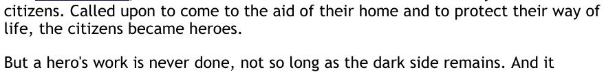
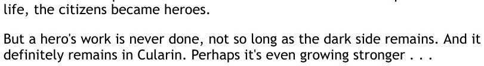
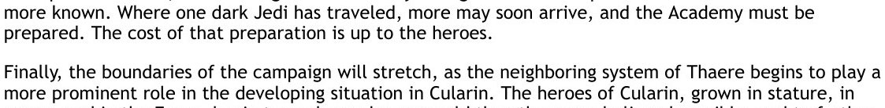

# Owner Material 037 — Star Wars D20 Drive folder (Core, Revised Core and Saga Edition): Living Force Campaign/Articles/Year 2/01:10:02 - Living Force, Year Two - Delving Deeper.pdf [Star Wars Roleplaying Game Revised Core (d20, 2002)]

- **Source:** Wizards of the Coast Star Wars Roleplaying Game books, web enhancements, Living Force campaign modules and articles (2000–2010), from the owner's "Star Wars D20" Drive folder (only the three edition subfolders; "General" was not read, as instructed). Secondary source (licensed Legends reference). Scan OCR'd on the box; the scan stays box-only and is **not** published.
- **Method:** every scanned page was OCR'd and machine-screened sentence by sentence for power-relevant statements (fights, kills, defeats, Force feats, rankings, superweapons) that name a character on our roster; each kept sentence is quoted verbatim from the OCR text and has a crop of the printed passage directly under it. Pages with nothing power-relevant are still listed with what is on them.
- **Citation:** "*01:10:02 - Living Force, Year Two - Delving Deeper* (SWRPG d20 Revised Core), p.X" by printed page ("scan p.X" where no printed number applies). **Weight:** Licensed RPG material: a secondary source. Narrative text sums up Legends lore; game statistics are rules for players, not canon power levels, and rank lowest.

## scan p.1 (scan page 1)

Page contents: Year two preview (hand-read)

- **No single roster character (rules/setting/general)** — entry/section: Living Force: "Called upon to come to the aid of their home and to protect their way of life, the citizens became heroes." Source: *01:10:02 - Living Force, Year Two - Delving Deeper* (SWRPG d20 Revised Core), scan p.1
  
- **No single roster character (rules/setting/general)** — entry/section: Living Force: "But a hero's work is never done, not so long as the dark side remains. And it definitely remains in Cularin. Perhaps it's even growing stronger..." Source: *01:10:02 - Living Force, Year Two - Delving Deeper* (SWRPG d20 Revised Core), scan p.1
  
- **No single roster character (rules/setting/general)** — entry/section: Metatheran Cartel: "It's clear that they're watching everything that goes on; how long can it be until they make a move?" Source: *01:10:02 - Living Force, Year Two - Delving Deeper* (SWRPG d20 Revised Core), scan p.1
  
- **No single roster character (rules/setting/general)** — entry/section: Almas: "Something is changing on Almas, and the Jedi are concerned." Source: *01:10:02 - Living Force, Year Two - Delving Deeper* (SWRPG d20 Revised Core), scan p.1
  
- **No single roster character (rules/setting/general)** — entry/section: Almas Jedi Academy: "Where one dark Jedi has traveled, more may soon arrive, and the Academy must be prepared. The cost of that preparation is up to the heroes." Source: *01:10:02 - Living Force, Year Two - Delving Deeper* (SWRPG d20 Revised Core), scan p.1
  
