# Owner Material 037 — Star Wars D20 Drive folder (Core, Revised Core and Saga Edition): Living Force Campaign/Articles/Year 2/01:24:02 - Gang War.pdf [Star Wars Roleplaying Game Revised Core (d20, 2002)]

- **Source:** Wizards of the Coast Star Wars Roleplaying Game books, web enhancements, Living Force campaign modules and articles (2000–2010), from the owner's "Star Wars D20" Drive folder (only the three edition subfolders; "General" was not read, as instructed). Secondary source (licensed Legends reference). Scan OCR'd on the box; the scan stays box-only and is **not** published.
- **Method:** every scanned page was OCR'd and machine-screened sentence by sentence for power-relevant statements (fights, kills, defeats, Force feats, rankings, superweapons) that name a character on our roster; each kept sentence is quoted verbatim from the OCR text and has a crop of the printed passage directly under it. Pages with nothing power-relevant are still listed with what is on them.
- **Citation:** "*01:24:02 - Gang War* (SWRPG d20 Revised Core), p.X" by printed page ("scan p.X" where no printed number applies). **Weight:** Licensed RPG material: a secondary source. Narrative text sums up Legends lore; game statistics are rules for players, not canon power levels, and rank lowest.

## scan p.1 (scan page 1)

Page contents: Belt rumors; Nirama patrols; Trammel; CANTINA rumors; the Cell (hand-read)

- **No single roster character (rules/setting/general)** — entry/section: Gang War: "Had there been a dogfight in the asteroid belt? And if so, who had won?" Source: *01:24:02 - Gang War* (SWRPG d20 Revised Core), scan p.1
  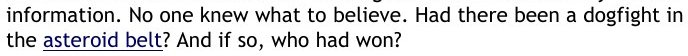
- **No single roster character (rules/setting/general)** — entry/section: Nirama: "they're simply patrolling "their" territory more efficiently than had been done in the past." Source: *01:24:02 - Gang War* (SWRPG d20 Revised Core), scan p.1
  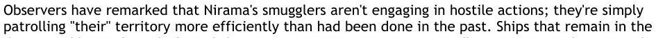
- **No single roster character (rules/setting/general)** — entry/section: Nirama: "No pirate attacks have occurred in the Belt in the last two months -- none at all." Source: *01:24:02 - Gang War* (SWRPG d20 Revised Core), scan p.1
  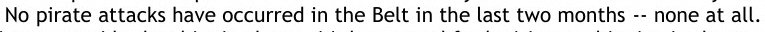
- **No single roster character (rules/setting/general)** — entry/section: Rufus Trammel: "that Trammel may be intending to attempt to wrest control of smuggling in the system from Nirama." Source: *01:24:02 - Gang War* (SWRPG d20 Revised Core), scan p.1
  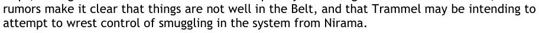
- **No single roster character (rules/setting/general)** — entry/section: CANTINA: "CANTINA, a creatively-named dive on the floating city of Air Avab within Genarius." Source: *01:24:02 - Gang War* (SWRPG d20 Revised Core), scan p.1
  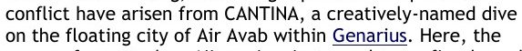

## scan p.2 (scan page 2)

Page contents: Cell; pirates; odds; govt silence; Tramsig statement; Wren halts op (hand-read)

- **No single roster character (rules/setting/general)** — entry/section: Rufus Trammel: "Trammel has made no claims of any ties to the Cell, and rumor has it, he doesn't think much of their failed coup attempt." Source: *01:24:02 - Gang War* (SWRPG d20 Revised Core), scan p.2
  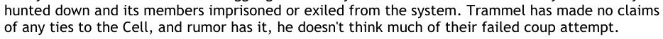
- **No single roster character (rules/setting/general)** — entry/section: Cularin pirates: "Smart money says that all the pirate organizations will sit back, wait, and attack whoever comes out on top while they're still weak from the fight." Source: *01:24:02 - Gang War* (SWRPG d20 Revised Core), scan p.2
  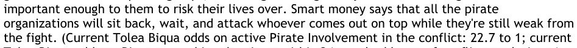
- **No single roster character (rules/setting/general)** — entry/section: Cularin pirates: "current Tolea Biqua odds on Pirates fighting one another prior to resolution of the conflict and weakening themselves to the extent that an attack would be useless: even money.)" Source: *01:24:02 - Gang War* (SWRPG d20 Revised Core), scan p.2
  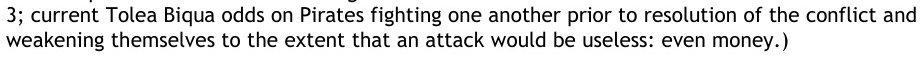
- **No single roster character (rules/setting/general)** — entry/section: Jir Tramsig: ""People of Cularin: In the interest of peace and prosperity, the Thaereian military is willing to sweep the asteroid belt of all the villainous scum that inhabit it. We will search every rock, drop charges into every hole, until we are certain that the law-abiding citizens of Cularin are no longer in danger from this heinous criminal element."" Source: *01:24:02 - Gang War* (SWRPG d20 Revised Core), scan p.2
  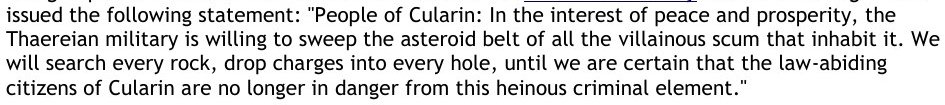
- **No single roster character (rules/setting/general)** — entry/section: Lavina Wren: "The operation was put on hold indefinitely, however, when Senator Lavina Wren learned of Tramsig's plans." Source: *01:24:02 - Gang War* (SWRPG d20 Revised Core), scan p.2
  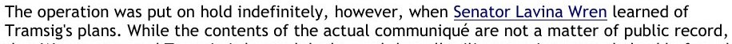
- **No single roster character (rules/setting/general)** — entry/section: Gang War: "It looks very much like a sizable gang war may be brewing..." Source: *01:24:02 - Gang War* (SWRPG d20 Revised Core), scan p.2
  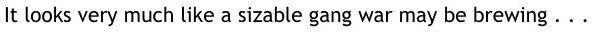
