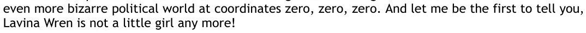
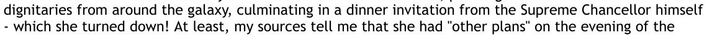
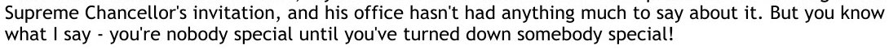
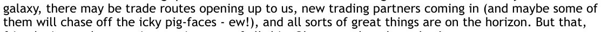
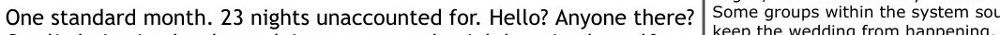
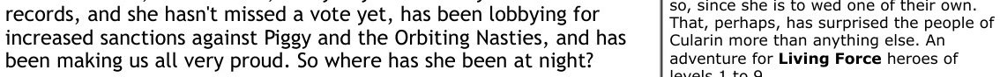
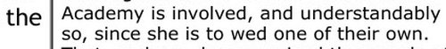
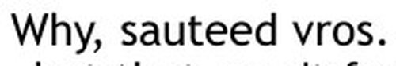
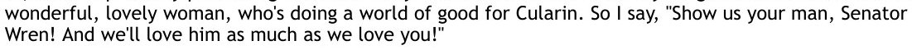

# Owner Material 037 — Star Wars D20 Drive folder (Core, Revised Core and Saga Edition): Living Force Campaign/Articles/Year 2/01:24:02 - Senator Wren's Social Calendar.pdf [Star Wars Roleplaying Game Revised Core (d20, 2002)]

- **Source:** Wizards of the Coast Star Wars Roleplaying Game books, web enhancements, Living Force campaign modules and articles (2000–2010), from the owner's "Star Wars D20" Drive folder (only the three edition subfolders; "General" was not read, as instructed). Secondary source (licensed Legends reference). Scan OCR'd on the box; the scan stays box-only and is **not** published.
- **Method:** every scanned page was OCR'd and machine-screened sentence by sentence for power-relevant statements (fights, kills, defeats, Force feats, rankings, superweapons) that name a character on our roster; each kept sentence is quoted verbatim from the OCR text and has a crop of the printed passage directly under it. Pages with nothing power-relevant are still listed with what is on them.
- **Citation:** "*01:24:02 - Senator Wren's Social Calendar* (SWRPG d20 Revised Core), p.X" by printed page ("scan p.X" where no printed number applies). **Weight:** Licensed RPG material: a secondary source. Narrative text sums up Legends lore; game statistics are rules for players, not canon power levels, and rank lowest.

## scan p.1 (scan page 1)

Page contents: Yara Grugara gossip report; adventure box (hand-read)

- **No single roster character (rules/setting/general)** — entry/section: Yara Grugara: "And let me be the first to tell you, Lavina Wren is not a little girl any more!" Source: *01:24:02 - Senator Wren's Social Calendar* (SWRPG d20 Revised Core), scan p.1
  
- **No single roster character (rules/setting/general)** — entry/section: Lavina Wren: "culminating in a dinner invitation from the Supreme Chancellor himself - which she turned down!" Source: *01:24:02 - Senator Wren's Social Calendar* (SWRPG d20 Revised Core), scan p.1
  
- **No single roster character (rules/setting/general)** — entry/section: Yara Grugara: "But you know what I say - you're nobody special until you've turned down somebody special!" Source: *01:24:02 - Senator Wren's Social Calendar* (SWRPG d20 Revised Core), scan p.1
  
- **No single roster character (rules/setting/general)** — entry/section: Yara Grugara: "(and maybe some of them will chase off the icky pig-faces - ew!)" Source: *01:24:02 - Senator Wren's Social Calendar* (SWRPG d20 Revised Core), scan p.1
  
- **No single roster character (rules/setting/general)** — entry/section: Yara Grugara: "One standard month. 23 nights unaccounted for. Hello? Anyone there?" Source: *01:24:02 - Senator Wren's Social Calendar* (SWRPG d20 Revised Core), scan p.1
  
- **No single roster character (rules/setting/general)** — entry/section: Lavina Wren: "has been lobbying for increased sanctions against Piggy and the Orbiting Nasties, and has been making us all very proud." Source: *01:24:02 - Senator Wren's Social Calendar* (SWRPG d20 Revised Core), scan p.1
  
- **No single roster character (rules/setting/general)** — entry/section: An Official Engagement: "Even the Jedi Academy is involved, and understandably so, since she is to wed one of their own." Source: *01:24:02 - Senator Wren's Social Calendar* (SWRPG d20 Revised Core), scan p.1
  

## scan p.2 (scan page 2)

Page contents: Vros; mystery man; close (hand-read)

- **No single roster character (rules/setting/general)** — entry/section: Lavina Wren: "Why, sauteed vros." Source: *01:24:02 - Senator Wren's Social Calendar* (SWRPG d20 Revised Core), scan p.2
  
- **No single roster character (rules/setting/general)** — entry/section: Yara Grugara: "So I say, "Show us your man, Senator Wren! And we'll love him as much as we love you!"" Source: *01:24:02 - Senator Wren's Social Calendar* (SWRPG d20 Revised Core), scan p.2
  
