# Owner Material 037 — Star Wars D20 Drive folder (Core, Revised Core and Saga Edition): Living Force Campaign/Articles/Year 2/02:07:02 - Discussions With Lanius.pdf [Star Wars Roleplaying Game Revised Core (d20, 2002)]

- **Source:** Wizards of the Coast Star Wars Roleplaying Game books, web enhancements, Living Force campaign modules and articles (2000–2010), from the owner's "Star Wars D20" Drive folder (only the three edition subfolders; "General" was not read, as instructed). Secondary source (licensed Legends reference). Scan OCR'd on the box; the scan stays box-only and is **not** published.
- **Method:** every scanned page was OCR'd and machine-screened sentence by sentence for power-relevant statements (fights, kills, defeats, Force feats, rankings, superweapons) that name a character on our roster; each kept sentence is quoted verbatim from the OCR text and has a crop of the printed passage directly under it. Pages with nothing power-relevant are still listed with what is on them.
- **Citation:** "*02:07:02 - Discussions With Lanius* (SWRPG d20 Revised Core), p.X" by printed page ("scan p.X" where no printed number applies). **Weight:** Licensed RPG material: a secondary source. Narrative text sums up Legends lore; game statistics are rules for players, not canon power levels, and rank lowest.

## scan p.1 (scan page 1)

Page contents: Lanius bio; interview begins (Cartel, Padawan abstention) (hand-read)

- **No single roster character (rules/setting/general)** — entry/section: Lanius Qel-Bertuk: "Master Lanius remembers very little of Master Jonas, aside from a certain kindness and respect for all living beings." Source: *02:07:02 - Discussions With Lanius* (SWRPG d20 Revised Core), scan p.1
  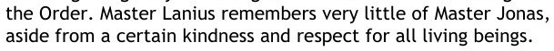
- **No single roster character (rules/setting/general)** — entry/section: Lanius Qel-Bertuk: "a second seat of Jedi training in the galaxy under the command of one of the most competent Jedi in generations not to sit on the Council." Source: *02:07:02 - Discussions With Lanius* (SWRPG d20 Revised Core), scan p.1
  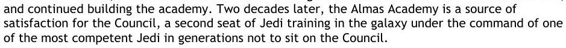
- **No single roster character (rules/setting/general)** — entry/section: Lanius Qel-Bertuk: "At times, his eyes track off into the distance, and you get the feeling that he is momentarily somewhere else and yet he is always there, always in the moment, and we were never able to catch him off-guard." Source: *02:07:02 - Discussions With Lanius* (SWRPG d20 Revised Core), scan p.1
  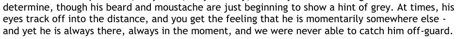
- **No single roster character (rules/setting/general)** — entry/section: Lanius Qel-Bertuk: "[Laughing] Certainly, I would. Would you be interested in clarifying what you would like me to discuss?" Source: *02:07:02 - Discussions With Lanius* (SWRPG d20 Revised Core), scan p.1
  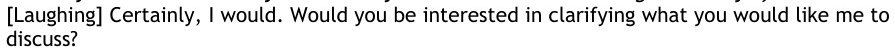
- **No single roster character (rules/setting/general)** — entry/section: Lanius Qel-Bertuk: "The Cartel is a tricky business - in multiple ways. As you know, the Jedi do not involve ourselves in local political situations." Source: *02:07:02 - Discussions With Lanius* (SWRPG d20 Revised Core), scan p.1
  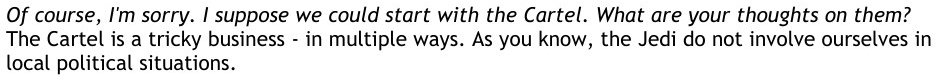
- **No single roster character (rules/setting/general)** — entry/section: Lanius Qel-Bertuk: "We teach the Padawans to follow their consciences. Each must make his or her own decision." Source: *02:07:02 - Discussions With Lanius* (SWRPG d20 Revised Core), scan p.1
  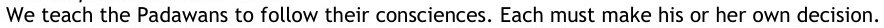

## scan p.2 (scan page 2)

Page contents: Interview: Cartel, underworld, Nirama, Padawans, Trammel (hand-read)

- **No single roster character (rules/setting/general)** — entry/section: Lanius Qel-Bertuk: "You've heard that the future is difficult to foresee? Well, the past that never was is more difficult still." Source: *02:07:02 - Discussions With Lanius* (SWRPG d20 Revised Core), scan p.2
  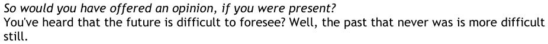
- **No single roster character (rules/setting/general)** — entry/section: Lanius Qel-Bertuk: "It's plenty of answer, actually. Reflect on it at your leisure." Source: *02:07:02 - Discussions With Lanius* (SWRPG d20 Revised Core), scan p.2
  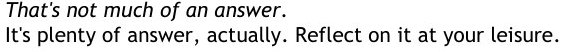
- **No single roster character (rules/setting/general)** — entry/section: Lanius Qel-Bertuk: "The fact that some of their results have been desirable does not excuse the means they have used to obtain them." Source: *02:07:02 - Discussions With Lanius* (SWRPG d20 Revised Core), scan p.2
  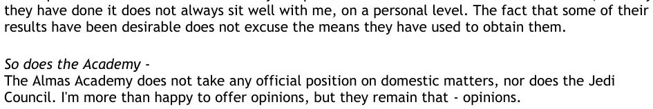
- **No single roster character (rules/setting/general)** — entry/section: Lanius Qel-Bertuk: "There are right and wrong times to fight, and right and wrong things for which to fight." Source: *02:07:02 - Discussions With Lanius* (SWRPG d20 Revised Core), scan p.2
  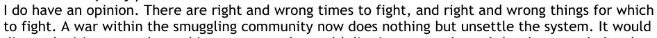
- **No single roster character (rules/setting/general)** — entry/section: Lanius Qel-Bertuk: "Besides, Nirama is a known quantity. He has stabilized and organized the lawlessness that existed under Hutt rule." Source: *02:07:02 - Discussions With Lanius* (SWRPG d20 Revised Core), scan p.2
  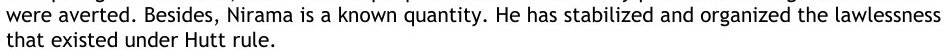
- **No single roster character (rules/setting/general)** — entry/section: Lanius Qel-Bertuk: "No, the head of the Jedi Academy speaks in support of order, rather than chaos, and in favor of peace, rather than war." Source: *02:07:02 - Discussions With Lanius* (SWRPG d20 Revised Core), scan p.2
  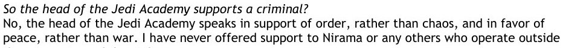
- **No single roster character (rules/setting/general)** — entry/section: Lanius Qel-Bertuk: "They will be fortunate Jedi indeed, if Nirama is the worst they ever have to deal with." Source: *02:07:02 - Discussions With Lanius* (SWRPG d20 Revised Core), scan p.2
  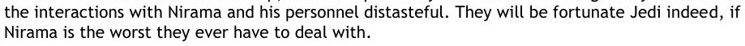
- **No single roster character (rules/setting/general)** — entry/section: Lanius Qel-Bertuk: "If he intends to bring war to the system, then rest assured - the Jedi will not sit idly by." Source: *02:07:02 - Discussions With Lanius* (SWRPG d20 Revised Core), scan p.2
  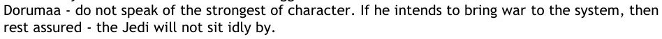

## scan p.3 (scan page 3)

Page contents: Interview: warning, sensing, the Sith fortress (hand-read)

- **No single roster character (rules/setting/general)** — entry/section: Lanius Qel-Bertuk: "If he needs more warning than our presence that overt aggression will not be tolerated, then he may not last long against Nirama." Source: *02:07:02 - Discussions With Lanius* (SWRPG d20 Revised Core), scan p.3
  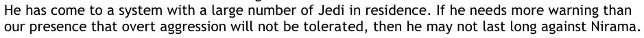
- **No single roster character (rules/setting/general)** — entry/section: Lanius Qel-Bertuk: "It would be an exceedingly bad idea for someone to come to Cularin with the idea of causing trouble, even if the Jedi Academy were not present." Source: *02:07:02 - Discussions With Lanius* (SWRPG d20 Revised Core), scan p.3
  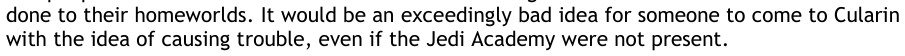
- **No single roster character (rules/setting/general)** — entry/section: Lanius Qel-Bertuk: "I sense a great deal. [He laughs softly.] It is a complicated universe in which we live. There are always dangers." Source: *02:07:02 - Discussions With Lanius* (SWRPG d20 Revised Core), scan p.3
  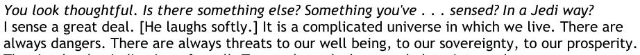
- **No single roster character (rules/setting/general)** — entry/section: Lanius Qel-Bertuk: "That is why the Jedi exist, after all. To watch, and when needed, to intercede." Source: *02:07:02 - Discussions With Lanius* (SWRPG d20 Revised Core), scan p.3
  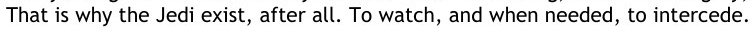
- **No single roster character (rules/setting/general)** — entry/section: Lanius Qel-Bertuk: "All things are connected, in the Force. There is nothing within the dark fortress that has not been there for generations. There are no new threats there." Source: *02:07:02 - Discussions With Lanius* (SWRPG d20 Revised Core), scan p.3
  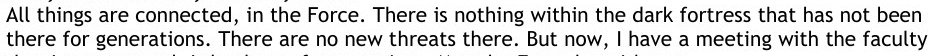
