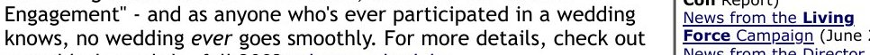

# Owner Material 037 — Star Wars D20 Drive folder (Core, Revised Core and Saga Edition): Living Force Campaign/Articles/Year 2/02:07:02 - Transmissions - February 2002.pdf [Star Wars Roleplaying Game Revised Core (d20, 2002)]

- **Source:** Wizards of the Coast Star Wars Roleplaying Game books, web enhancements, Living Force campaign modules and articles (2000–2010), from the owner's "Star Wars D20" Drive folder (only the three edition subfolders; "General" was not read, as instructed). Secondary source (licensed Legends reference). Scan OCR'd on the box; the scan stays box-only and is **not** published.
- **Method:** every scanned page was OCR'd and machine-screened sentence by sentence for power-relevant statements (fights, kills, defeats, Force feats, rankings, superweapons) that name a character on our roster; each kept sentence is quoted verbatim from the OCR text and has a crop of the printed passage directly under it. Pages with nothing power-relevant are still listed with what is on them.
- **Citation:** "*02:07:02 - Transmissions - February 2002* (SWRPG d20 Revised Core), p.X" by printed page ("scan p.X" where no printed number applies). **Weight:** Licensed RPG material: a secondary source. Narrative text sums up Legends lore; game statistics are rules for players, not canon power levels, and rank lowest.

## scan p.1 (scan page 1)

Page contents: Opening crawl; year one review; metagaming; year two kickoff (hand-read)

- **No single roster character (rules/setting/general)** — entry/section: Living Force: "A long time ago, in special corner of a galaxy far away, a stalwart band of volunteers set out to create a vision, a story of the Star Wars universe to be told by players at gaming tables throughout the world. A story about heroes, and the difference they make..." Source: *02:07:02 - Transmissions - February 2002* (SWRPG d20 Revised Core), scan p.1
  
- **No single roster character (rules/setting/general)** — entry/section: Living Force: "And just about everyone seems to want their own 'droids and ships!" Source: *02:07:02 - Transmissions - February 2002* (SWRPG d20 Revised Core), scan p.1
  
- **No single roster character (rules/setting/general)** — entry/section: Living Force: "Now the real ride begins. The stage is set, and the players are on their marks. All that's needed now are the heroes of Cularin. And that, as they say, is where you come in." Source: *02:07:02 - Transmissions - February 2002* (SWRPG d20 Revised Core), scan p.1
  
- **No single roster character (rules/setting/general)** — entry/section: An Official Engagement: "and as anyone who's ever participated in a wedding knows, no wedding ever goes smoothly." Source: *02:07:02 - Transmissions - February 2002* (SWRPG d20 Revised Core), scan p.1
  

## scan p.2 (scan page 2)

Page contents: Log sheets; staff; shipyard; military metaorg; credits (hand-read)

- **No single roster character (rules/setting/general)** — entry/section: Living Force: "experience, credits, Force points, and dark side points (though heroes shouldn't be getting many of those!)." Source: *02:07:02 - Transmissions - February 2002* (SWRPG d20 Revised Core), scan p.2
  
- **No single roster character (rules/setting/general)** — entry/section: Cularin Shipyard: "We're proud to announce the opening of the Cularin Shipyard at Winter Fantasy (and with ships and payments, can the repo beings be far behind?)." Source: *02:07:02 - Transmissions - February 2002* (SWRPG d20 Revised Core), scan p.2
  
- **No single roster character (rules/setting/general)** — entry/section: Morrie Mullins: "Morrie Mullins, Plot Guy, without whom there would not have been a campaign. Morrie is my good left arm and an evil genius." Source: *02:07:02 - Transmissions - February 2002* (SWRPG d20 Revised Core), scan p.2
  
