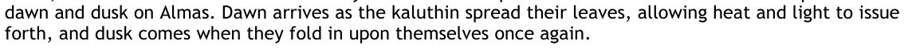
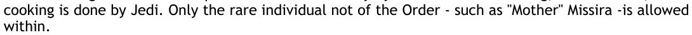
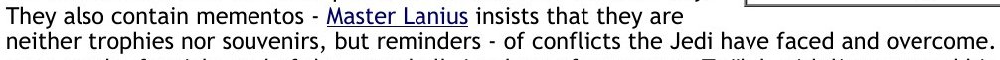
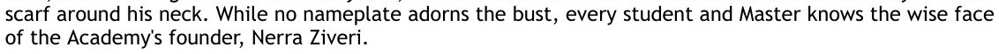
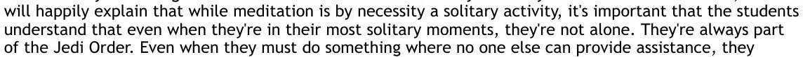
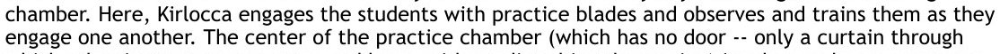
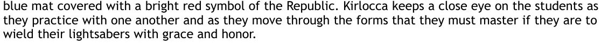
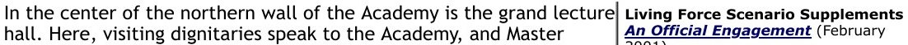

# Owner Material 037 — Star Wars D20 Drive folder (Core, Revised Core and Saga Edition): Living Force Campaign/Articles/Year 2/02:28:02 - Into the Academy.pdf [Star Wars Roleplaying Game Revised Core (d20, 2002)]

- **Source:** Wizards of the Coast Star Wars Roleplaying Game books, web enhancements, Living Force campaign modules and articles (2000–2010), from the owner's "Star Wars D20" Drive folder (only the three edition subfolders; "General" was not read, as instructed). Secondary source (licensed Legends reference). Scan OCR'd on the box; the scan stays box-only and is **not** published.
- **Method:** every scanned page was OCR'd and machine-screened sentence by sentence for power-relevant statements (fights, kills, defeats, Force feats, rankings, superweapons) that name a character on our roster; each kept sentence is quoted verbatim from the OCR text and has a crop of the printed passage directly under it. Pages with nothing power-relevant are still listed with what is on them.
- **Citation:** "*02:28:02 - Into the Academy* (SWRPG d20 Revised Core), p.X" by printed page ("scan p.X" where no printed number applies). **Weight:** Licensed RPG material: a secondary source. Narrative text sums up Legends lore; game statistics are rules for players, not canon power levels, and rank lowest.

## scan p.1 (scan page 1)

Page contents: Intro; doors; access; entry hall; Ziveri bust; adventure box (hand-read)

- **No single roster character (rules/setting/general)** — entry/section: Almas Jedi Academy: "Dawn arrives as the kaluthin spread their leaves, allowing heat and light to issue forth, and dusk comes when they fold in upon themselves once again." Source: *02:28:02 - Into the Academy* (SWRPG d20 Revised Core), scan p.1
  
- **No single roster character (rules/setting/general)** — entry/section: Almas Jedi Academy: "Only the rare individual not of the Order - such as "Mother" Missira -is allowed within." Source: *02:28:02 - Into the Academy* (SWRPG d20 Revised Core), scan p.1
  
- **No single roster character (rules/setting/general)** — entry/section: Lanius Qel-Bertuk: "Master Lanius insists that they are neither trophies nor souvenirs, but reminders - of conflicts the Jedi have faced and overcome." Source: *02:28:02 - Into the Academy* (SWRPG d20 Revised Core), scan p.1
  
- **No single roster character (rules/setting/general)** — entry/section: Nerra Ziveri: "While no nameplate adorns the bust, every student and Master knows the wise face of the Academy's founder, Nerra Ziveri." Source: *02:28:02 - Into the Academy* (SWRPG d20 Revised Core), scan p.1
  

## scan p.2 (scan page 2)

Page contents: Map key; fountain chamber; classrooms; lightsaber room (hand-read)

- **No single roster character (rules/setting/general)** — entry/section: Almas Jedi Academy: "it's important that the students understand that even when they're in their most solitary moments, they're not alone. They're always part of the Jedi Order." Source: *02:28:02 - Into the Academy* (SWRPG d20 Revised Core), scan p.2
  
- **No single roster character (rules/setting/general)** — entry/section: Kirlocca: "Here, Kirlocca engages the students with practice blades and observes and trains them as they engage one another." Source: *02:28:02 - Into the Academy* (SWRPG d20 Revised Core), scan p.2
  
- **No single roster character (rules/setting/general)** — entry/section: Kirlocca: "as they move through the forms that they must master if they are to wield their lightsabers with grace and honor." Source: *02:28:02 - Into the Academy* (SWRPG d20 Revised Core), scan p.2
  

## scan p.3 (scan page 3)

Page contents: Grand lecture hall; close (hand-read)

- **No single roster character (rules/setting/general)** — entry/section: Almas Jedi Academy: "The annual recitation of the story of Kibh Jeen occurs in the grand lecture hall," Source: *02:28:02 - Into the Academy* (SWRPG d20 Revised Core), scan p.3
  
