# Owner Material 037 — Star Wars D20 Drive folder (Core, Revised Core and Saga Edition): Living Force Campaign/Articles/Year 2/03:07:02 - Life in the Shadows.pdf [Star Wars Roleplaying Game Revised Core (d20, 2002)]

- **Source:** Wizards of the Coast Star Wars Roleplaying Game books, web enhancements, Living Force campaign modules and articles (2000–2010), from the owner's "Star Wars D20" Drive folder (only the three edition subfolders; "General" was not read, as instructed). Secondary source (licensed Legends reference). Scan OCR'd on the box; the scan stays box-only and is **not** published.
- **Method:** every scanned page was OCR'd and machine-screened sentence by sentence for power-relevant statements (fights, kills, defeats, Force feats, rankings, superweapons) that name a character on our roster; each kept sentence is quoted verbatim from the OCR text and has a crop of the printed passage directly under it. Pages with nothing power-relevant are still listed with what is on them.
- **Citation:** "*03:07:02 - Life in the Shadows* (SWRPG d20 Revised Core), p.X" by printed page ("scan p.X" where no printed number applies). **Weight:** Licensed RPG material: a secondary source. Narrative text sums up Legends lore; game statistics are rules for players, not canon power levels, and rank lowest.

## scan p.1 (scan page 1)

Page contents: Old Ezil on Cularin, Nirama, Trammel, pirates; caption (hand-read)

- **No single roster character (rules/setting/general)** — entry/section: Old Ezil: "You strike me as the curious type. Well, I've gotta tell ya - curiosity? It can be a bit of a problem around Cularin." Source: *03:07:02 - Life in the Shadows* (SWRPG d20 Revised Core), scan p.1
  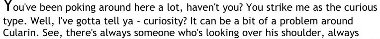
- **No single roster character (rules/setting/general)** — entry/section: Old Ezil: "Moons and mynocks, my daddy remembered when there wasn't even an academy in the system," Source: *03:07:02 - Life in the Shadows* (SWRPG d20 Revised Core), scan p.1
  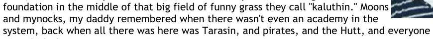
- **No single roster character (rules/setting/general)** — entry/section: Old Ezil: "My daddy liked to say that one in every four people you meet is just gonna hate you." Source: *03:07:02 - Life in the Shadows* (SWRPG d20 Revised Core), scan p.1
  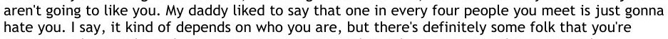
- **No single roster character (rules/setting/general)** — entry/section: Old Ezil: "But when you start poking around in dark corners, looking at folks who don't like being looked at, that's when you start asking for trouble." Source: *03:07:02 - Life in the Shadows* (SWRPG d20 Revised Core), scan p.1
  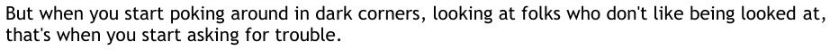
- **No single roster character (rules/setting/general)** — entry/section: Nirama: "I've met Nirama, and I like the - well, whatever he is. I was gonna call him a "man," but I don't know that he'd like that." Source: *03:07:02 - Life in the Shadows* (SWRPG d20 Revised Core), scan p.1
  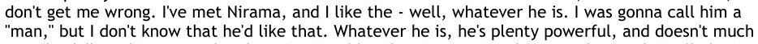
- **No single roster character (rules/setting/general)** — entry/section: Nirama: "He can be polite as a Jedi at a coronation, but you cross him and you've got someone you'd really rather not be picking a fight with," Source: *03:07:02 - Life in the Shadows* (SWRPG d20 Revised Core), scan p.1
  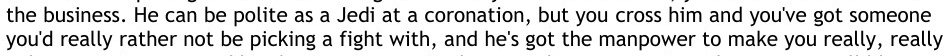
- **No single roster character (rules/setting/general)** — entry/section: Nirama: "They may not all like him, but they respect him, and it's not just fear that does it." Source: *03:07:02 - Life in the Shadows* (SWRPG d20 Revised Core), scan p.1
  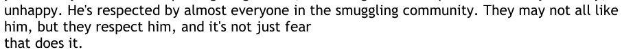
- **No single roster character (rules/setting/general)** — entry/section: Rufus Trammel: "But for all his wind-bagging, for all his stomping and buying and threatening, he hasn't done all that much to really impress me. Strikes me as the kind who's just out to make a name for himself." Source: *03:07:02 - Life in the Shadows* (SWRPG d20 Revised Core), scan p.1
  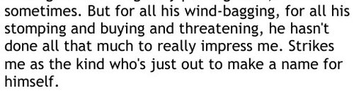

## scan p.2 (scan page 2)

Page contents: Freelancers, Jake, Xav Verivax; Ezil's advice (hand-read)

- **No single roster character (rules/setting/general)** — entry/section: Jake: "Boy always did have a head for business." Source: *03:07:02 - Life in the Shadows* (SWRPG d20 Revised Core), scan p.2
  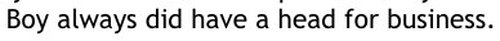
- **No single roster character (rules/setting/general)** — entry/section: Xav Verivax: "Jake's a good guy, although he has this habit of hanging around Xav Verivax, and Xav's trouble on a stick." Source: *03:07:02 - Life in the Shadows* (SWRPG d20 Revised Core), scan p.2
  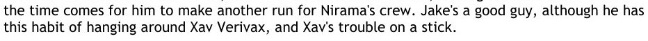
- **No single roster character (rules/setting/general)** — entry/section: Xav Verivax: "But boy, you catch Xav on the wrong day? He'll whip out a knife and have you half-dead before you know what hit you." Source: *03:07:02 - Life in the Shadows* (SWRPG d20 Revised Core), scan p.2
  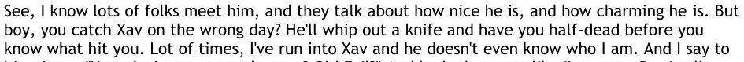
- **No single roster character (rules/setting/general)** — entry/section: Xav Verivax: ""Xav, don't you remember me? Old Ezil?" And he looks at me like I'm crazy. But I tell you, I am not the crazy one in that conversation!" Source: *03:07:02 - Life in the Shadows* (SWRPG d20 Revised Core), scan p.2
  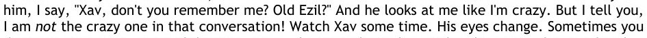
- **No single roster character (rules/setting/general)** — entry/section: Xav Verivax: "His eyes change. Sometimes you don't see it coming - most of the time, even - but you always know when he's not in his own head." Source: *03:07:02 - Life in the Shadows* (SWRPG d20 Revised Core), scan p.2
  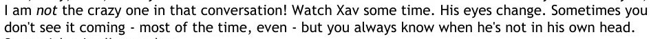
- **No single roster character (rules/setting/general)** — entry/section: Old Ezil: "If you wanna survive, you always, always gotta look out for yourself." Source: *03:07:02 - Life in the Shadows* (SWRPG d20 Revised Core), scan p.2
  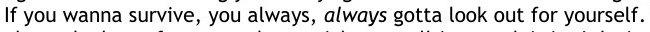
- **No single roster character (rules/setting/general)** — entry/section: Old Ezil: "Listen to Old Ezil. I oughta know, been here all my life. That's just what life is like, out here on the fringes." Source: *03:07:02 - Life in the Shadows* (SWRPG d20 Revised Core), scan p.2
  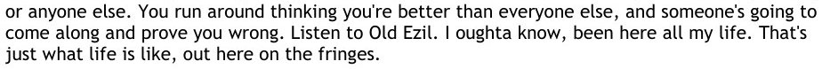
