# Owner Material 037 — Star Wars D20 Drive folder (Core, Revised Core and Saga Edition): Living Force Campaign/Articles/Year 2/03:07:02 - Now I Am the Master.pdf [Star Wars Roleplaying Game Revised Core (d20, 2002)]

- **Source:** Wizards of the Coast Star Wars Roleplaying Game books, web enhancements, Living Force campaign modules and articles (2000–2010), from the owner's "Star Wars D20" Drive folder (only the three edition subfolders; "General" was not read, as instructed). Secondary source (licensed Legends reference). Scan OCR'd on the box; the scan stays box-only and is **not** published.
- **Method:** every scanned page was OCR'd and machine-screened sentence by sentence for power-relevant statements (fights, kills, defeats, Force feats, rankings, superweapons) that name a character on our roster; each kept sentence is quoted verbatim from the OCR text and has a crop of the printed passage directly under it. Pages with nothing power-relevant are still listed with what is on them.
- **Citation:** "*03:07:02 - Now I Am the Master* (SWRPG d20 Revised Core), p.X" by printed page ("scan p.X" where no printed number applies). **Weight:** Licensed RPG material: a secondary source. Narrative text sums up Legends lore; game statistics are rules for players, not canon power levels, and rank lowest.

## scan p.1 (scan page 1)

Page contents: Trials intro; Trial 1; A.J. example; Desert Cries box (hand-read)

- **No single roster character (rules/setting/general)** — entry/section: Almas Jedi Academy: "Just as there is more than one path to learning to wield the Force responsibly, so are there multiple ways to demonstrate readiness to wear the mantle of a Jedi Knight." Source: *03:07:02 - Now I Am the Master* (SWRPG d20 Revised Core), scan p.1
  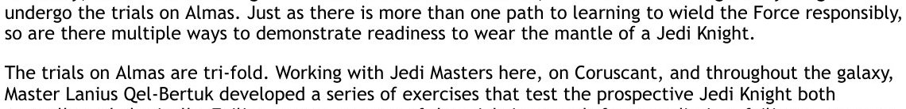
- **No single roster character (rules/setting/general)** — entry/section: Lanius Qel-Bertuk: "Failing to pass any one of the trials is grounds for remediation; failing to pass any two trials in a single attempt to become a Jedi Knight is grounds for dismissal from the Academy." Source: *03:07:02 - Now I Am the Master* (SWRPG d20 Revised Core), scan p.1
  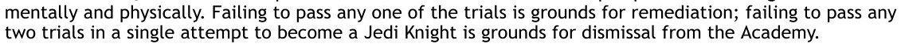
- **No single roster character (rules/setting/general)** — entry/section: Almas Jedi Academy: "The Jedi Knight must embody the philosophy of the Order, must make it a part of who she is, and must understand it as she does herself." Source: *03:07:02 - Now I Am the Master* (SWRPG d20 Revised Core), scan p.1
  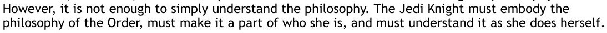

## scan p.2 (scan page 2)

Page contents: A.J. questioning; Trial 2 Jedi Peace; Trial 3 Jedi Promise (hand-read)

- **No single roster character (rules/setting/general)** — entry/section: A.J.: "that she would only resort to the use of more than one lightsaber if the situation grew truly dire." Source: *03:07:02 - Now I Am the Master* (SWRPG d20 Revised Core), scan p.2
  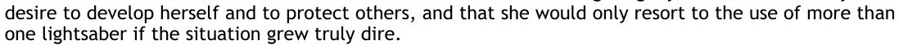
- **No single roster character (rules/setting/general)** — entry/section: Almas Jedi Academy: "What is held in the hands has much less impact on the worthiness of a Jedi than what is held in her heart," Source: *03:07:02 - Now I Am the Master* (SWRPG d20 Revised Core), scan p.2
  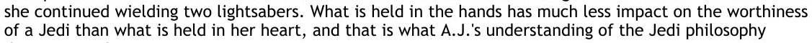
- **No single roster character (rules/setting/general)** — entry/section: Almas Jedi Academy: "there is always the calm of the Jedi, always the inner peace that allows him to hear the will of the Force." Source: *03:07:02 - Now I Am the Master* (SWRPG d20 Revised Core), scan p.2
  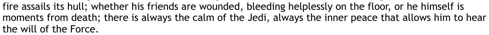
- **No single roster character (rules/setting/general)** — entry/section: Almas Jedi Academy: ""Meditate on why it is you want to be a Jedi Knight. Search your heart for the truth of why you have undertaken this path. Seek to understand the commitment you will make, if you become a Jedi Knight. You will meditate for five days."" Source: *03:07:02 - Now I Am the Master* (SWRPG d20 Revised Core), scan p.2
  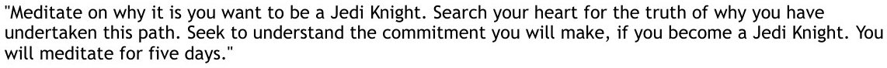
- **No single roster character (rules/setting/general)** — entry/section: Almas Jedi Academy: "He either completes the meditation, or he does not. Such is the nature of success or failure in the second trial." Source: *03:07:02 - Now I Am the Master* (SWRPG d20 Revised Core), scan p.2
  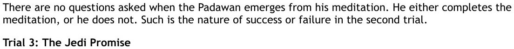
- **No single roster character (rules/setting/general)** — entry/section: Almas Jedi Academy: "All Jedi undertake their training understanding that the dark side is only a breath away." Source: *03:07:02 - Now I Am the Master* (SWRPG d20 Revised Core), scan p.2
  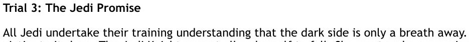
- **No single roster character (rules/setting/general)** — entry/section: Almas Jedi Academy: "The Jedi Promise is made not in words, but in deeds, and is a promise not to give in to fear no matter what the cost." Source: *03:07:02 - Now I Am the Master* (SWRPG d20 Revised Core), scan p.2
  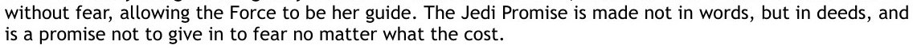

## scan p.3 (scan page 3)

Page contents: Trial 3 desert journey; close (hand-read)

- **No single roster character (rules/setting/general)** — entry/section: Almas Jedi Academy: "Defeating that which has been feared is not necessarily a sign of success, if fear or anger were tools in the Padawan's victory." Source: *03:07:02 - Now I Am the Master* (SWRPG d20 Revised Core), scan p.3
  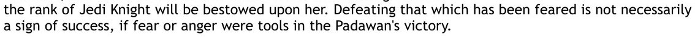
