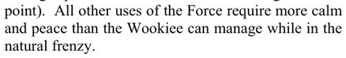
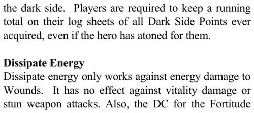
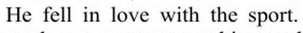
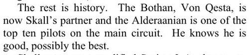
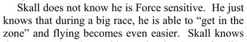
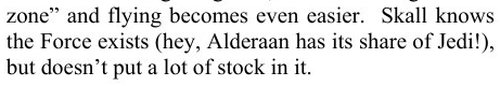

# Owner Material 037 — Star Wars D20 Drive folder (Core, Revised Core and Saga Edition): Living Force Campaign/Articles/Year 2/03:07:02 - Revised Core Rulebook Update.pdf [Star Wars Roleplaying Game Revised Core (d20, 2002)]

- **Source:** Wizards of the Coast Star Wars Roleplaying Game books, web enhancements, Living Force campaign modules and articles (2000–2010), from the owner's "Star Wars D20" Drive folder (only the three edition subfolders; "General" was not read, as instructed). Secondary source (licensed Legends reference). Scan OCR'd on the box; the scan stays box-only and is **not** published.
- **Method:** every scanned page was OCR'd and machine-screened sentence by sentence for power-relevant statements (fights, kills, defeats, Force feats, rankings, superweapons) that name a character on our roster; each kept sentence is quoted verbatim from the OCR text and has a crop of the printed passage directly under it. Pages with nothing power-relevant are still listed with what is on them.
- **Citation:** "*03:07:02 - Revised Core Rulebook Update* (SWRPG d20 Revised Core), p.X" by printed page ("scan p.X" where no printed number applies). **Weight:** Licensed RPG material: a secondary source. Narrative text sums up Legends lore; game statistics are rules for players, not canon power levels, and rank lowest.

## scan p.1 (scan page 1)

Page contents: Earnings; Force/Dark Side Points; Wookiee rage; house rules start (hand-read)

- **No single roster character (rules/setting/general)** — entry/section: Wookiee: "All other uses of the Force require more calm and peace than the Wookiee can manage while in the natural frenzy." Source: *03:07:02 - Revised Core Rulebook Update* (SWRPG d20 Revised Core), scan p.1
  

## scan p.2 (scan page 2)

Page contents: Atonement; Dissipate Energy; Illusion; Stun; dianoga; Skall Delos (hand-read)

- **No single roster character (rules/setting/general)** — entry/section: Living Force: "Players are required to keep a running total on their log sheets of all Dark Side Points ever acquired, even if the hero has atoned for them." Source: *03:07:02 - Revised Core Rulebook Update* (SWRPG d20 Revised Core), scan p.2
  
- **No single roster character (rules/setting/general)** — entry/section: Skall Delos: "He fell in love with the sport." Source: *03:07:02 - Revised Core Rulebook Update* (SWRPG d20 Revised Core), scan p.2
  
- **No single roster character (rules/setting/general)** — entry/section: Skall Delos: "The rest is history. The Bothan, Von Qesta, is now Skall's partner and the Alderaanian is one of the top ten pilots on the main circuit. He knows he is good, possibly the best." Source: *03:07:02 - Revised Core Rulebook Update* (SWRPG d20 Revised Core), scan p.2
  
- **No single roster character (rules/setting/general)** — entry/section: Skall Delos: "He just knows that during a big race, he is able to "get in the zone" and flying becomes even easier." Source: *03:07:02 - Revised Core Rulebook Update* (SWRPG d20 Revised Core), scan p.2
  
- **No single roster character (rules/setting/general)** — entry/section: Skall Delos: "Skall knows the Force exists (hey, Alderaan has its share of Jedi!), but doesn't put a lot of stock in it." Source: *03:07:02 - Revised Core Rulebook Update* (SWRPG d20 Revised Core), scan p.2
  

### Stat block notes (game mechanics, not feats)

- Carnivorous Dianoga: Carnivorous Dianoga: Aquatic Scavenger 4; Init +5; Def 20; Spd 6m/swim 10m; VP/WP 26/17; Atk +5 melee (1d4+4, tentacle), +5 melee (1d8+4, bite); SQ Constrict; SV Fort +7, Ref +2, Will +0; SZ L; Str 17, Dex 13, Con 17, Int 4, Wis 8, Cha 6; CC C (Source: *03:07:02 - Revised Core Rulebook Update* (SWRPG d20 Revised Core), scan p.2)
- Skall Delos: Skall Delos: Male human Soldier 2/Scoundrel 5; Init +4; Def 19; VP/WP 45/13; Atk +6 melee (2d4+1, vibrodagger), +9 ranged (3d6, blaster pistol); SV Fort +5, Ref +8, Will +0; SZ M; FP 3; Rep 5; Str 12, Dex 18, Con 13, Int 14, Wis 8, Cha 10; Pilot +19; Enhance Ability +11; Force Sensitive (Source: *03:07:02 - Revised Core Rulebook Update* (SWRPG d20 Revised Core), scan p.2)

## scan p.3 (scan page 3)

Page contents: Pod racer stats (hand-read)

### Stat block notes (game mechanics, not feats)

- Skall Delos: Skall's Pod racer: Modified Sorin v3 Avalon; Huge (8.7 m); Speed 160m (820 km/h); Def 10; HP 24 (Source: *03:07:02 - Revised Core Rulebook Update* (SWRPG d20 Revised Core), scan p.3)
