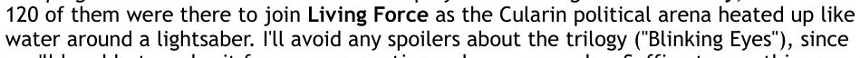
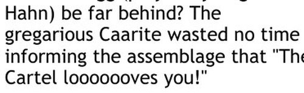
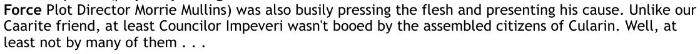
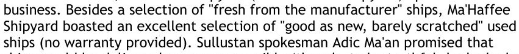

# Owner Material 037 — Star Wars D20 Drive folder (Core, Revised Core and Saga Edition): Living Force Campaign/Articles/Year 2/03:07:02 - Transmissions - March 2002.pdf [Star Wars Roleplaying Game Revised Core (d20, 2002)]

- **Source:** Wizards of the Coast Star Wars Roleplaying Game books, web enhancements, Living Force campaign modules and articles (2000–2010), from the owner's "Star Wars D20" Drive folder (only the three edition subfolders; "General" was not read, as instructed). Secondary source (licensed Legends reference). Scan OCR'd on the box; the scan stays box-only and is **not** published.
- **Method:** every scanned page was OCR'd and machine-screened sentence by sentence for power-relevant statements (fights, kills, defeats, Force feats, rankings, superweapons) that name a character on our roster; each kept sentence is quoted verbatim from the OCR text and has a crop of the printed passage directly under it. Pages with nothing power-relevant are still listed with what is on them.
- **Citation:** "*03:07:02 - Transmissions - March 2002* (SWRPG d20 Revised Core), p.X" by printed page ("scan p.X" where no printed number applies). **Weight:** Licensed RPG material: a secondary source. Narrative text sums up Legends lore; game statistics are rules for players, not canon power levels, and rank lowest.

## scan p.1 (scan page 1)

Page contents: Winter Fantasy 2002; 2,000 players; retirement; Peaces interactive (hand-read)

- **No single roster character (rules/setting/general)** — entry/section: Living Force: "as the Cularin political arena heated up like water around a lightsaber." Source: *03:07:02 - Transmissions - March 2002* (SWRPG d20 Revised Core), scan p.1
  
- **No single roster character (rules/setting/general)** — entry/section: Thurm Loogg: "The gregarious Caarite wasted no time informing the assemblage that "The Cartel looooooves you!"" Source: *03:07:02 - Transmissions - March 2002* (SWRPG d20 Revised Core), scan p.1
  
- **No single roster character (rules/setting/general)** — entry/section: Westa Impeveri: "Unlike our Caarite friend, at least Councilor Impeveri wasn't booed by the assembled citizens of Cularin. Well, at least not by many of them . . ." Source: *03:07:02 - Transmissions - March 2002* (SWRPG d20 Revised Core), scan p.1
  
- **No single roster character (rules/setting/general)** — entry/section: Jaiteh Yasin: "Twi'lek ambassador -- though to or from what, no one is quite certain -- made himself quite popular with ladies of various species" Source: *03:07:02 - Transmissions - March 2002* (SWRPG d20 Revised Core), scan p.1
  

## scan p.2 (scan page 2)

Page contents: Xav; Ma'Haffee Shipyard; ship price list; Celebration II (hand-read)

- **No single roster character (rules/setting/general)** — entry/section: Xav Verivax: "Xav was seen with a variety of lovelies on his arm, and there are reports of more than one broken heart as this charmer moved from conquest to conquest." Source: *03:07:02 - Transmissions - March 2002* (SWRPG d20 Revised Core), scan p.2
  
- **No single roster character (rules/setting/general)** — entry/section: Ma'Haffee Shipyard: "Ma'Haffee Shipyard boasted an excellent selection of "good as new, barely scratched" used ships (no warranty provided)." Source: *03:07:02 - Transmissions - March 2002* (SWRPG d20 Revised Core), scan p.2
  
- **No single roster character (rules/setting/general)** — entry/section: Rowrrhaffee: ""Grrrrwoooouuuurrrr!" which translates roughly to "Leave me alone or I will rip off your arms."" Source: *03:07:02 - Transmissions - March 2002* (SWRPG d20 Revised Core), scan p.2
  

### Stat block notes (game mechanics, not feats)

- Ma'Haffee Shipyard: Ma'Haffee price list (new): Z-95 Headhunter 80,000; Cloakshape Fighter 85,000; Gun Tug 142,000; Phoenix Hawk Light Pinnace 110,000; YT-1300 100,000; Action IV Bulk Freighter 945,000; Barloz Medium Freighter 120,000; Citadel Cruiser 200,000; Firespray-31 120,000; Gallofree Medium Transport 350,000; Royal Starship 1,365,000; Star Shuttle 2,650,000 (Source: *03:07:02 - Transmissions - March 2002* (SWRPG d20 Revised Core), scan p.2)
