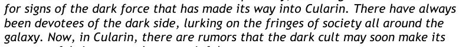
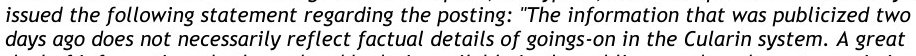
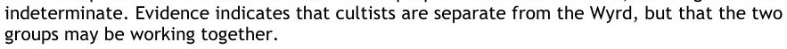
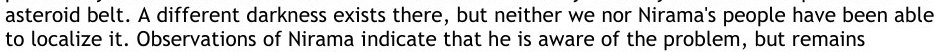
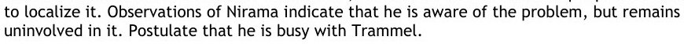
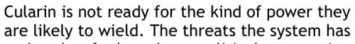
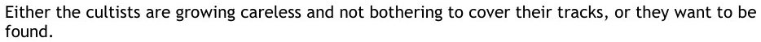
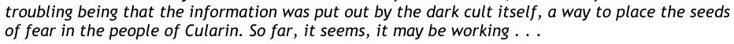

# Owner Material 037 — Star Wars D20 Drive folder (Core, Revised Core and Saga Edition): Living Force Campaign/Articles/Year 2/04:11:02 - A Dark Cult.pdf [Star Wars Roleplaying Game Revised Core (d20, 2002)]

- **Source:** Wizards of the Coast Star Wars Roleplaying Game books, web enhancements, Living Force campaign modules and articles (2000–2010), from the owner's "Star Wars D20" Drive folder (only the three edition subfolders; "General" was not read, as instructed). Secondary source (licensed Legends reference). Scan OCR'd on the box; the scan stays box-only and is **not** published.
- **Method:** every scanned page was OCR'd and machine-screened sentence by sentence for power-relevant statements (fights, kills, defeats, Force feats, rankings, superweapons) that name a character on our roster; each kept sentence is quoted verbatim from the OCR text and has a crop of the printed passage directly under it. Pages with nothing power-relevant are still listed with what is on them.
- **Citation:** "*04:11:02 - A Dark Cult* (SWRPG d20 Revised Core), p.X" by printed page ("scan p.X" where no printed number applies). **Weight:** Licensed RPG material: a secondary source. Narrative text sums up Legends lore; game statistics are rules for players, not canon power levels, and rank lowest.

## scan p.1 (scan page 1)

Page contents: Intro; Academy statement; intercepted transmission (hand-read)

- **No single roster character (rules/setting/general)** — entry/section: Dark cult: "There have always been devotees of the dark side, lurking on the fringes of society all around the galaxy." Source: *04:11:02 - A Dark Cult* (SWRPG d20 Revised Core), scan p.1
  
- **No single roster character (rules/setting/general)** — entry/section: Almas Jedi Academy: ""The information that was publicized two days ago does not necessarily reflect factual details of goings-on in the Cularin system." Source: *04:11:02 - A Dark Cult* (SWRPG d20 Revised Core), scan p.1
  
- **No single roster character (rules/setting/general)** — entry/section: Dark cult: "Evidence indicates that cultists are separate from the Wyrd, but that the two groups may be working together." Source: *04:11:02 - A Dark Cult* (SWRPG d20 Revised Core), scan p.1
  
- **No single roster character (rules/setting/general)** — entry/section: Dark cult: "A different darkness exists there, but neither we nor Nirama's people have been able to localize it." Source: *04:11:02 - A Dark Cult* (SWRPG d20 Revised Core), scan p.1
  
- **No single roster character (rules/setting/general)** — entry/section: Nirama: "Observations of Nirama indicate that he is aware of the problem, but remains uninvolved in it. Postulate that he is busy with Trammel." Source: *04:11:02 - A Dark Cult* (SWRPG d20 Revised Core), scan p.1
  
- **No single roster character (rules/setting/general)** — entry/section: Dark cult: "Cularin is not ready for the kind of power they are likely to wield." Source: *04:11:02 - A Dark Cult* (SWRPG d20 Revised Core), scan p.1
  

## scan p.2 (scan page 2)

Page contents: Transmission close; speculation (hand-read)

- **No single roster character (rules/setting/general)** — entry/section: Dark cult: "before then, we were chasing fog." Source: *04:11:02 - A Dark Cult* (SWRPG d20 Revised Core), scan p.2
  
- **No single roster character (rules/setting/general)** — entry/section: Dark cult: "Either the cultists are growing careless and not bothering to cover their tracks, or they want to be found." Source: *04:11:02 - A Dark Cult* (SWRPG d20 Revised Core), scan p.2
  
- **No single roster character (rules/setting/general)** — entry/section: Dark cult: "Neither offers comfort." Source: *04:11:02 - A Dark Cult* (SWRPG d20 Revised Core), scan p.2
  
- **No single roster character (rules/setting/general)** — entry/section: Dark cult: "a way to place the seeds of fear in the people of Cularin. So far, it seems, it may be working..." Source: *04:11:02 - A Dark Cult* (SWRPG d20 Revised Core), scan p.2
  
