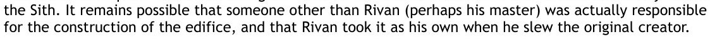
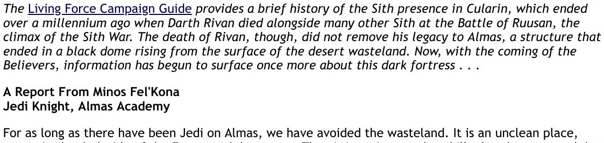
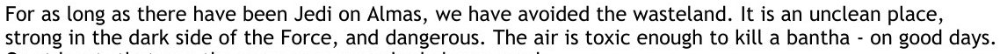
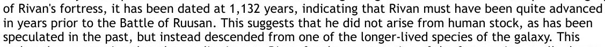
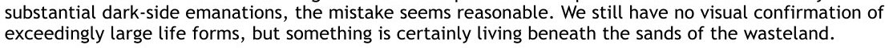
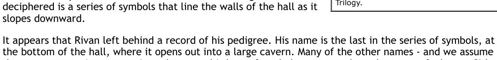
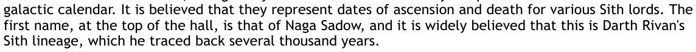
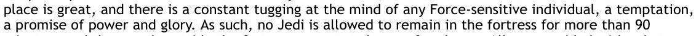
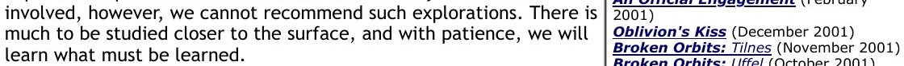

# Owner Material 037 — Star Wars D20 Drive folder (Core, Revised Core and Saga Edition): Living Force Campaign/Articles/Year 2/04:25:02 - The Sith Fortress.pdf [Star Wars Roleplaying Game Revised Core (d20, 2002)]

- **Source:** Wizards of the Coast Star Wars Roleplaying Game books, web enhancements, Living Force campaign modules and articles (2000–2010), from the owner's "Star Wars D20" Drive folder (only the three edition subfolders; "General" was not read, as instructed). Secondary source (licensed Legends reference). Scan OCR'd on the box; the scan stays box-only and is **not** published.
- **Method:** every scanned page was OCR'd and machine-screened sentence by sentence for power-relevant statements (fights, kills, defeats, Force feats, rankings, superweapons) that name a character on our roster; each kept sentence is quoted verbatim from the OCR text and has a crop of the printed passage directly under it. Pages with nothing power-relevant are still listed with what is on them.
- **Citation:** "*04:25:02 - The Sith Fortress* (SWRPG d20 Revised Core), p.X" by printed page ("scan p.X" where no printed number applies). **Weight:** Licensed RPG material: a secondary source. Narrative text sums up Legends lore; game statistics are rules for players, not canon power levels, and rank lowest.

## scan p.1 (scan page 1)

Page contents: Intro; Fel'Kona report: wasteland, dome dating, life forms, breach; box (hand-read)

- **Darth Rivan** — entry/section: 04:25:02 - The Sith Fortress: "It remains possible that someone other than Rivan (perhaps his master) was actually responsible for the construction of the edifice, and that Rivan took it as his own when he slew the original creator." Source: *04:25:02 - The Sith Fortress* (SWRPG d20 Revised Core), scan p.1
  
- **Darth Rivan** — entry/section: Darth Rivan: "which ended over a millennium ago when Darth Rivan died alongside many other Sith at the Battle of Ruusan, the climax of the Sith War. The death of Rivan, though, did not remove his legacy to Almas, a structure that ended in a black dome rising from the surface of the desert wasteland." Source: *04:25:02 - The Sith Fortress* (SWRPG d20 Revised Core), scan p.1
  
- **No single roster character (rules/setting/general)** — entry/section: Minos Fel'Kona: "For as long as there have been Jedi on Almas, we have avoided the wasteland. It is an unclean place, strong in the dark side of the Force, and dangerous. The air is toxic enough to kill a bantha - on good days." Source: *04:25:02 - The Sith Fortress* (SWRPG d20 Revised Core), scan p.1
  
- **Darth Rivan** — entry/section: Darth Rivan: "it has been dated at 1,132 years, indicating that Rivan must have been quite advanced in years prior to the Battle of Ruusan. This suggests that he did not arise from human stock, as has been speculated in the past, but instead descended from one of the longer-lived species of the galaxy." Source: *04:25:02 - The Sith Fortress* (SWRPG d20 Revised Core), scan p.1
  
- **No single roster character (rules/setting/general)** — entry/section: Almas: "We still have no visual confirmation of exceedingly large life forms, but something is certainly living beneath the sands of the wasteland." Source: *04:25:02 - The Sith Fortress* (SWRPG d20 Revised Core), scan p.1
  

## scan p.2 (scan page 2)

Page contents: Entry hall; Sith pedigree; limits; artifacts (hand-read)

- **Darth Rivan** — entry/section: Darth Rivan: "It appears that Rivan left behind a record of his pedigree. His name is the last in the series of symbols, at the bottom of the hall, where it opens out into a large cavern." Source: *04:25:02 - The Sith Fortress* (SWRPG d20 Revised Core), scan p.2
  
- **Darth Rivan** — entry/section: Darth Rivan: "The first name, at the top of the hall, is that of Naga Sadow, and it is widely believed that this is Darth Rivan's Sith lineage, which he traced back several thousand years." Source: *04:25:02 - The Sith Fortress* (SWRPG d20 Revised Core), scan p.2
  
- **No single roster character (rules/setting/general)** — entry/section: Sith Fortress: "there is a constant tugging at the mind of any Force-sensitive individual, a temptation, a promise of power and glory." Source: *04:25:02 - The Sith Fortress* (SWRPG d20 Revised Core), scan p.2
  
- **No single roster character (rules/setting/general)** — entry/section: Minos Fel'Kona: "There is much to be studied closer to the surface, and with patience, we will learn what must be learned." Source: *04:25:02 - The Sith Fortress* (SWRPG d20 Revised Core), scan p.2
  
