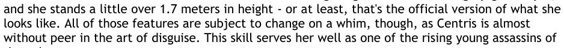
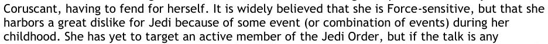
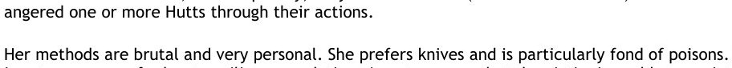
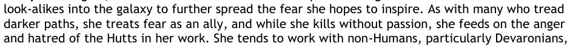
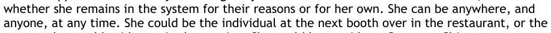
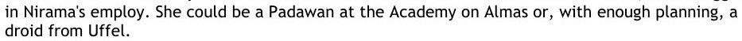

# Owner Material 037 — Star Wars D20 Drive folder (Core, Revised Core and Saga Edition): Living Force Campaign/Articles/Year 2/05:16:02 - Profile of an Assassin.pdf [Star Wars Roleplaying Game Revised Core (d20, 2002)]

- **Source:** Wizards of the Coast Star Wars Roleplaying Game books, web enhancements, Living Force campaign modules and articles (2000–2010), from the owner's "Star Wars D20" Drive folder (only the three edition subfolders; "General" was not read, as instructed). Secondary source (licensed Legends reference). Scan OCR'd on the box; the scan stays box-only and is **not** published.
- **Method:** every scanned page was OCR'd and machine-screened sentence by sentence for power-relevant statements (fights, kills, defeats, Force feats, rankings, superweapons) that name a character on our roster; each kept sentence is quoted verbatim from the OCR text and has a crop of the printed passage directly under it. Pages with nothing power-relevant are still listed with what is on them.
- **Citation:** "*05:16:02 - Profile of an Assassin* (SWRPG d20 Revised Core), p.X" by printed page ("scan p.X" where no printed number applies). **Weight:** Licensed RPG material: a secondary source. Narrative text sums up Legends lore; game statistics are rules for players, not canon power levels, and rank lowest.

## scan p.1 (scan page 1)

Page contents: Centris profile (hand-read)

- **No single roster character (rules/setting/general)** — entry/section: Melo Centris: "All of those features are subject to change on a whim, though, as Centris is almost without peer in the art of disguise." Source: *05:16:02 - Profile of an Assassin* (SWRPG d20 Revised Core), scan p.1
  
- **No single roster character (rules/setting/general)** — entry/section: Melo Centris: "It is widely believed that she is Force-sensitive, but that she harbors a great dislike for Jedi because of some event (or combination of events) during her childhood." Source: *05:16:02 - Profile of an Assassin* (SWRPG d20 Revised Core), scan p.1
  
- **No single roster character (rules/setting/general)** — entry/section: Melo Centris: "Her methods are brutal and very personal. She prefers knives and is particularly fond of poisons." Source: *05:16:02 - Profile of an Assassin* (SWRPG d20 Revised Core), scan p.1
  
- **No single roster character (rules/setting/general)** — entry/section: Melo Centris: "it would be naive to believe that she has never accidentally poisoned herself - and yet, she lives." Source: *05:16:02 - Profile of an Assassin* (SWRPG d20 Revised Core), scan p.1
  
- **No single roster character (rules/setting/general)** — entry/section: Melo Centris: "As with many who tread darker paths, she treats fear as an ally, and while she kills without passion, she feeds on the anger and hatred of the Hutts in her work." Source: *05:16:02 - Profile of an Assassin* (SWRPG d20 Revised Core), scan p.1
  

## scan p.2 (scan page 2)

Page contents: Threat; stat block; poison (hand-read)

- **No single roster character (rules/setting/general)** — entry/section: Melo Centris: "She can be anywhere, and anyone, at any time." Source: *05:16:02 - Profile of an Assassin* (SWRPG d20 Revised Core), scan p.2
  
- **No single roster character (rules/setting/general)** — entry/section: Melo Centris: "She could be a Padawan at the Academy on Almas or, with enough planning, a droid from Uffel." Source: *05:16:02 - Profile of an Assassin* (SWRPG d20 Revised Core), scan p.2
  
- **No single roster character (rules/setting/general)** — entry/section: Melo Centris: "She is a dangerous, angry individual. Her ultimate agenda remains unclear. But it can't be good." Source: *05:16:02 - Profile of an Assassin* (SWRPG d20 Revised Core), scan p.2
  

### Stat block notes (game mechanics, not feats)

- Melo Centris: Melo Centris: Tainted Human Female Force Adept 4/Scoundrel 5/Dark Side Devotee 1; Init +4; Def 22; VP/WP 52/10; Atk +10/+5 melee (1d4-1 + poison, knife), +10/+5 ranged; SQ Poison Use, Poison Immunity; DR 4; SV Fort +4, Ref +11, Will +8; FP 2; DSP 6; Rep 1; Str 8, Dex 18, Con 10, Int 14, Wis 12, Cha 14; Disguise +21, Hide +21, Fear +15, Force Grip +10, Force Stealth +11; poison DC 17 Fort (1d6 Dex, then paralysis 1d3 hours) (Source: *05:16:02 - Profile of an Assassin* (SWRPG d20 Revised Core), scan p.2)
