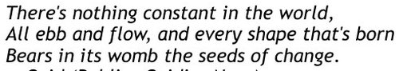
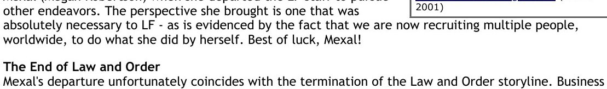
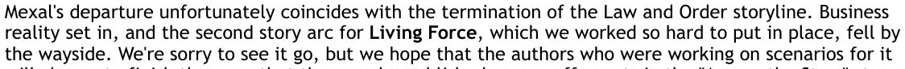

# Owner Material 037 — Star Wars D20 Drive folder (Core, Revised Core and Saga Edition): Living Force Campaign/Articles/Year 2/05:16:02 - Transmissions - May 2002.pdf [Star Wars Roleplaying Game Revised Core (d20, 2002)]

- **Source:** Wizards of the Coast Star Wars Roleplaying Game books, web enhancements, Living Force campaign modules and articles (2000–2010), from the owner's "Star Wars D20" Drive folder (only the three edition subfolders; "General" was not read, as instructed). Secondary source (licensed Legends reference). Scan OCR'd on the box; the scan stays box-only and is **not** published.
- **Method:** every scanned page was OCR'd and machine-screened sentence by sentence for power-relevant statements (fights, kills, defeats, Force feats, rankings, superweapons) that name a character on our roster; each kept sentence is quoted verbatim from the OCR text and has a crop of the printed passage directly under it. Pages with nothing power-relevant are still listed with what is on them.
- **Citation:** "*05:16:02 - Transmissions - May 2002* (SWRPG d20 Revised Core), p.X" by printed page ("scan p.X" where no printed number applies). **Weight:** Licensed RPG material: a secondary source. Narrative text sums up Legends lore; game statistics are rules for players, not canon power levels, and rank lowest.

## scan p.1 (scan page 1)

Page contents: Epigraph; new faces; Mexal departs; end of Law and Order (hand-read)

- **No single roster character (rules/setting/general)** — entry/section: Living Force: "There's nothing constant in the world, All ebb and flow, and every shape that's born Bears in its womb the seeds of change." Source: *05:16:02 - Transmissions - May 2002* (SWRPG d20 Revised Core), scan p.1
  
- **No single roster character (rules/setting/general)** — entry/section: Mexal: "The perspective she brought is one that was absolutely necessary to LF - as is evidenced by the fact that we are now recruiting multiple people, worldwide, to do what she did by herself. Best of luck, Mexal!" Source: *05:16:02 - Transmissions - May 2002* (SWRPG d20 Revised Core), scan p.1
  
- **No single roster character (rules/setting/general)** — entry/section: Law and Order: "Business reality set in, and the second story arc for Living Force, which we worked so hard to put in place, fell by the wayside." Source: *05:16:02 - Transmissions - May 2002* (SWRPG d20 Revised Core), scan p.1
  

## scan p.2 (scan page 2)

Page contents: L&O characters; Revised Rulebook conversion plan (hand-read)

- **No single roster character (rules/setting/general)** — entry/section: Law and Order: "so you can make your own decisions as to whether the character sticks around or rides off into a glorious dual sunset." Source: *05:16:02 - Transmissions - May 2002* (SWRPG d20 Revised Core), scan p.2
  
- **No single roster character (rules/setting/general)** — entry/section: Living Force: "Living Force is about character and story, and we want you to be able to play your hero as you envision her or him." Source: *05:16:02 - Transmissions - May 2002* (SWRPG d20 Revised Core), scan p.2
  
- **No single roster character (rules/setting/general)** — entry/section: Living Force: "and we can't reveal anything about the new rules without getting ourselves canned." Source: *05:16:02 - Transmissions - May 2002* (SWRPG d20 Revised Core), scan p.2
  
