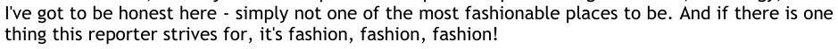
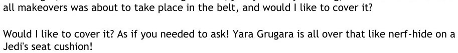
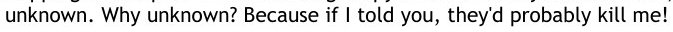
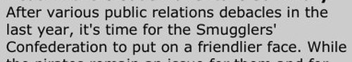
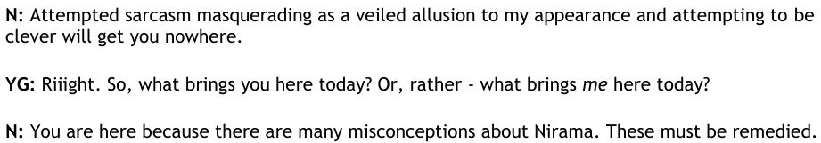
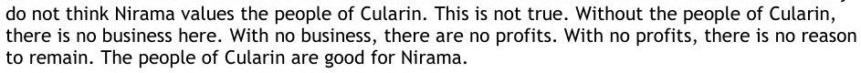
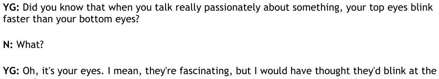
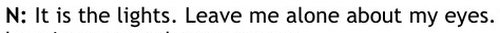
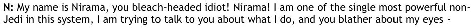
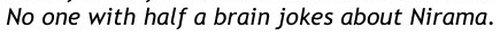

# Owner Material 037 — Star Wars D20 Drive folder (Core, Revised Core and Saga Edition): Living Force Campaign/Articles/Year 2/05:30:02 - A Friendly Face.pdf [Star Wars Roleplaying Game Revised Core (d20, 2002)]

- **Source:** Wizards of the Coast Star Wars Roleplaying Game books, web enhancements, Living Force campaign modules and articles (2000–2010), from the owner's "Star Wars D20" Drive folder (only the three edition subfolders; "General" was not read, as instructed). Secondary source (licensed Legends reference). Scan OCR'd on the box; the scan stays box-only and is **not** published.
- **Method:** every scanned page was OCR'd and machine-screened sentence by sentence for power-relevant statements (fights, kills, defeats, Force feats, rankings, superweapons) that name a character on our roster; each kept sentence is quoted verbatim from the OCR text and has a crop of the printed passage directly under it. Pages with nothing power-relevant are still listed with what is on them.
- **Citation:** "*05:30:02 - A Friendly Face* (SWRPG d20 Revised Core), p.X" by printed page ("scan p.X" where no printed number applies). **Weight:** Licensed RPG material: a secondary source. Narrative text sums up Legends lore; game statistics are rules for players, not canon power levels, and rank lowest.

## scan p.1 (scan page 1)

Page contents: Yara intro; makeover; box start (hand-read)

- **No single roster character (rules/setting/general)** — entry/section: Yara Grugara: "And if there is one thing this reporter strives for, it's fashion, fashion, fashion!" Source: *05:30:02 - A Friendly Face* (SWRPG d20 Revised Core), scan p.1
  
- **No single roster character (rules/setting/general)** — entry/section: Yara Grugara: "Would I like to cover it? As if you needed to ask! Yara Grugara is all over that like nerf-hide on a Jedi's seat cushion!" Source: *05:30:02 - A Friendly Face* (SWRPG d20 Revised Core), scan p.1
  
- **No single roster character (rules/setting/general)** — entry/section: Yara Grugara: "Why unknown? Because if I told you, they'd probably kill me!" Source: *05:30:02 - A Friendly Face* (SWRPG d20 Revised Core), scan p.1
  
- **No single roster character (rules/setting/general)** — entry/section: Philanthropy: "After various public relations debacles in the last year, it's time for the Smugglers' Confederation to put on a friendlier face." Source: *05:30:02 - A Friendly Face* (SWRPG d20 Revised Core), scan p.1
  

## scan p.2 (scan page 2)

Page contents: Nirama description; interview begins (hand-read)

- **No single roster character (rules/setting/general)** — entry/section: Nirama: "N: Attempted sarcasm masquerading as a veiled allusion to my appearance and attempting to be clever will get you nowhere." Source: *05:30:02 - A Friendly Face* (SWRPG d20 Revised Core), scan p.2
  
- **No single roster character (rules/setting/general)** — entry/section: Nirama: "N: You are here because there are many misconceptions about Nirama. These must be remedied." Source: *05:30:02 - A Friendly Face* (SWRPG d20 Revised Core), scan p.2
  
- **No single roster character (rules/setting/general)** — entry/section: Nirama: "N: You are the queen of makeovers, are you not?" Source: *05:30:02 - A Friendly Face* (SWRPG d20 Revised Core), scan p.2
  
- **No single roster character (rules/setting/general)** — entry/section: Nirama: "N: Nirama. Please." Source: *05:30:02 - A Friendly Face* (SWRPG d20 Revised Core), scan p.2
  
- **No single roster character (rules/setting/general)** — entry/section: Nirama: "Without the people of Cularin, there is no business here. With no business, there are no profits. With no profits, there is no reason to remain. The people of Cularin are good for Nirama." Source: *05:30:02 - A Friendly Face* (SWRPG d20 Revised Core), scan p.2
  
- **No single roster character (rules/setting/general)** — entry/section: Yara Grugara: "YG: Did you know that when you talk really passionately about something, your top eyes blink faster than your bottom eyes?" Source: *05:30:02 - A Friendly Face* (SWRPG d20 Revised Core), scan p.2
  

## scan p.3 (scan page 3)

Page contents: Interview escalation; aftermath (hand-read)

- **No single roster character (rules/setting/general)** — entry/section: Nirama: "N: It is the lights. Leave me alone about my eyes." Source: *05:30:02 - A Friendly Face* (SWRPG d20 Revised Core), scan p.3
  
- **No single roster character (rules/setting/general)** — entry/section: Yara Grugara: "YG: Riiight . . . and that whole Trade Federation thing on Naboo was really the doings of some Sith Lord, and not just those dumb Neimoidians being greedy." Source: *05:30:02 - A Friendly Face* (SWRPG d20 Revised Core), scan p.3
  
- **No single roster character (rules/setting/general)** — entry/section: Nirama: "N: What are you talking about -- Naboo? Sith? We are talking about Cularin!" Source: *05:30:02 - A Friendly Face* (SWRPG d20 Revised Core), scan p.3
  
- **No single roster character (rules/setting/general)** — entry/section: Nirama: "N: My name is Nirama, you bleach-headed idiot! Nirama! I am one of the single most powerful non- Jedi in this system," Source: *05:30:02 - A Friendly Face* (SWRPG d20 Revised Core), scan p.3
  
- **No single roster character (rules/setting/general)** — entry/section: Nirama: "N: Gaah! You are no journalist! You are a vapid, inane, womprat-breeding joke!" Source: *05:30:02 - A Friendly Face* (SWRPG d20 Revised Core), scan p.3
  
- **No single roster character (rules/setting/general)** — entry/section: Yara Grugara: "YG: What does "vapid" mean?" Source: *05:30:02 - A Friendly Face* (SWRPG d20 Revised Core), scan p.3
  
- **No single roster character (rules/setting/general)** — entry/section: Nirama: "N: This interview is over." Source: *05:30:02 - A Friendly Face* (SWRPG d20 Revised Core), scan p.3
  
- **No single roster character (rules/setting/general)** — entry/section: Nirama: "No one with half a brain jokes about Nirama." Source: *05:30:02 - A Friendly Face* (SWRPG d20 Revised Core), scan p.3
  
