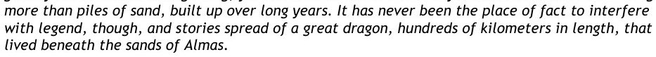
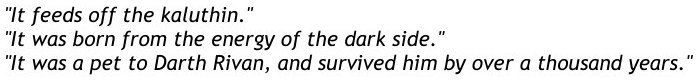
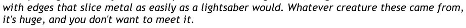
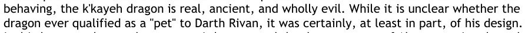
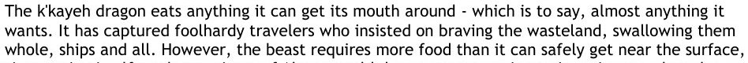
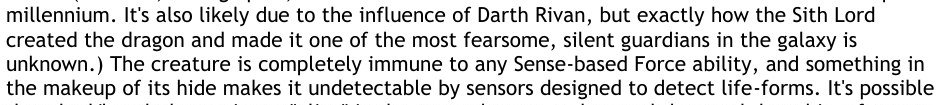
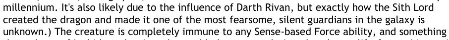
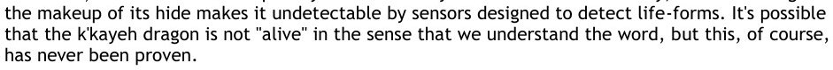
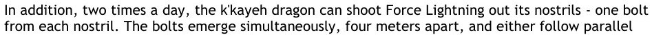
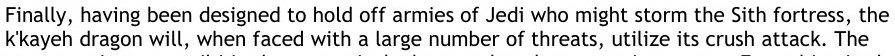

# Owner Material 037 — Star Wars D20 Drive folder (Core, Revised Core and Saga Edition): Living Force Campaign/Articles/Year 2/07:08:02 - Dragon of the Desert.pdf [Star Wars Roleplaying Game Revised Core (d20, 2002)]

- **Source:** Wizards of the Coast Star Wars Roleplaying Game books, web enhancements, Living Force campaign modules and articles (2000–2010), from the owner's "Star Wars D20" Drive folder (only the three edition subfolders; "General" was not read, as instructed). Secondary source (licensed Legends reference). Scan OCR'd on the box; the scan stays box-only and is **not** published.
- **Method:** every scanned page was OCR'd and machine-screened sentence by sentence for power-relevant statements (fights, kills, defeats, Force feats, rankings, superweapons) that name a character on our roster; each kept sentence is quoted verbatim from the OCR text and has a crop of the printed passage directly under it. Pages with nothing power-relevant are still listed with what is on them.
- **Citation:** "*07:08:02 - Dragon of the Desert* (SWRPG d20 Revised Core), p.X" by printed page ("scan p.X" where no printed number applies). **Weight:** Licensed RPG material: a secondary source. Narrative text sums up Legends lore; game statistics are rules for players, not canon power levels, and rank lowest.

## scan p.1 (scan page 1)

Page contents: Approach over desert; legend; teeth; dragon description; diet (hand-read)

- **No single roster character (rules/setting/general)** — entry/section: K'kayeh Dragon: "It has never been the place of fact to interfere with legend, though, and stories spread of a great dragon, hundreds of kilometers in length, that lived beneath the sands of Almas." Source: *07:08:02 - Dragon of the Desert* (SWRPG d20 Revised Core), scan p.1
  
- **Darth Rivan** — entry/section: K'kayeh Dragon: ""It feeds off the kaluthin." "It was born from the energy of the dark side." "It was a pet to Darth Rivan, and survived him by over a thousand years."" Source: *07:08:02 - Dragon of the Desert* (SWRPG d20 Revised Core), scan p.1
  
- **No single roster character (rules/setting/general)** — entry/section: K'kayeh Dragon: "Whatever creature these came from, it's huge, and you don't want to meet it." Source: *07:08:02 - Dragon of the Desert* (SWRPG d20 Revised Core), scan p.1
  
- **Darth Rivan** — entry/section: K'kayeh Dragon: "the k'kayeh dragon is real, ancient, and wholly evil. While it is unclear whether the dragon ever qualified as a "pet" to Darth Rivan, it was certainly, at least in part, of his design." Source: *07:08:02 - Dragon of the Desert* (SWRPG d20 Revised Core), scan p.1
  
- **No single roster character (rules/setting/general)** — entry/section: K'kayeh Dragon: "It has captured foolhardy travelers who insisted on braving the wasteland, swallowing them whole, ships and all." Source: *07:08:02 - Dragon of the Desert* (SWRPG d20 Revised Core), scan p.1
  

## scan p.2 (scan page 2)

Page contents: Force sensitivity; stat block; combat; lightning; crush (hand-read)

- **Darth Rivan** — entry/section: 07:08:02 - Dragon of the Desert: "It's also likely due to the influence of Darth Rivan, but exactly how the Sith Lord created the dragon and made it one of the most fearsome, silent guardians in the galaxy is unknown.) The creature is completely immune to any Sense-based Force ability, and something in the makeup of its hide makes it undetectable by sensors designed to detect life-forms." Source: *07:08:02 - Dragon of the Desert* (SWRPG d20 Revised Core), scan p.2
  
- **Darth Rivan** — entry/section: K'kayeh Dragon: "It's also likely due to the influence of Darth Rivan, but exactly how the Sith Lord created the dragon and made it one of the most fearsome, silent guardians in the galaxy is unknown." Source: *07:08:02 - Dragon of the Desert* (SWRPG d20 Revised Core), scan p.2
  
- **No single roster character (rules/setting/general)** — entry/section: K'kayeh Dragon: "It's possible that the k'kayeh dragon is not "alive" in the sense that we understand the word, but this, of course, has never been proven." Source: *07:08:02 - Dragon of the Desert* (SWRPG d20 Revised Core), scan p.2
  
- **No single roster character (rules/setting/general)** — entry/section: K'kayeh Dragon: "In addition, two times a day, the k'kayeh dragon can shoot Force Lightning out its nostrils - one bolt from each nostril." Source: *07:08:02 - Dragon of the Desert* (SWRPG d20 Revised Core), scan p.2
  
- **No single roster character (rules/setting/general)** — entry/section: K'kayeh Dragon: "Finally, having been designed to hold off armies of Jedi who might storm the Sith fortress, the k'kayeh dragon will, when faced with a large number of threats, utilize its crush attack." Source: *07:08:02 - Dragon of the Desert* (SWRPG d20 Revised Core), scan p.2
  

### Stat block notes (game mechanics, not feats)

- K'kayeh Dragon: K'kayeh Dragon: Force-Using Armored Subterranean Predator 20; Init -2; Def 35; Spd 10m, burrow 20m; VP/WP 540/400; Atk +33 melee (8d8+21 bite, crit 19-20) or +28 (4d10+10, 2 claws) or +28 (4d20+31 crush); SQ Surface Camouflage, Darkvision, DR 25, Sensor Immunity, Swallow Whole, Improved Grab, immune to Sense; SV Fort +32, Ref +10, Will +11; Colossal (200 m); Rep 4; Str 52, Dex 6, Con 50, Int 6, Wis 20, Cha 15; Battlemind +35, Enhance Ability +31, Force Strike +10; Feats Power Attack, Track, Cleave, Great Cleave, Frightful Presence, Improved Critical (Bite); Rage, Alter, Control, Sense; nostril Force Lightning 2/day (DC 22 Ref 4d8, both bolts DC 28 10d8; costs half current VP); teeth ignore hardness; crush 200x40 m 4d20, trapped 4d10/round (Source: *07:08:02 - Dragon of the Desert* (SWRPG d20 Revised Core), scan p.2)

## scan p.3 (scan page 3)

Page contents: Crush escape; LF intro link (hand-read)

