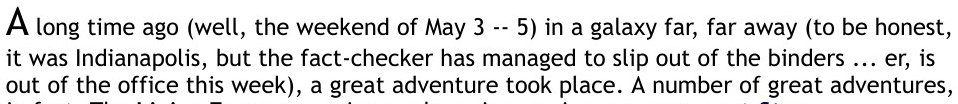
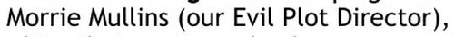
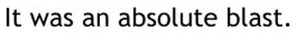
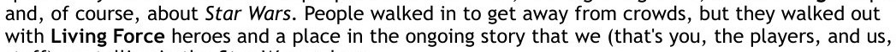
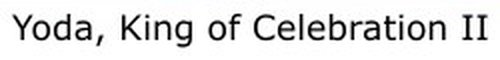
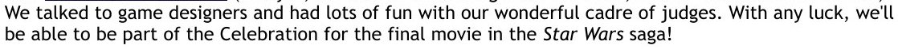

# Owner Material 037 — Star Wars D20 Drive folder (Core, Revised Core and Saga Edition): Living Force Campaign/Articles/Year 2/07:08:02 - Transmissions - July 2002.pdf [Star Wars Roleplaying Game Revised Core (d20, 2002)]

- **Source:** Wizards of the Coast Star Wars Roleplaying Game books, web enhancements, Living Force campaign modules and articles (2000–2010), from the owner's "Star Wars D20" Drive folder (only the three edition subfolders; "General" was not read, as instructed). Secondary source (licensed Legends reference). Scan OCR'd on the box; the scan stays box-only and is **not** published.
- **Method:** every scanned page was OCR'd and machine-screened sentence by sentence for power-relevant statements (fights, kills, defeats, Force feats, rankings, superweapons) that name a character on our roster; each kept sentence is quoted verbatim from the OCR text and has a crop of the printed passage directly under it. Pages with nothing power-relevant are still listed with what is on them.
- **Citation:** "*07:08:02 - Transmissions - July 2002* (SWRPG d20 Revised Core), p.X" by printed page ("scan p.X" where no printed number applies). **Weight:** Licensed RPG material: a secondary source. Narrative text sums up Legends lore; game statistics are rules for players, not canon power levels, and rank lowest.

## scan p.1 (scan page 1)

Page contents: CII intro; staff; nearly 40 tables; drive down (hand-read)

- **No single roster character (rules/setting/general)** — entry/section: Living Force: "A long time ago (well, the weekend of May 3 -- 5) in a galaxy far, far away (to be honest, it was Indianapolis, but the fact-checker has managed to slip out of the binders ... er, is out of the office this week), a great adventure took place." Source: *07:08:02 - Transmissions - July 2002* (SWRPG d20 Revised Core), scan p.1
  
- **No single roster character (rules/setting/general)** — entry/section: Morrie Mullins: "Morrie Mullins (our Evil Plot Director)" Source: *07:08:02 - Transmissions - July 2002* (SWRPG d20 Revised Core), scan p.1
  
- **No single roster character (rules/setting/general)** — entry/section: Living Force: "It was an absolute blast." Source: *07:08:02 - Transmissions - July 2002* (SWRPG d20 Revised Core), scan p.1
  

## scan p.2 (scan page 2)

Page contents: Badges; 75,000 attendees; RPGA HQ; games run (hand-read)

- **No single roster character (rules/setting/general)** — entry/section: Living Force: "For Living Force, CII turned out to be very much a case of, "If you build it, they will come."" Source: *07:08:02 - Transmissions - July 2002* (SWRPG d20 Revised Core), scan p.2
  
- **No single roster character (rules/setting/general)** — entry/section: Living Force: "People walked in to get away from crowds, but they walked out with Living Force heroes and a place in the ongoing story" Source: *07:08:02 - Transmissions - July 2002* (SWRPG d20 Revised Core), scan p.2
  

## scan p.3 (scan page 3)

Page contents: Wrap-up; thanks (volunteer list omitted) (hand-read)

- **No single roster character (rules/setting/general)** — entry/section: Yoda: "Yoda, King of Celebration II" Source: *07:08:02 - Transmissions - July 2002* (SWRPG d20 Revised Core), scan p.3
  
- **No single roster character (rules/setting/general)** — entry/section: Living Force: "With any luck, we'll be able to be part of the Celebration for the final movie in the Star Wars saga!" Source: *07:08:02 - Transmissions - July 2002* (SWRPG d20 Revised Core), scan p.3
  
