# Owner Material 037 — Star Wars D20 Drive folder (Core, Revised Core and Saga Edition): Living Force Campaign/Articles/Year 2/07:12:02 - Dark On Dark.pdf [Star Wars Roleplaying Game Revised Core (d20, 2002)]

- **Source:** Wizards of the Coast Star Wars Roleplaying Game books, web enhancements, Living Force campaign modules and articles (2000–2010), from the owner's "Star Wars D20" Drive folder (only the three edition subfolders; "General" was not read, as instructed). Secondary source (licensed Legends reference). Scan OCR'd on the box; the scan stays box-only and is **not** published.
- **Method:** every scanned page was OCR'd and machine-screened sentence by sentence for power-relevant statements (fights, kills, defeats, Force feats, rankings, superweapons) that name a character on our roster; each kept sentence is quoted verbatim from the OCR text and has a crop of the printed passage directly under it. Pages with nothing power-relevant are still listed with what is on them.
- **Citation:** "*07:12:02 - Dark On Dark* (SWRPG d20 Revised Core), p.X" by printed page ("scan p.X" where no printed number applies). **Weight:** Licensed RPG material: a secondary source. Narrative text sums up Legends lore; game statistics are rules for players, not canon power levels, and rank lowest.

## scan p.1 (scan page 1)

Page contents: Ezil intro; Nirama's problem children; Riboga; Trammel; box (hand-read)

- **No single roster character (rules/setting/general)** — entry/section: Old Ezil: "And let me tell you something, youngster, there ain't been no one who liked my company since before your grandfather's daddy got hair on his chin." Source: *07:12:02 - Dark On Dark* (SWRPG d20 Revised Core), scan p.1
  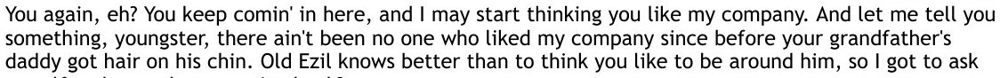
- **No single roster character (rules/setting/general)** — entry/section: Old Ezil: "Today, it just happens I'm in a talky mood, so you go buy me a drink and we'll see what I can tell you." Source: *07:12:02 - Dark On Dark* (SWRPG d20 Revised Core), scan p.1
  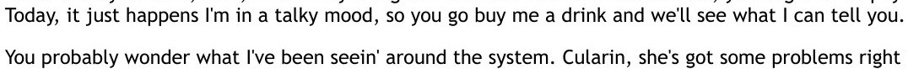
- **No single roster character (rules/setting/general)** — entry/section: Nirama: "He's got more problem children in that outfit than a k'kayeh dragon has teeth - and son, I got to tell you, that's a lot." Source: *07:12:02 - Dark On Dark* (SWRPG d20 Revised Core), scan p.1
  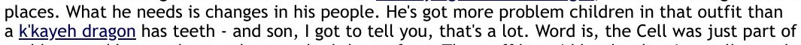
- **No single roster character (rules/setting/general)** — entry/section: Nirama: "I mean, you think he's forgotten that he's the one what took down Riboga? Him, a lowly accountant, knocked a Hutt off his pedestal. Gotta respect that." Source: *07:12:02 - Dark On Dark* (SWRPG d20 Revised Core), scan p.1
  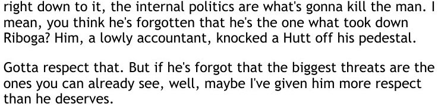
- **No single roster character (rules/setting/general)** — entry/section: Trammel: "The man's not a tactical moron." Source: *07:12:02 - Dark On Dark* (SWRPG d20 Revised Core), scan p.1
  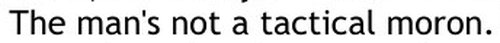
- **No single roster character (rules/setting/general)** — entry/section: Trammel: "Trammel's just as nasty a type as any out there" Source: *07:12:02 - Dark On Dark* (SWRPG d20 Revised Core), scan p.1
  
- **No single roster character (rules/setting/general)** — entry/section: Philosophy: "At the center of the mass of ships is a single asteroid, glowing with a black aura." Source: *07:12:02 - Dark On Dark* (SWRPG d20 Revised Core), scan p.1
  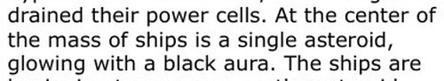

## scan p.2 (scan page 2)

Page contents: The Cell; Jobril chip; therbligs (hand-read)

- **No single roster character (rules/setting/general)** — entry/section: Old Ezil: "The Cell was a bunch of nerf-herders. Everyone who heard about 'em knew it." Source: *07:12:02 - Dark On Dark* (SWRPG d20 Revised Core), scan p.2
  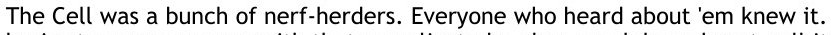
- **No single roster character (rules/setting/general)** — entry/section: Jobril: ""I want some surgery. Put a chip in my brain so you can control me, so's you won't never have to worry about me betraying you."" Source: *07:12:02 - Dark On Dark* (SWRPG d20 Revised Core), scan p.2
  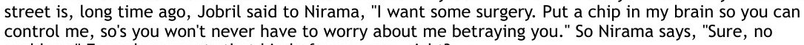
- **No single roster character (rules/setting/general)** — entry/section: Old Ezil: "Now, that's just Old Ezil's opinion, and he's been wrong before." Source: *07:12:02 - Dark On Dark* (SWRPG d20 Revised Core), scan p.2
  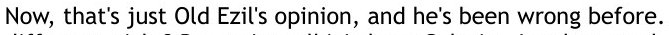
- **No single roster character (rules/setting/general)** — entry/section: Old Ezil: ""You want one of these therbligs? They're sensitive to the Force!"" Source: *07:12:02 - Dark On Dark* (SWRPG d20 Revised Core), scan p.2
  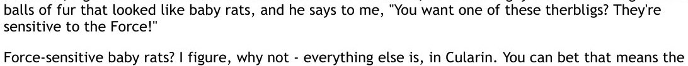
- **No single roster character (rules/setting/general)** — entry/section: Old Ezil: "Force-sensitive baby rats? I figure, why not - everything else is, in Cularin." Source: *07:12:02 - Dark On Dark* (SWRPG d20 Revised Core), scan p.2
  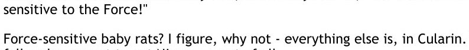
