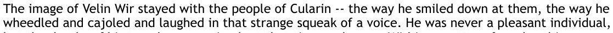
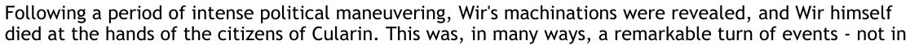
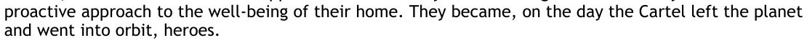
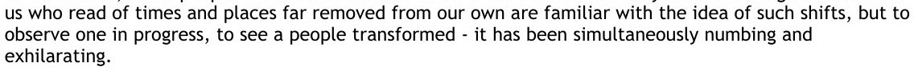
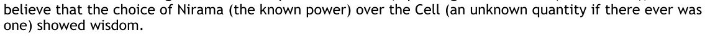
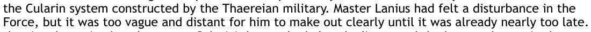
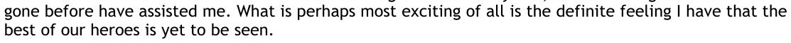

# Owner Material 037 — Star Wars D20 Drive folder (Core, Revised Core and Saga Edition): Living Force Campaign/Articles/Year 2/07:25:02 - A Changing Galaxy.pdf [Star Wars Roleplaying Game Revised Core (d20, 2002)]

- **Source:** Wizards of the Coast Star Wars Roleplaying Game books, web enhancements, Living Force campaign modules and articles (2000–2010), from the owner's "Star Wars D20" Drive folder (only the three edition subfolders; "General" was not read, as instructed). Secondary source (licensed Legends reference). Scan OCR'd on the box; the scan stays box-only and is **not** published.
- **Method:** every scanned page was OCR'd and machine-screened sentence by sentence for power-relevant statements (fights, kills, defeats, Force feats, rankings, superweapons) that name a character on our roster; each kept sentence is quoted verbatim from the OCR text and has a crop of the printed passage directly under it. Pages with nothing power-relevant are still listed with what is on them.
- **Citation:** "*07:25:02 - A Changing Galaxy* (SWRPG d20 Revised Core), p.X" by printed page ("scan p.X" where no printed number applies). **Weight:** Licensed RPG material: a secondary source. Narrative text sums up Legends lore; game statistics are rules for players, not canon power levels, and rank lowest.

## scan p.1 (scan page 1)

Page contents: Intro/spoiler warning; Velin Wir; Cartel ousted; the Cell (hand-read)

- **No single roster character (rules/setting/general)** — entry/section: Velin Wir: "The image of Velin Wir stayed with the people of Cularin -- the way he smiled down at them, the way he wheedled and cajoled and laughed in that strange squeak of a voice." Source: *07:25:02 - A Changing Galaxy* (SWRPG d20 Revised Core), scan p.1
  
- **No single roster character (rules/setting/general)** — entry/section: Velin Wir: "Following a period of intense political maneuvering, Wir's machinations were revealed, and Wir himself died at the hands of the citizens of Cularin." Source: *07:25:02 - A Changing Galaxy* (SWRPG d20 Revised Core), scan p.1
  
- **No single roster character (rules/setting/general)** — entry/section: Oden Malksch: "They became, on the day the Cartel left the planet and went into orbit, heroes." Source: *07:25:02 - A Changing Galaxy* (SWRPG d20 Revised Core), scan p.1
  
- **No single roster character (rules/setting/general)** — entry/section: Oden Malksch: "but to observe one in progress, to see a people transformed - it has been simultaneously numbing and exhilarating." Source: *07:25:02 - A Changing Galaxy* (SWRPG d20 Revised Core), scan p.1
  
- **No single roster character (rules/setting/general)** — entry/section: Nirama: "I believe that the choice of Nirama (the known power) over the Cell (an unknown quantity if there ever was one) showed wisdom." Source: *07:25:02 - A Changing Galaxy* (SWRPG d20 Revised Core), scan p.1
  

## scan p.2 (scan page 2)

Page contents: Fallen Jedi; Thaereian base; Cartel attempt; growing darkness; signed Oden Malksch (hand-read)

- **No single roster character (rules/setting/general)** — entry/section: Lanius: "Master Lanius had felt a disturbance in the Force, but it was too vague and distant for him to make out clearly until it was already nearly too late." Source: *07:25:02 - A Changing Galaxy* (SWRPG d20 Revised Core), scan p.2
  
- **No single roster character (rules/setting/general)** — entry/section: Oden Malksch: "What is perhaps most exciting of all is the definite feeling I have that the best of our heroes is yet to be seen." Source: *07:25:02 - A Changing Galaxy* (SWRPG d20 Revised Core), scan p.2
  
