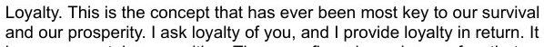
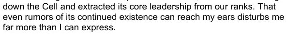
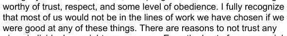
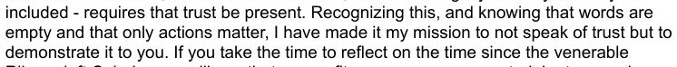
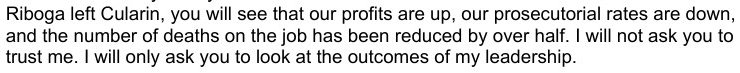
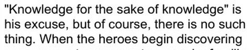
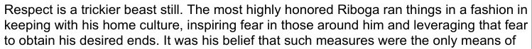
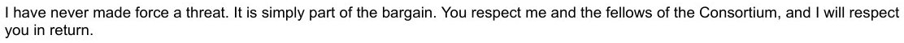
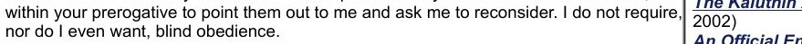

# Owner Material 037 — Star Wars D20 Drive folder (Core, Revised Core and Saga Edition): Living Force Campaign/Articles/Year 2/07:25:02 - The Cell Revisited.pdf [Star Wars Roleplaying Game Revised Core (d20, 2002)]

- **Source:** Wizards of the Coast Star Wars Roleplaying Game books, web enhancements, Living Force campaign modules and articles (2000–2010), from the owner's "Star Wars D20" Drive folder (only the three edition subfolders; "General" was not read, as instructed). Secondary source (licensed Legends reference). Scan OCR'd on the box; the scan stays box-only and is **not** published.
- **Method:** every scanned page was OCR'd and machine-screened sentence by sentence for power-relevant statements (fights, kills, defeats, Force feats, rankings, superweapons) that name a character on our roster; each kept sentence is quoted verbatim from the OCR text and has a crop of the printed passage directly under it. Pages with nothing power-relevant are still listed with what is on them.
- **Citation:** "*07:25:02 - The Cell Revisited* (SWRPG d20 Revised Core), p.X" by printed page ("scan p.X" where no printed number applies). **Weight:** Licensed RPG material: a secondary source. Narrative text sums up Legends lore; game statistics are rules for players, not canon power levels, and rank lowest.

## scan p.1 (scan page 1)

Page contents: Nirama letter: loyalty; Cell rumors; trust; respect; box (hand-read)

- **No single roster character (rules/setting/general)** — entry/section: Nirama: "Loyalty. This is the concept that has ever been most key to our survival and our prosperity. I ask loyalty of you, and I provide loyalty in return." Source: *07:25:02 - The Cell Revisited* (SWRPG d20 Revised Core), scan p.1
  
- **No single roster character (rules/setting/general)** — entry/section: Nirama: "That even rumors of its continued existence can reach my ears disturbs me far more than I can express." Source: *07:25:02 - The Cell Revisited* (SWRPG d20 Revised Core), scan p.1
  
- **No single roster character (rules/setting/general)** — entry/section: Nirama: "I fully recognize that most of us would not be in the lines of work we have chosen if we were good at any of these things." Source: *07:25:02 - The Cell Revisited* (SWRPG d20 Revised Core), scan p.1
  
- **No single roster character (rules/setting/general)** — entry/section: Nirama: "knowing that words are empty and that only actions matter, I have made it my mission to not speak of trust but to demonstrate it to you." Source: *07:25:02 - The Cell Revisited* (SWRPG d20 Revised Core), scan p.1
  
- **No single roster character (rules/setting/general)** — entry/section: Nirama: "our profits are up, our prosecutorial rates are down, and the number of deaths on the job has been reduced by over half. I will not ask you to trust me. I will only ask you to look at the outcomes of my leadership." Source: *07:25:02 - The Cell Revisited* (SWRPG d20 Revised Core), scan p.1
  
- **No single roster character (rules/setting/general)** — entry/section: Len Markus: ""Knowledge for the sake of knowledge" is his excuse, but of course, there is no such thing." Source: *07:25:02 - The Cell Revisited* (SWRPG d20 Revised Core), scan p.1
  
- **No single roster character (rules/setting/general)** — entry/section: Riboga: "The most highly honored Riboga ran things in a fashion in keeping with his home culture, inspiring fear in those around him and leveraging that fear to obtain his desired ends." Source: *07:25:02 - The Cell Revisited* (SWRPG d20 Revised Core), scan p.1
  

## scan p.2 (scan page 2)

Page contents: Obedience; freedom; challenge to the Cell (hand-read)

- **No single roster character (rules/setting/general)** — entry/section: Nirama: "I have never made force a threat. It is simply part of the bargain. You respect me and the fellows of the Consortium, and I will respect you in return." Source: *07:25:02 - The Cell Revisited* (SWRPG d20 Revised Core), scan p.2
  
- **No single roster character (rules/setting/general)** — entry/section: Nirama: "I do not require, nor do I even want, blind obedience." Source: *07:25:02 - The Cell Revisited* (SWRPG d20 Revised Core), scan p.2
  
