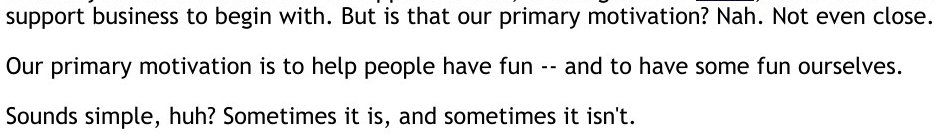
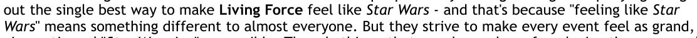
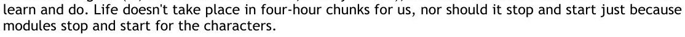
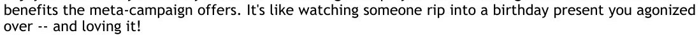
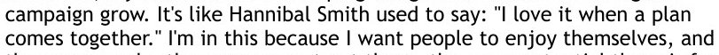
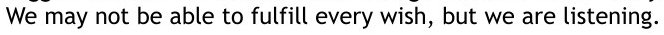

# Owner Material 037 — Star Wars D20 Drive folder (Core, Revised Core and Saga Edition): Living Force Campaign/Articles/Year 2/08:08:02 - Transmissions - August 2002.pdf [Star Wars Roleplaying Game Revised Core (d20, 2002)]

- **Source:** Wizards of the Coast Star Wars Roleplaying Game books, web enhancements, Living Force campaign modules and articles (2000–2010), from the owner's "Star Wars D20" Drive folder (only the three edition subfolders; "General" was not read, as instructed). Secondary source (licensed Legends reference). Scan OCR'd on the box; the scan stays box-only and is **not** published.
- **Method:** every scanned page was OCR'd and machine-screened sentence by sentence for power-relevant statements (fights, kills, defeats, Force feats, rankings, superweapons) that name a character on our roster; each kept sentence is quoted verbatim from the OCR text and has a crop of the printed passage directly under it. Pages with nothing power-relevant are still listed with what is on them.
- **Citation:** "*08:08:02 - Transmissions - August 2002* (SWRPG d20 Revised Core), p.X" by printed page ("scan p.X" where no printed number applies). **Weight:** Licensed RPG material: a secondary source. Narrative text sums up Legends lore; game statistics are rules for players, not canon power levels, and rank lowest.

## scan p.1 (scan page 1)

Page contents: Those Questions; fun motivation; Luke Skywalker; Beyond the Table (hand-read)

- **No single roster character (rules/setting/general)** — entry/section: Living Force: "Our primary motivation is to help people have fun -- and to have some fun ourselves. Sounds simple, huh? Sometimes it is, and sometimes it isn't." Source: *08:08:02 - Transmissions - August 2002* (SWRPG d20 Revised Core), scan p.1
  
- **No single roster character (rules/setting/general)** — entry/section: Living Force: ""feeling like Star Wars" means something different to almost everyone." Source: *08:08:02 - Transmissions - August 2002* (SWRPG d20 Revised Core), scan p.1
  
- **No single roster character (rules/setting/general)** — entry/section: Living Force: "Life doesn't take place in four-hour chunks for us, nor should it stop and start just because modules stop and start for the characters." Source: *08:08:02 - Transmissions - August 2002* (SWRPG d20 Revised Core), scan p.1
  

## scan p.2 (scan page 2)

Page contents: Meta; Hannibal quote; suggestion box; conversion timing (hand-read)

- **No single roster character (rules/setting/general)** — entry/section: Living Force: "It's like watching someone rip into a birthday present you agonized over -- and loving it!" Source: *08:08:02 - Transmissions - August 2002* (SWRPG d20 Revised Core), scan p.2
  
- **No single roster character (rules/setting/general)** — entry/section: Jae Walker: "It's like Hannibal Smith used to say: "I love it when a plan comes together."" Source: *08:08:02 - Transmissions - August 2002* (SWRPG d20 Revised Core), scan p.2
  
- **No single roster character (rules/setting/general)** — entry/section: Living Force: "We may not be able to fulfill every wish, but we are listening." Source: *08:08:02 - Transmissions - August 2002* (SWRPG d20 Revised Core), scan p.2
  
