# Owner Material 037 — Star Wars D20 Drive folder (Core, Revised Core and Saga Edition): Living Force Campaign/Articles/Year 2/08:29:02 - Further Discussions with Lanius.pdf [Star Wars Roleplaying Game Revised Core (d20, 2002)]

- **Source:** Wizards of the Coast Star Wars Roleplaying Game books, web enhancements, Living Force campaign modules and articles (2000–2010), from the owner's "Star Wars D20" Drive folder (only the three edition subfolders; "General" was not read, as instructed). Secondary source (licensed Legends reference). Scan OCR'd on the box; the scan stays box-only and is **not** published.
- **Method:** every scanned page was OCR'd and machine-screened sentence by sentence for power-relevant statements (fights, kills, defeats, Force feats, rankings, superweapons) that name a character on our roster; each kept sentence is quoted verbatim from the OCR text and has a crop of the printed passage directly under it. Pages with nothing power-relevant are still listed with what is on them.
- **Citation:** "*08:29:02 - Further Discussions with Lanius* (SWRPG d20 Revised Core), p.X" by printed page ("scan p.X" where no printed number applies). **Weight:** Licensed RPG material: a secondary source. Narrative text sums up Legends lore; game statistics are rules for players, not canon power levels, and rank lowest.

## scan p.1 (scan page 1)

Page contents: Kirlocca bio; Believers; threat (hand-read)

- **No single roster character (rules/setting/general)** — entry/section: Kirlocca: "Watching Master Kirlocca fight has been described as "like watching water flow over the falls," among other colorful metaphors." Source: *08:29:02 - Further Discussions with Lanius* (SWRPG d20 Revised Core), scan p.1
  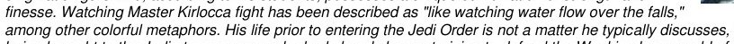
- **No single roster character (rules/setting/general)** — entry/section: Kirlocca: "before being brought to the Jedi at a young age, he had already begun training to defend the Wookiee homeworld of Kashyyyk and was becoming versed in the arts of combat." Source: *08:29:02 - Further Discussions with Lanius* (SWRPG d20 Revised Core), scan p.1
  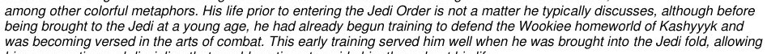
- **No single roster character (rules/setting/general)** — entry/section: Lanius: "L: There are always those who oppose the Jedi. Nothing new there. The universe has a light side and a dark side, and without the darkness, the light has no meaning." Source: *08:29:02 - Further Discussions with Lanius* (SWRPG d20 Revised Core), scan p.1
  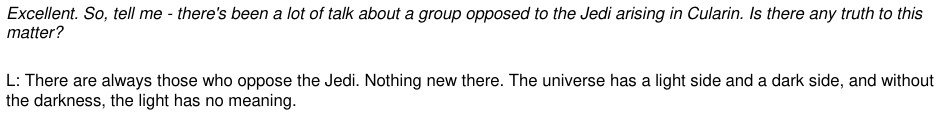
- **No single roster character (rules/setting/general)** — entry/section: Kirlocca: "K: The "Believers" are a group of individuals devoted to the study and practice of the dark side of the Force. They are misguided." Source: *08:29:02 - Further Discussions with Lanius* (SWRPG d20 Revised Core), scan p.1
  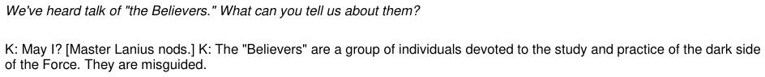
- **No single roster character (rules/setting/general)** — entry/section: Kirlocca: "K: They are only as big a threat as we allow them to be." Source: *08:29:02 - Further Discussions with Lanius* (SWRPG d20 Revised Core), scan p.1
  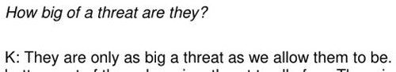
- **No single roster character (rules/setting/general)** — entry/section: Lanius: "L: Any group that utilizes the Force for its own ends, rather than for the betterment of the galaxy, is a threat to all of us. There is much power to be gained through the abuse of the Force. It can come easily." Source: *08:29:02 - Further Discussions with Lanius* (SWRPG d20 Revised Core), scan p.1
  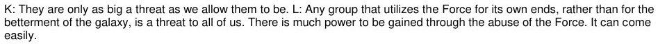

## scan p.2 (scan page 2)

Page contents: Numbers; truth; fortress; fallibility; Coruscant mission; change (hand-read)

- **No single roster character (rules/setting/general)** — entry/section: Lanius: "L: Clouded, their numbers are. [He and Kirlocca look at each other and inexplicably start chuckling.]" Source: *08:29:02 - Further Discussions with Lanius* (SWRPG d20 Revised Core), scan p.2
  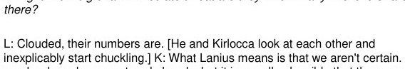
- **No single roster character (rules/setting/general)** — entry/section: Kirlocca: "K: If they knew the truth, we could." Source: *08:29:02 - Further Discussions with Lanius* (SWRPG d20 Revised Core), scan p.2
  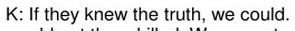
- **No single roster character (rules/setting/general)** — entry/section: Lanius: "We cannot compel them to do something they believe would lead to their own deaths." Source: *08:29:02 - Further Discussions with Lanius* (SWRPG d20 Revised Core), scan p.2
  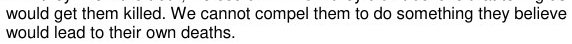
- **No single roster character (rules/setting/general)** — entry/section: Kirlocca: "K: The dark side remains strong there, even after centuries." Source: *08:29:02 - Further Discussions with Lanius* (SWRPG d20 Revised Core), scan p.2
  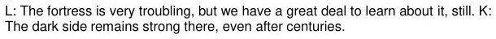
- **No single roster character (rules/setting/general)** — entry/section: Lanius: "L: That's exactly what I'm saying." Source: *08:29:02 - Further Discussions with Lanius* (SWRPG d20 Revised Core), scan p.2
  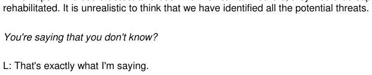
- **No single roster character (rules/setting/general)** — entry/section: Kirlocca: "K: We're still as mortal as anyone else. We can make mistakes. Being a Jedi does not make one better than any other person in the galaxy. It provides certain responsibilities, which coincide with the abilities we are granted through the Force. We are not infallible." Source: *08:29:02 - Further Discussions with Lanius* (SWRPG d20 Revised Core), scan p.2
  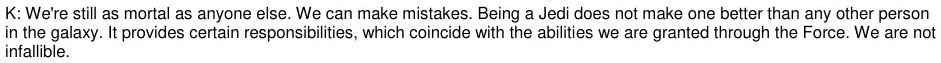
- **No single roster character (rules/setting/general)** — entry/section: Lanius: "L: You would be correct." Source: *08:29:02 - Further Discussions with Lanius* (SWRPG d20 Revised Core), scan p.2
  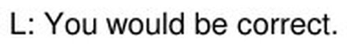
- **No single roster character (rules/setting/general)** — entry/section: Lanius: "L: Are you asking questions that might jeopardize system security?" Source: *08:29:02 - Further Discussions with Lanius* (SWRPG d20 Revised Core), scan p.2
  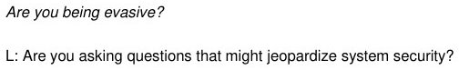
- **No single roster character (rules/setting/general)** — entry/section: Kirlocca: "K: Change is inevitable. It is impossible to be completely prepared for the changes that affect us most. We can only prepare as best we can and hope that our wisdom and experience will be enough to guide us through." Source: *08:29:02 - Further Discussions with Lanius* (SWRPG d20 Revised Core), scan p.2
  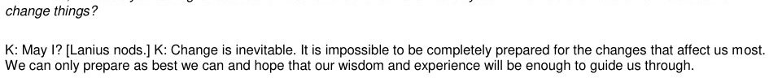

## scan p.3 (scan page 3)

Page contents: Cryptic close (read from image) (hand-read)

