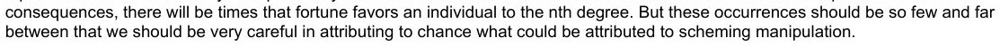
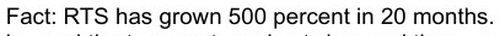
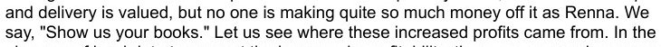
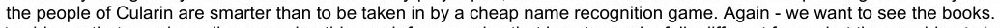
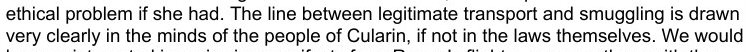
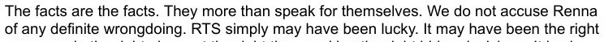
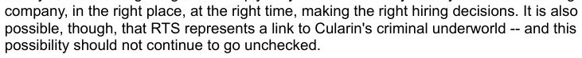

# Owner Material 037 — Star Wars D20 Drive folder (Core, Revised Core and Saga Edition): Living Force Campaign/Articles/Year 2/08:29:02 - Renna's Transport Service.pdf [Star Wars Roleplaying Game Revised Core (d20, 2002)]

- **Source:** Wizards of the Coast Star Wars Roleplaying Game books, web enhancements, Living Force campaign modules and articles (2000–2010), from the owner's "Star Wars D20" Drive folder (only the three edition subfolders; "General" was not read, as instructed). Secondary source (licensed Legends reference). Scan OCR'd on the box; the scan stays box-only and is **not** published.
- **Method:** every scanned page was OCR'd and machine-screened sentence by sentence for power-relevant statements (fights, kills, defeats, Force feats, rankings, superweapons) that name a character on our roster; each kept sentence is quoted verbatim from the OCR text and has a crop of the printed passage directly under it. Pages with nothing power-relevant are still listed with what is on them.
- **Citation:** "*08:29:02 - Renna's Transport Service* (SWRPG d20 Revised Core), p.X" by printed page ("scan p.X" where no printed number applies). **Weight:** Licensed RPG material: a secondary source. Narrative text sums up Legends lore; game statistics are rules for players, not canon power levels, and rank lowest.

## scan p.1 (scan page 1)

Page contents: Intro; RTS growth facts; pricing; box; Nirama-ties fact (image) (hand-read)

- **No single roster character (rules/setting/general)** — entry/section: Renna: "But these occurrences should be so few and far between that we should be very careful in attributing to chance what could be attributed to scheming manipulation." Source: *08:29:02 - Renna's Transport Service* (SWRPG d20 Revised Core), scan p.1
  
- **No single roster character (rules/setting/general)** — entry/section: Renna: "Fact: RTS has grown 500 percent in 20 months." Source: *08:29:02 - Renna's Transport Service* (SWRPG d20 Revised Core), scan p.1
  
- **No single roster character (rules/setting/general)** — entry/section: Renna: "We say, "Show us your books." Let us see where these increased profits came from." Source: *08:29:02 - Renna's Transport Service* (SWRPG d20 Revised Core), scan p.1
  
- **No single roster character (rules/setting/general)** — entry/section: Renna: "the people of Cularin are smarter than to be taken in by a cheap name recognition game. Again - we want to see the books." Source: *08:29:02 - Renna's Transport Service* (SWRPG d20 Revised Core), scan p.1
  

## scan p.2 (scan page 2)

Page contents: Smuggling ties; conclusion (hand-read)

- **No single roster character (rules/setting/general)** — entry/section: Renna: "The line between legitimate transport and smuggling is drawn very clearly in the minds of the people of Cularin, if not in the laws themselves." Source: *08:29:02 - Renna's Transport Service* (SWRPG d20 Revised Core), scan p.2
  
- **No single roster character (rules/setting/general)** — entry/section: Renna: "The facts are the facts. They more than speak for themselves. We do not accuse Renna of any definite wrongdoing. RTS simply may have been lucky." Source: *08:29:02 - Renna's Transport Service* (SWRPG d20 Revised Core), scan p.2
  
- **No single roster character (rules/setting/general)** — entry/section: Renna: "It is also possible, though, that RTS represents a link to Cularin's criminal underworld -- and this possibility should not continue to go unchecked." Source: *08:29:02 - Renna's Transport Service* (SWRPG d20 Revised Core), scan p.2
  
