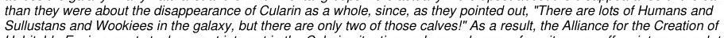
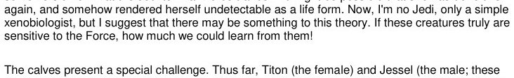
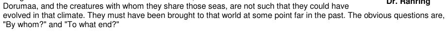
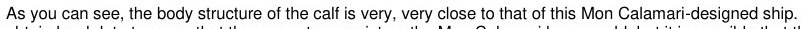
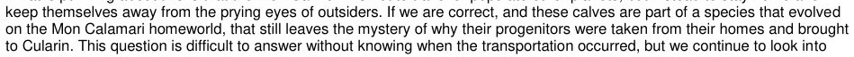

# Owner Material 037 — Star Wars D20 Drive folder (Core, Revised Core and Saga Edition): Living Force Campaign/Articles/Year 2/10:10:02 - Rebirth.pdf [Star Wars Roleplaying Game Revised Core (d20, 2002)]

- **Source:** Wizards of the Coast Star Wars Roleplaying Game books, web enhancements, Living Force campaign modules and articles (2000–2010), from the owner's "Star Wars D20" Drive folder (only the three edition subfolders; "General" was not read, as instructed). Secondary source (licensed Legends reference). Scan OCR'd on the box; the scan stays box-only and is **not** published.
- **Method:** every scanned page was OCR'd and machine-screened sentence by sentence for power-relevant statements (fights, kills, defeats, Force feats, rankings, superweapons) that name a character on our roster; each kept sentence is quoted verbatim from the OCR text and has a crop of the printed passage directly under it. Pages with nothing power-relevant are still listed with what is on them.
- **Citation:** "*10:10:02 - Rebirth* (SWRPG d20 Revised Core), p.X" by printed page ("scan p.X" where no printed number applies). **Weight:** Licensed RPG material: a secondary source. Narrative text sums up Legends lore; game statistics are rules for players, not canon power levels, and rank lowest.

## scan p.1 (scan page 1)

Page contents: Calves' birthday; documentary; mother theory; Titon & Jessel; Mon Cal ship match (hand-read)

- **No single roster character (rules/setting/general)** — entry/section: Leviathan calves: ""There are lots of Humans and Sullustans and Wookiees in the galaxy, but there are only two of those calves!"" Source: *10:10:02 - Rebirth* (SWRPG d20 Revised Core), scan p.1
  
- **No single roster character (rules/setting/general)** — entry/section: A. Rahring: "Now, I'm no Jedi, only a simple xenobiologist, but I suggest that there may be something to this theory. If these creatures truly are sensitive to the Force, how much we could learn from them!" Source: *10:10:02 - Rebirth* (SWRPG d20 Revised Core), scan p.1
  
- **No single roster character (rules/setting/general)** — entry/section: A. Rahring: "They must have been brought to that world at some point far in the past. The obvious questions are, "By whom?" and "To what end?"" Source: *10:10:02 - Rebirth* (SWRPG d20 Revised Core), scan p.1
  
- **No single roster character (rules/setting/general)** — entry/section: A. Rahring: "As you can see, the body structure of the calf is very, very close to that of this Mon Calamari-designed ship." Source: *10:10:02 - Rebirth* (SWRPG d20 Revised Core), scan p.1
  

## scan p.2 (scan page 2)

Page contents: Mon Cal mystery; break (hand-read)

- **No single roster character (rules/setting/general)** — entry/section: A. Rahring: "that still leaves the mystery of why their progenitors were taken from their homes and brought to Cularin." Source: *10:10:02 - Rebirth* (SWRPG d20 Revised Core), scan p.2
  
