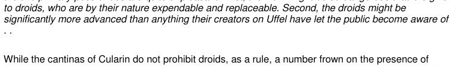
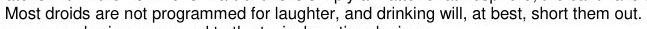
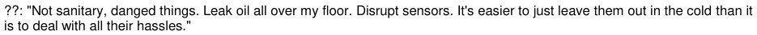
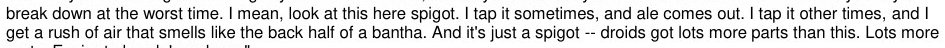
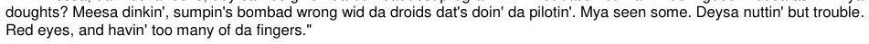
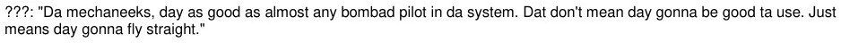
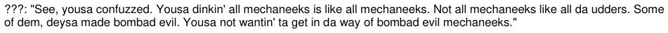
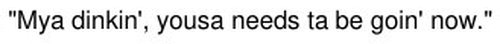

# Owner Material 037 — Star Wars D20 Drive folder (Core, Revised Core and Saga Edition): Living Force Campaign/Articles/Year 2/10:10:02 - Shadow Droids.pdf [Star Wars Roleplaying Game Revised Core (d20, 2002)]

- **Source:** Wizards of the Coast Star Wars Roleplaying Game books, web enhancements, Living Force campaign modules and articles (2000–2010), from the owner's "Star Wars D20" Drive folder (only the three edition subfolders; "General" was not read, as instructed). Secondary source (licensed Legends reference). Scan OCR'd on the box; the scan stays box-only and is **not** published.
- **Method:** every scanned page was OCR'd and machine-screened sentence by sentence for power-relevant statements (fights, kills, defeats, Force feats, rankings, superweapons) that name a character on our roster; each kept sentence is quoted verbatim from the OCR text and has a crop of the printed passage directly under it. Pages with nothing power-relevant are still listed with what is on them.
- **Citation:** "*10:10:02 - Shadow Droids* (SWRPG d20 Revised Core), p.X" by printed page ("scan p.X" where no printed number applies). **Weight:** Licensed RPG material: a secondary source. Narrative text sums up Legends lore; game statistics are rules for players, not canon power levels, and rank lowest.

## scan p.1 (scan page 1)

Page contents: Pirate droid reports; cantina; OPS transcript with barkeep (hand-read)

- **No single roster character (rules/setting/general)** — entry/section: Shadow droids: "Second, the droids might be significantly more advanced than anything their creators on Uffel have let the public become aware of." Source: *10:10:02 - Shadow Droids* (SWRPG d20 Revised Core), scan p.1
  
- **No single roster character (rules/setting/general)** — entry/section: Shadow droids: "Most droids are not programmed for laughter, and drinking will, at best, short them out." Source: *10:10:02 - Shadow Droids* (SWRPG d20 Revised Core), scan p.1
  
- **No single roster character (rules/setting/general)** — entry/section: Shadow droids: ""Not sanitary, danged things. Leak oil all over my floor. Disrupt sensors. It's easier to just leave them out in the cold than it is to deal with all their hassles."" Source: *10:10:02 - Shadow Droids* (SWRPG d20 Revised Core), scan p.1
  
- **No single roster character (rules/setting/general)** — entry/section: Shadow droids: "I tap it other times, and I get a rush of air that smells like the back half of a bantha." Source: *10:10:02 - Shadow Droids* (SWRPG d20 Revised Core), scan p.1
  

## scan p.2 (scan page 2)

Page contents: Corner booth shipper dialogue; blaster threat (hand-read)

- **No single roster character (rules/setting/general)** — entry/section: Shadow droids: ""Meesa dinkin', sumpin's bombad wrong wid da droids dat's doin' da pilotin'. Mya seen some. Deysa nuttin' but trouble. Red eyes, and havin' too many of da fingers."" Source: *10:10:02 - Shadow Droids* (SWRPG d20 Revised Core), scan p.2
  
- **No single roster character (rules/setting/general)** — entry/section: Shadow droids: ""Da mechaneeks, day as good as almost any bombad pilot in da system. Dat don't mean day gonna be good ta use. Just means day gonna fly straight."" Source: *10:10:02 - Shadow Droids* (SWRPG d20 Revised Core), scan p.2
  
- **No single roster character (rules/setting/general)** — entry/section: Shadow droids: ""Not all mechaneeks like all da udders. Some of dem, deysa made bombad evil. Yousa not wantin' ta get in da way of bombad evil mechaneeks."" Source: *10:10:02 - Shadow Droids* (SWRPG d20 Revised Core), scan p.2
  
- **No single roster character (rules/setting/general)** — entry/section: Shadow droids: ""Mya dinkin', yousa needs ta be goin' now."" Source: *10:10:02 - Shadow Droids* (SWRPG d20 Revised Core), scan p.2
  
