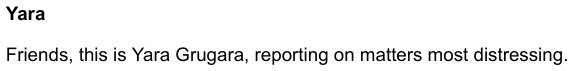
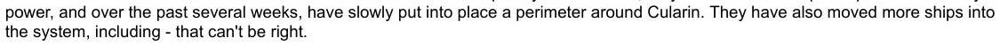
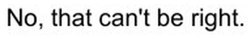
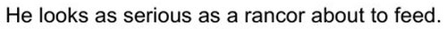
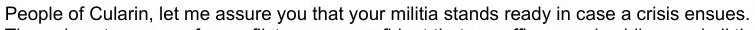
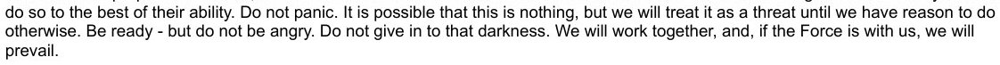
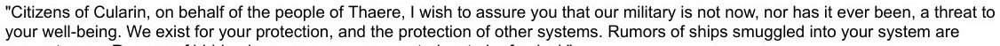
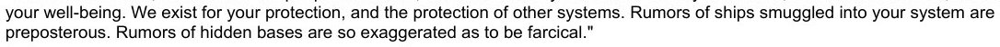
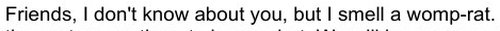

# Owner Material 037 — Star Wars D20 Drive folder (Core, Revised Core and Saga Edition): Living Force Campaign/Articles/Year 2/10:10:02 - The Creaking Gate.pdf [Star Wars Roleplaying Game Revised Core (d20, 2002)]

- **Source:** Wizards of the Coast Star Wars Roleplaying Game books, web enhancements, Living Force campaign modules and articles (2000–2010), from the owner's "Star Wars D20" Drive folder (only the three edition subfolders; "General" was not read, as instructed). Secondary source (licensed Legends reference). Scan OCR'd on the box; the scan stays box-only and is **not** published.
- **Method:** every scanned page was OCR'd and machine-screened sentence by sentence for power-relevant statements (fights, kills, defeats, Force feats, rankings, superweapons) that name a character on our roster; each kept sentence is quoted verbatim from the OCR text and has a crop of the printed passage directly under it. Pages with nothing power-relevant are still listed with what is on them.
- **Citation:** "*10:10:02 - The Creaking Gate* (SWRPG d20 Revised Core), p.X" by printed page ("scan p.X" where no printed number applies). **Weight:** Licensed RPG material: a secondary source. Narrative text sums up Legends lore; game statistics are rules for players, not canon power levels, and rank lowest.

## scan p.1 (scan page 1)

Page contents: Interruption; disheveled Yara; Thaereian buildup; capital ships; box (hand-read)

- **No single roster character (rules/setting/general)** — entry/section: Yara Grugara: "Friends, this is Yara Grugara, reporting on matters most distressing." Source: *10:10:02 - The Creaking Gate* (SWRPG d20 Revised Core), scan p.1
  
- **No single roster character (rules/setting/general)** — entry/section: Yara Grugara: "They have also moved more ships into the system, including - that can't be right." Source: *10:10:02 - The Creaking Gate* (SWRPG d20 Revised Core), scan p.1
  
- **No single roster character (rules/setting/general)** — entry/section: Yara Grugara: "No, that can't be right." Source: *10:10:02 - The Creaking Gate* (SWRPG d20 Revised Core), scan p.1
  

## scan p.2 (scan page 2)

Page contents: Dal'Nay statement; Tramsig statement; womp-rat (hand-read)

- **No single roster character (rules/setting/general)** — entry/section: Osten Dal'Nay: "He looks as serious as a rancor about to feed." Source: *10:10:02 - The Creaking Gate* (SWRPG d20 Revised Core), scan p.2
  
- **No single roster character (rules/setting/general)** — entry/section: Osten Dal'Nay: "People of Cularin, let me assure you that your militia stands ready in case a crisis ensues." Source: *10:10:02 - The Creaking Gate* (SWRPG d20 Revised Core), scan p.2
  
- **No single roster character (rules/setting/general)** — entry/section: Osten Dal'Nay: "Do not panic. It is possible that this is nothing, but we will treat it as a threat until we have reason to do otherwise. Be ready - but do not be angry. Do not give in to that darkness. We will work together, and, if the Force is with us, we will prevail." Source: *10:10:02 - The Creaking Gate* (SWRPG d20 Revised Core), scan p.2
  
- **No single roster character (rules/setting/general)** — entry/section: Jir Tramsig: ""Citizens of Cularin, on behalf of the people of Thaere, I wish to assure you that our military is not now, nor has it ever been, a threat to your well-being." Source: *10:10:02 - The Creaking Gate* (SWRPG d20 Revised Core), scan p.2
  
- **No single roster character (rules/setting/general)** — entry/section: Jir Tramsig: "Rumors of ships smuggled into your system are preposterous. Rumors of hidden bases are so exaggerated as to be farcical."" Source: *10:10:02 - The Creaking Gate* (SWRPG d20 Revised Core), scan p.2
  
- **No single roster character (rules/setting/general)** — entry/section: Yara Grugara: "Friends, I don't know about you, but I smell a womp-rat." Source: *10:10:02 - The Creaking Gate* (SWRPG d20 Revised Core), scan p.2
  
