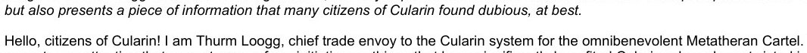
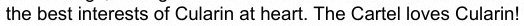
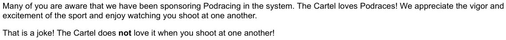
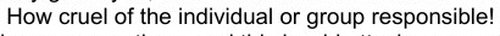
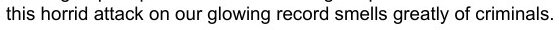
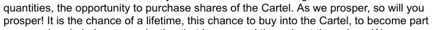
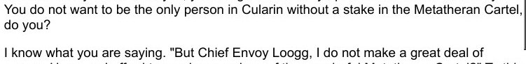
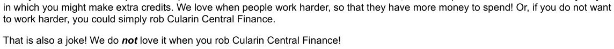
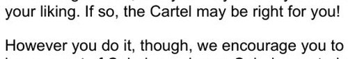
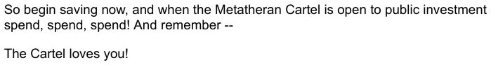

# Owner Material 037 — Star Wars D20 Drive folder (Core, Revised Core and Saga Edition): Living Force Campaign/Articles/Year 2/10:31:02 - Trade and Trade Alike.pdf [Star Wars Roleplaying Game Revised Core (d20, 2002)]

- **Source:** Wizards of the Coast Star Wars Roleplaying Game books, web enhancements, Living Force campaign modules and articles (2000–2010), from the owner's "Star Wars D20" Drive folder (only the three edition subfolders; "General" was not read, as instructed). Secondary source (licensed Legends reference). Scan OCR'd on the box; the scan stays box-only and is **not** published.
- **Method:** every scanned page was OCR'd and machine-screened sentence by sentence for power-relevant statements (fights, kills, defeats, Force feats, rankings, superweapons) that name a character on our roster; each kept sentence is quoted verbatim from the OCR text and has a crop of the printed passage directly under it. Pages with nothing power-relevant are still listed with what is on them.
- **Citation:** "*10:31:02 - Trade and Trade Alike* (SWRPG d20 Revised Core), p.X" by printed page ("scan p.X" where no printed number applies). **Weight:** Licensed RPG material: a secondary source. Narrative text sums up Legends lore; game statistics are rules for players, not canon power levels, and rank lowest.

## scan p.1 (scan page 1)

Page contents: PR campaign; Loogg ad: Podraces, gift ship transmitter, public investment; box; affordability jokes (hand-read)

- **No single roster character (rules/setting/general)** — entry/section: Thurm Loogg: "Hello, citizens of Cularin! I am Thurm Loogg, chief trade envoy to the Cularin system for the omnibenevolent Metatheran Cartel." Source: *10:31:02 - Trade and Trade Alike* (SWRPG d20 Revised Core), scan p.1
  
- **No single roster character (rules/setting/general)** — entry/section: Thurm Loogg: "The Cartel loves Cularin!" Source: *10:31:02 - Trade and Trade Alike* (SWRPG d20 Revised Core), scan p.1
  
- **No single roster character (rules/setting/general)** — entry/section: Thurm Loogg: "The Cartel loves Podraces! We appreciate the vigor and excitement of the sport and enjoy watching you shoot at one another. That is a joke! The Cartel does not love it when you shoot at one another!" Source: *10:31:02 - Trade and Trade Alike* (SWRPG d20 Revised Core), scan p.1
  
- **No single roster character (rules/setting/general)** — entry/section: Thurm Loogg: "How cruel of the individual or group responsible!" Source: *10:31:02 - Trade and Trade Alike* (SWRPG d20 Revised Core), scan p.1
  
- **No single roster character (rules/setting/general)** — entry/section: Thurm Loogg: "this horrid attack on our glowing record smells greatly of criminals." Source: *10:31:02 - Trade and Trade Alike* (SWRPG d20 Revised Core), scan p.1
  
- **No single roster character (rules/setting/general)** — entry/section: Thurm Loogg: "As we prosper, so will you prosper!" Source: *10:31:02 - Trade and Trade Alike* (SWRPG d20 Revised Core), scan p.1
  
- **No single roster character (rules/setting/general)** — entry/section: Thurm Loogg: "You do not want to be the only person in Cularin without a stake in the Metatheran Cartel, do you?" Source: *10:31:02 - Trade and Trade Alike* (SWRPG d20 Revised Core), scan p.1
  
- **No single roster character (rules/setting/general)** — entry/section: Thurm Loogg: "Or, if you do not want to work harder, you could simply rob Cularin Central Finance. That is also a joke! We do not love it when you rob Cularin Central Finance!" Source: *10:31:02 - Trade and Trade Alike* (SWRPG d20 Revised Core), scan p.1
  

## scan p.2 (scan page 2)

Page contents: Jedi pitch; spend; The Cartel loves you (hand-read)

- **No single roster character (rules/setting/general)** — entry/section: Thurm Loogg: "If so, the Cartel may be right for you!" Source: *10:31:02 - Trade and Trade Alike* (SWRPG d20 Revised Core), scan p.2
  
- **No single roster character (rules/setting/general)** — entry/section: Thurm Loogg: "So begin saving now, and when the Metatheran Cartel is open to public investment -spend, spend, spend! And remember -- The Cartel loves you!" Source: *10:31:02 - Trade and Trade Alike* (SWRPG d20 Revised Core), scan p.2
  
