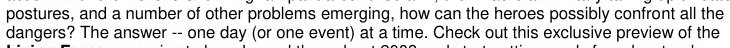
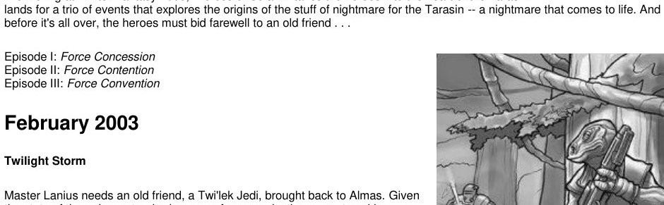
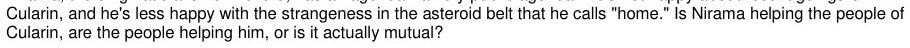
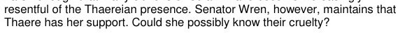
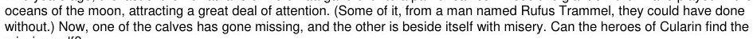

# Owner Material 037 — Star Wars D20 Drive folder (Core, Revised Core and Saga Edition): Living Force Campaign/Articles/Year 2/11:14:02 - Living Force 2003 Preview.pdf [Star Wars Roleplaying Game Revised Core (d20, 2002)]

- **Source:** Wizards of the Coast Star Wars Roleplaying Game books, web enhancements, Living Force campaign modules and articles (2000–2010), from the owner's "Star Wars D20" Drive folder (only the three edition subfolders; "General" was not read, as instructed). Secondary source (licensed Legends reference). Scan OCR'd on the box; the scan stays box-only and is **not** published.
- **Method:** every scanned page was OCR'd and machine-screened sentence by sentence for power-relevant statements (fights, kills, defeats, Force feats, rankings, superweapons) that name a character on our roster; each kept sentence is quoted verbatim from the OCR text and has a crop of the printed passage directly under it. Pages with nothing power-relevant are still listed with what is on them.
- **Citation:** "*11:14:02 - Living Force 2003 Preview* (SWRPG d20 Revised Core), p.X" by printed page ("scan p.X" where no printed number applies). **Weight:** Licensed RPG material: a secondary source. Narrative text sums up Legends lore; game statistics are rules for players, not canon power levels, and rank lowest.

## scan p.1 (scan page 1)

Page contents: Year 3 intro; Forces of Cularin; Twilight Storm; Metatheran Caution; Belted In (hand-read)

- **No single roster character (rules/setting/general)** — entry/section: Living Force: "how can the heroes possibly confront all the dangers? The answer -- one day (or one event) at a time." Source: *11:14:02 - Living Force 2003 Preview* (SWRPG d20 Revised Core), scan p.1
  
- **No single roster character (rules/setting/general)** — entry/section: Forces of Cularin: "explores the origins of the stuff of nightmare for the Tarasin -- a nightmare that comes to life. And before it's all over, the heroes must bid farewell to an old friend..." Source: *11:14:02 - Living Force 2003 Preview* (SWRPG d20 Revised Core), scan p.1
  
- **No single roster character (rules/setting/general)** — entry/section: Nirama: "Is Nirama helping the people of Cularin, are the people helping him, or is it actually mutual?" Source: *11:14:02 - Living Force 2003 Preview* (SWRPG d20 Revised Core), scan p.1
  

## scan p.2 (scan page 2)

Page contents: Belted In episodes; From the Trees; Night Eyes; Dorumaa's Children (hand-read)

- **No single roster character (rules/setting/general)** — entry/section: Lavina Wren: "Senator Wren, however, maintains that Thaere has her support. Could she possibly know their cruelty?" Source: *11:14:02 - Living Force 2003 Preview* (SWRPG d20 Revised Core), scan p.2
  
- **No single roster character (rules/setting/general)** — entry/section: Trammel: "(Some of it, from a man named Rufus Trammel, they could have done without.)" Source: *11:14:02 - Living Force 2003 Preview* (SWRPG d20 Revised Core), scan p.2
  
