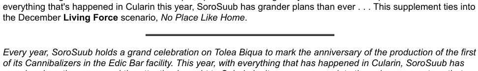
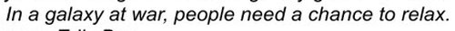
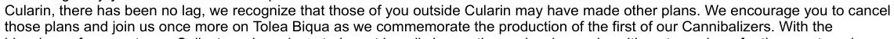
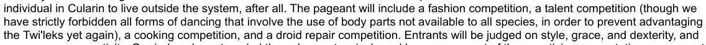
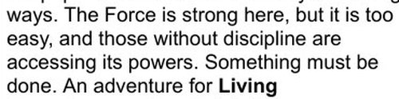
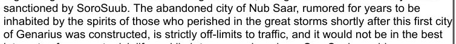
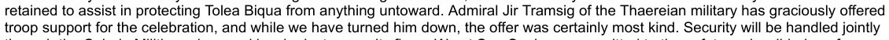
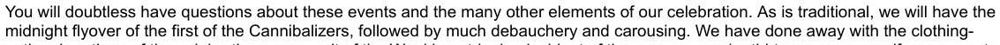
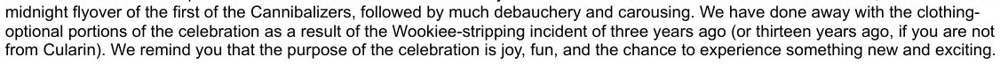

# Owner Material 037 — Star Wars D20 Drive folder (Core, Revised Core and Saga Edition): Living Force Campaign/Articles/Year 2/11:27:02 - Celebrate SoroSuub.pdf [Star Wars Roleplaying Game Revised Core (d20, 2002)]

- **Source:** Wizards of the Coast Star Wars Roleplaying Game books, web enhancements, Living Force campaign modules and articles (2000–2010), from the owner's "Star Wars D20" Drive folder (only the three edition subfolders; "General" was not read, as instructed). Secondary source (licensed Legends reference). Scan OCR'd on the box; the scan stays box-only and is **not** published.
- **Method:** every scanned page was OCR'd and machine-screened sentence by sentence for power-relevant statements (fights, kills, defeats, Force feats, rankings, superweapons) that name a character on our roster; each kept sentence is quoted verbatim from the OCR text and has a crop of the printed passage directly under it. Pages with nothing power-relevant are still listed with what is on them.
- **Citation:** "*11:27:02 - Celebrate SoroSuub* (SWRPG d20 Revised Core), p.X" by printed page ("scan p.X" where no printed number applies). **Weight:** Licensed RPG material: a secondary source. Narrative text sums up Legends lore; game statistics are rules for players, not canon power levels, and rank lowest.

## scan p.1 (scan page 1)

Page contents: Intro (opening line from image); press release; events; gambling; pageant; drinks; box; excursions (hand-read)

- **No single roster character (rules/setting/general)** — entry/section: SoroSuub: "Every year, SoroSuub holds a grand celebration on Tolea Biqua to mark the anniversary of the production of the first of its Cannibalizers in the Edic Bar facility." Source: *11:27:02 - Celebrate SoroSuub* (SWRPG d20 Revised Core), scan p.1
  
- **No single roster character (rules/setting/general)** — entry/section: SoroSuub: "In a galaxy at war, people need a chance to relax." Source: *11:27:02 - Celebrate SoroSuub* (SWRPG d20 Revised Core), scan p.1
  
- **No single roster character (rules/setting/general)** — entry/section: Miim Te'Suub: "We encourage you to cancel those plans and join us once more on Tolea Biqua" Source: *11:27:02 - Celebrate SoroSuub* (SWRPG d20 Revised Core), scan p.1
  
- **No single roster character (rules/setting/general)** — entry/section: Miim Te'Suub: "(though we have strictly forbidden all forms of dancing that involve the use of body parts not available to all species, in order to prevent advantaging the Twi'leks yet again)" Source: *11:27:02 - Celebrate SoroSuub* (SWRPG d20 Revised Core), scan p.1
  
- **No single roster character (rules/setting/general)** — entry/section: No Place Like Home: "The Force is strong here, but it is too easy, and those without discipline are accessing its powers. Something must be done." Source: *11:27:02 - Celebrate SoroSuub* (SWRPG d20 Revised Core), scan p.1
  
- **No single roster character (rules/setting/general)** — entry/section: Nub Saar: "The abandoned city of Nub Saar, rumored for years to be inhabited by the spirits of those who perished in the great storms shortly after this first city of Genarius was constructed, is strictly off-limits to traffic" Source: *11:27:02 - Celebrate SoroSuub* (SWRPG d20 Revised Core), scan p.1
  

## scan p.2 (scan page 2)

Page contents: Security; flyover; Wookiee incident; signed Miim Te'Suub (hand-read)

- **No single roster character (rules/setting/general)** — entry/section: Jir Tramsig: "Admiral Jir Tramsig of the Thaereian military has graciously offered troop support for the celebration, and while we have turned him down, the offer was certainly most kind." Source: *11:27:02 - Celebrate SoroSuub* (SWRPG d20 Revised Core), scan p.2
  
- **No single roster character (rules/setting/general)** — entry/section: Miim Te'Suub: "As is traditional, we will have the midnight flyover of the first of the Cannibalizers, followed by much debauchery and carousing." Source: *11:27:02 - Celebrate SoroSuub* (SWRPG d20 Revised Core), scan p.2
  
- **No single roster character (rules/setting/general)** — entry/section: Miim Te'Suub: "We have done away with the clothingoptional portions of the celebration as a result of the Wookiee-stripping incident of three years ago (or thirteen years ago, if you are not from Cularin)." Source: *11:27:02 - Celebrate SoroSuub* (SWRPG d20 Revised Core), scan p.2
  
