# Owner Material 037 — Star Wars D20 Drive folder (Core, Revised Core and Saga Edition): Living Force Campaign/Articles/Year 2/12:05:02 - That is Nirama's Word.pdf [Star Wars Roleplaying Game Revised Core (d20, 2002)]

- **Source:** Wizards of the Coast Star Wars Roleplaying Game books, web enhancements, Living Force campaign modules and articles (2000–2010), from the owner's "Star Wars D20" Drive folder (only the three edition subfolders; "General" was not read, as instructed). Secondary source (licensed Legends reference). Scan OCR'd on the box; the scan stays box-only and is **not** published.
- **Method:** every scanned page was OCR'd and machine-screened sentence by sentence for power-relevant statements (fights, kills, defeats, Force feats, rankings, superweapons) that name a character on our roster; each kept sentence is quoted verbatim from the OCR text and has a crop of the printed passage directly under it. Pages with nothing power-relevant are still listed with what is on them.
- **Citation:** "*12:05:02 - That is Nirama's Word* (SWRPG d20 Revised Core), p.X" by printed page ("scan p.X" where no printed number applies). **Weight:** Licensed RPG material: a secondary source. Narrative text sums up Legends lore; game statistics are rules for players, not canon power levels, and rank lowest.

## scan p.1 (scan page 1)

Page contents: Broadcast intro; Nirama introduces himself; home; dark tide; record (hand-read)

- **No single roster character (rules/setting/general)** — entry/section: Nirama: "Citizens, I am Nirama. Many of you know me by reputation alone. I am what you might call a lord of crime." Source: *12:05:02 - That is Nirama's Word* (SWRPG d20 Revised Core), scan p.1
  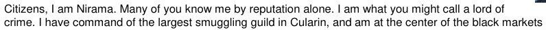
- **No single roster character (rules/setting/general)** — entry/section: Nirama: "There are many of you who find my work distasteful, who believe that I am an individual who wallows in darkness and has anger and hatred in his heart. These things are not true." Source: *12:05:02 - That is Nirama's Word* (SWRPG d20 Revised Core), scan p.1
  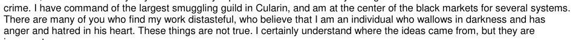
- **No single roster character (rules/setting/general)** — entry/section: Nirama: "I have a great fondness for Cularin. It is my home, in every sense of the word." Source: *12:05:02 - That is Nirama's Word* (SWRPG d20 Revised Core), scan p.1
  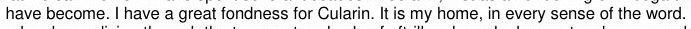
- **No single roster character (rules/setting/general)** — entry/section: Nirama: "However, our efforts alone will not be sufficient to stop the dark tide that has begun to rise throughout Cularin and threatens to wash away all that we love." Source: *12:05:02 - That is Nirama's Word* (SWRPG d20 Revised Core), scan p.1
  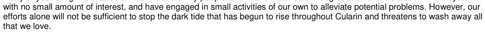
- **No single roster character (rules/setting/general)** — entry/section: Nirama: "I am loathe to wax poetic about Cularin. It is not in my nature. I am not a creature of poetry; I am a creature of fact." Source: *12:05:02 - That is Nirama's Word* (SWRPG d20 Revised Core), scan p.1
  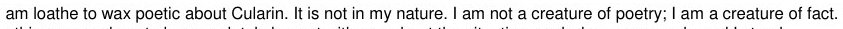
- **No single roster character (rules/setting/general)** — entry/section: Nirama: "I have provided order where the Hutt sowed chaos. I have worked to keep the pirate factions fighting amongst themselves, rather than attacking you." Source: *12:05:02 - That is Nirama's Word* (SWRPG d20 Revised Core), scan p.1
  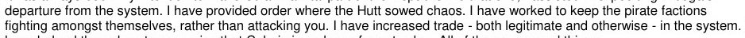

## scan p.2 (scan page 2)

Page contents: Warnings to Thaere, Cartel, traitors, Alina Impeveri, Trammel; offer to Wren & Jedi (hand-read)

- **No single roster character (rules/setting/general)** — entry/section: Nirama: "If you wish to do harm to Cularin, you must first go through me." Source: *12:05:02 - That is Nirama's Word* (SWRPG d20 Revised Core), scan p.2
  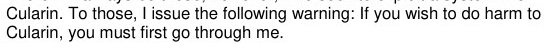
- **No single roster character (rules/setting/general)** — entry/section: Nirama: "Admiral Tramsig, you and your bantha-fondling pseudo-soldiers should stop toying with the people of Cularin." Source: *12:05:02 - That is Nirama's Word* (SWRPG d20 Revised Core), scan p.2
  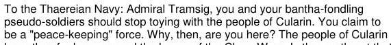
- **No single roster character (rules/setting/general)** — entry/section: Nirama: "I suppose enough guns that are large enough will suppress just about anything. If you do not stop acting against the people of Cularin, you will suffer. That is Nirama's word." Source: *12:05:02 - That is Nirama's Word* (SWRPG d20 Revised Core), scan p.2
  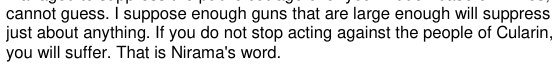
- **No single roster character (rules/setting/general)** — entry/section: Nirama: "Loogg, I have never trusted your smile. When you smile and proclaim your loyalty to the Republic, I hear lies in your voice. But then, Loogg, I have yet to hear truth in your voice." Source: *12:05:02 - That is Nirama's Word* (SWRPG d20 Revised Core), scan p.2
  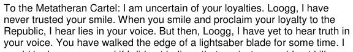
- **No single roster character (rules/setting/general)** — entry/section: Nirama: "I would be less concerned if I did not believe that a misstep would not kill you, but rather, would make two of you where before there was only one." Source: *12:05:02 - That is Nirama's Word* (SWRPG d20 Revised Core), scan p.2
  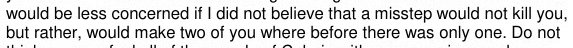
- **No single roster character (rules/setting/general)** — entry/section: Nirama: "You have betrayed me. You have killed innocents. If I find you, I will kill you myself. That is Nirama's word." Source: *12:05:02 - That is Nirama's Word* (SWRPG d20 Revised Core), scan p.2
  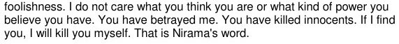
- **No single roster character (rules/setting/general)** — entry/section: Nirama: "To Alina Impeveri: Born of politics, you simply cannot get enough of the lies and deceit, can you?" Source: *12:05:02 - That is Nirama's Word* (SWRPG d20 Revised Core), scan p.2
  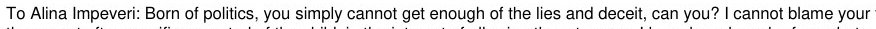
- **No single roster character (rules/setting/general)** — entry/section: Nirama: "I will feed you to something with many very dull teeth that chews slowly. That is Nirama's word." Source: *12:05:02 - That is Nirama's Word* (SWRPG d20 Revised Core), scan p.2
  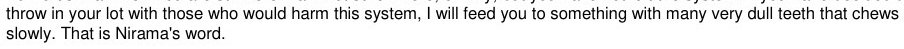
- **No single roster character (rules/setting/general)** — entry/section: Nirama: "a single individual may be competent, but a group that understands one another and works in concert can become unstoppable." Source: *12:05:02 - That is Nirama's Word* (SWRPG d20 Revised Core), scan p.2
  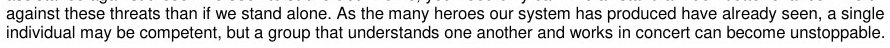
- **No single roster character (rules/setting/general)** — entry/section: Nirama: "This is my home. I do not like what I see being done to it, and I will do everything in my power to keep Cularin safe. That is Nirama's word." Source: *12:05:02 - That is Nirama's Word* (SWRPG d20 Revised Core), scan p.2
  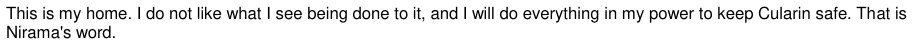
