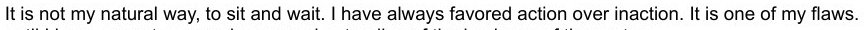
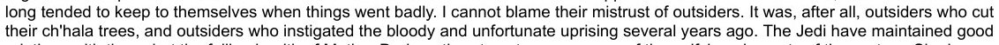
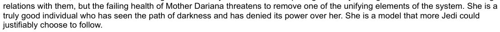
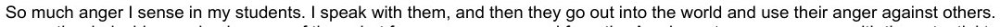
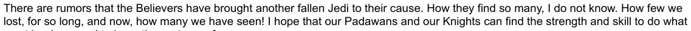
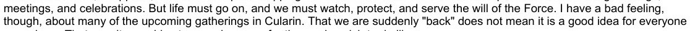
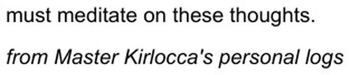

# Owner Material 037 — Star Wars D20 Drive folder (Core, Revised Core and Saga Edition): Living Force Campaign/Articles/Year 2/12:19:02 - Winter Fantasy Preview.pdf [Star Wars Roleplaying Game Revised Core (d20, 2002)]

- **Source:** Wizards of the Coast Star Wars Roleplaying Game books, web enhancements, Living Force campaign modules and articles (2000–2010), from the owner's "Star Wars D20" Drive folder (only the three edition subfolders; "General" was not read, as instructed). Secondary source (licensed Legends reference). Scan OCR'd on the box; the scan stays box-only and is **not** published.
- **Method:** every scanned page was OCR'd and machine-screened sentence by sentence for power-relevant statements (fights, kills, defeats, Force feats, rankings, superweapons) that name a character on our roster; each kept sentence is quoted verbatim from the OCR text and has a crop of the printed passage directly under it. Pages with nothing power-relevant are still listed with what is on them.
- **Citation:** "*12:19:02 - Winter Fantasy Preview* (SWRPG d20 Revised Core), p.X" by printed page ("scan p.X" where no printed number applies). **Weight:** Licensed RPG material: a secondary source. Narrative text sums up Legends lore; game statistics are rules for players, not canon power levels, and rank lowest.

## scan p.1 (scan page 1)

Page contents: WF2001 recap; Forces of Cularin; Kirlocca's log (hand-read)

- **No single roster character (rules/setting/general)** — entry/section: Kirlocca: "It is not my natural way, to sit and wait. I have always favored action over inaction. It is one of my flaws." Source: *12:19:02 - Winter Fantasy Preview* (SWRPG d20 Revised Core), scan p.1
  
- **No single roster character (rules/setting/general)** — entry/section: Kirlocca: "I cannot blame their mistrust of outsiders. It was, after all, outsiders who cut their ch'hala trees, and outsiders who instigated the bloody and unfortunate uprising several years ago." Source: *12:19:02 - Winter Fantasy Preview* (SWRPG d20 Revised Core), scan p.1
  
- **No single roster character (rules/setting/general)** — entry/section: Dariana: "She is a truly good individual who has seen the path of darkness and has denied its power over her. She is a model that more Jedi could justifiably choose to follow." Source: *12:19:02 - Winter Fantasy Preview* (SWRPG d20 Revised Core), scan p.1
  
- **No single roster character (rules/setting/general)** — entry/section: Kirlocca: "So much anger I sense in my students. I speak with them, and then they go out into the world and use their anger against others." Source: *12:19:02 - Winter Fantasy Preview* (SWRPG d20 Revised Core), scan p.1
  
- **No single roster character (rules/setting/general)** — entry/section: Kirlocca: "How few we lost, for so long, and now, how many we have seen!" Source: *12:19:02 - Winter Fantasy Preview* (SWRPG d20 Revised Core), scan p.1
  
- **No single roster character (rules/setting/general)** — entry/section: Kirlocca: "But life must go on, and we must watch, protect, and serve the will of the Force. I have a bad feeling, though, about many of the upcoming gatherings in Cularin." Source: *12:19:02 - Winter Fantasy Preview* (SWRPG d20 Revised Core), scan p.1
  
- **No single roster character (rules/setting/general)** — entry/section: Kirlocca: "I must meditate on these thoughts. -- from Master Kirlocca's personal logs" Source: *12:19:02 - Winter Fantasy Preview* (SWRPG d20 Revised Core), scan p.1
  
