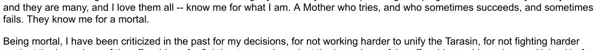
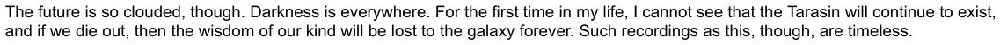
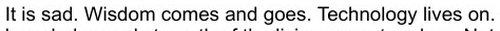
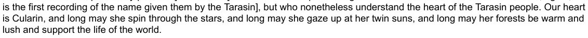
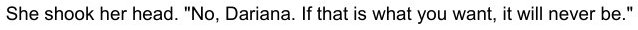
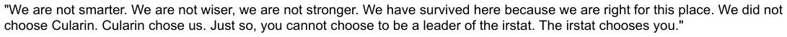
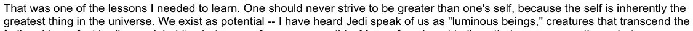
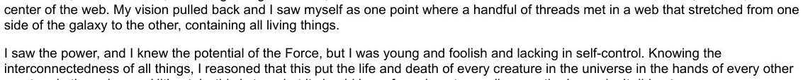
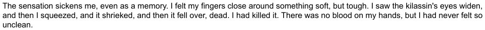
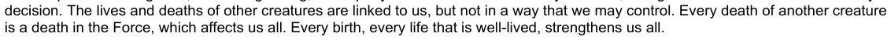

# Owner Material 037 — Star Wars D20 Drive folder (Core, Revised Core and Saga Edition): Living Force Campaign/Articles/Year 3/01:02:03 - A Mother's Memoirs.pdf [Star Wars Roleplaying Game Revised Core (d20, 2002)]

- **Source:** Wizards of the Coast Star Wars Roleplaying Game books, web enhancements, Living Force campaign modules and articles (2000–2010), from the owner's "Star Wars D20" Drive folder (only the three edition subfolders; "General" was not read, as instructed). Secondary source (licensed Legends reference). Scan OCR'd on the box; the scan stays box-only and is **not** published.
- **Method:** every scanned page was OCR'd and machine-screened sentence by sentence for power-relevant statements (fights, kills, defeats, Force feats, rankings, superweapons) that name a character on our roster; each kept sentence is quoted verbatim from the OCR text and has a crop of the printed passage directly under it. Pages with nothing power-relevant are still listed with what is on them.
- **Citation:** "*01:02:03 - A Mother's Memoirs* (SWRPG d20 Revised Core), p.X" by printed page ("scan p.X" where no printed number applies). **Weight:** Licensed RPG material: a secondary source. Narrative text sums up Legends lore; game statistics are rules for players, not canon power levels, and rank lowest.

## scan p.1 (scan page 1)

Page contents: Intro; recording justification; darkness; kampo/sa'tosin; youth; box (hand-read)

- **No single roster character (rules/setting/general)** — entry/section: Dariana: "A Mother who tries, and who sometimes succeeds, and sometimes fails. They know me for a mortal." Source: *01:02:03 - A Mother's Memoirs* (SWRPG d20 Revised Core), scan p.1
  
- **No single roster character (rules/setting/general)** — entry/section: Dariana: "For the first time in my life, I cannot see that the Tarasin will continue to exist, and if we die out, then the wisdom of our kind will be lost to the galaxy forever." Source: *01:02:03 - A Mother's Memoirs* (SWRPG d20 Revised Core), scan p.1
  
- **No single roster character (rules/setting/general)** — entry/section: Dariana: "It is sad. Wisdom comes and goes. Technology lives on." Source: *01:02:03 - A Mother's Memoirs* (SWRPG d20 Revised Core), scan p.1
  
- **No single roster character (rules/setting/general)** — entry/section: Dariana: "Our heart is Cularin, and long may she spin through the stars, and long may she gaze up at her twin suns, and long may her forests be warm and lush and support the life of the world." Source: *01:02:03 - A Mother's Memoirs* (SWRPG d20 Revised Core), scan p.1
  
- **No single roster character (rules/setting/general)** — entry/section: Dariana: "I have lived as best I could, and when I die, it will be with no regrets, except that, perhaps, had things been different, I might have had one more day to attempt to do good." Source: *01:02:03 - A Mother's Memoirs* (SWRPG d20 Revised Core), scan p.1
  

## scan p.2 (scan page 2)

Page contents: Mother's lesson; web vision; kilassin killing (hand-read)

- **No single roster character (rules/setting/general)** — entry/section: Dariana: "She shook her head. "No, Dariana. If that is what you want, it will never be."" Source: *01:02:03 - A Mother's Memoirs* (SWRPG d20 Revised Core), scan p.2
  
- **No single roster character (rules/setting/general)** — entry/section: Dariana: ""We are not smarter. We are not wiser, we are not stronger. We have survived here because we are right for this place. We did not choose Cularin. Cularin chose us. Just so, you cannot choose to be a leader of the irstat. The irstat chooses you."" Source: *01:02:03 - A Mother's Memoirs* (SWRPG d20 Revised Core), scan p.2
  
- **No single roster character (rules/setting/general)** — entry/section: Dariana: "One should never strive to be greater than one's self, because the self is inherently the greatest thing in the universe." Source: *01:02:03 - A Mother's Memoirs* (SWRPG d20 Revised Core), scan p.2
  
- **No single roster character (rules/setting/general)** — entry/section: Dariana: "My vision pulled back and I saw myself as one point where a handful of threads met in a web that stretched from one side of the galaxy to the other, containing all living things." Source: *01:02:03 - A Mother's Memoirs* (SWRPG d20 Revised Core), scan p.2
  
- **No single roster character (rules/setting/general)** — entry/section: Dariana: "I felt my fingers close around something soft, but tough. I saw the kilassin's eyes widen, and then I squeezed, and it shrieked, and then it fell over, dead. I had killed it. There was no blood on my hands, but I had never felt so unclean." Source: *01:02:03 - A Mother's Memoirs* (SWRPG d20 Revised Core), scan p.2
  
- **No single roster character (rules/setting/general)** — entry/section: Dariana: "Every death of another creature is a death in the Force, which affects us all. Every birth, every life that is well-lived, strengthens us all." Source: *01:02:03 - A Mother's Memoirs* (SWRPG d20 Revised Core), scan p.2
  
- **No single roster character (rules/setting/general)** — entry/section: Dariana: "For now, I grow tired. Perhaps I will speak more of this later. But this -- this is enough speech, for one day." Source: *01:02:03 - A Mother's Memoirs* (SWRPG d20 Revised Core), scan p.2
  
