# Owner Material 037 — Star Wars D20 Drive folder (Core, Revised Core and Saga Edition): Living Force Campaign/Articles/Year 3/01:09:03 - Cularin's Militia Exposed!.pdf [Star Wars Roleplaying Game Revised Core (d20, 2002)]

- **Source:** Wizards of the Coast Star Wars Roleplaying Game books, web enhancements, Living Force campaign modules and articles (2000–2010), from the owner's "Star Wars D20" Drive folder (only the three edition subfolders; "General" was not read, as instructed). Secondary source (licensed Legends reference). Scan OCR'd on the box; the scan stays box-only and is **not** published.
- **Method:** every scanned page was OCR'd and machine-screened sentence by sentence for power-relevant statements (fights, kills, defeats, Force feats, rankings, superweapons) that name a character on our roster; each kept sentence is quoted verbatim from the OCR text and has a crop of the printed passage directly under it. Pages with nothing power-relevant are still listed with what is on them.
- **Citation:** "*01:09:03 - Cularin's Militia Exposed!* (SWRPG d20 Revised Core), p.X" by printed page ("scan p.X" where no printed number applies). **Weight:** Licensed RPG material: a secondary source. Narrative text sums up Legends lore; game statistics are rules for players, not canon power levels, and rank lowest.

## scan p.1 (scan page 1)

Page contents: Yara en route; tough questions; restricted airspace (hand-read)

- **No single roster character (rules/setting/general)** — entry/section: Yara Grugara: "Were my producers happy about it? No way! They wanted Yara doing fashion and society pieces!" Source: *01:09:03 - Cularin's Militia Exposed!* (SWRPG d20 Revised Core), scan p.1
  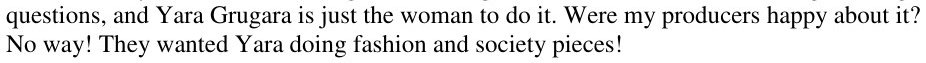
- **No single roster character (rules/setting/general)** — entry/section: Yara Grugara: "So, what's the truth? What did Thaere do? Yara doesn't know. Yara will find out, though." Source: *01:09:03 - Cularin's Militia Exposed!* (SWRPG d20 Revised Core), scan p.1
  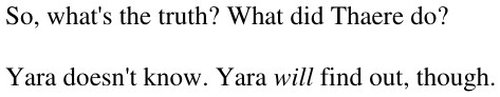
- **No single roster character (rules/setting/general)** — entry/section: Yara Grugara: "Well, friends, there you have it. Yara is yet again going somewhere that Yara is not wanted. Imagine!" Source: *01:09:03 - Cularin's Militia Exposed!* (SWRPG d20 Revised Core), scan p.1
  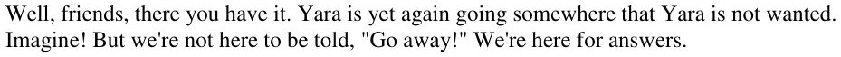

## scan p.2 (scan page 2)

Page contents: Forced landing; Wookiees; droid in shot; Broof interview set-up (hand-read)

- **No single roster character (rules/setting/general)** — entry/section: Yara Grugara: "Pilot? Yes, you heard that right. Go ahead and take us in. Oh, just park anywhere. I'm sure they'll come and find us..." Source: *01:09:03 - Cularin's Militia Exposed!* (SWRPG d20 Revised Core), scan p.2
  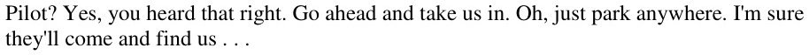
- **No single roster character (rules/setting/general)** — entry/section: Yara Grugara: "Is it nothing more than a front for that strange, twitchy-eyed Nirama?" Source: *01:09:03 - Cularin's Militia Exposed!* (SWRPG d20 Revised Core), scan p.2
  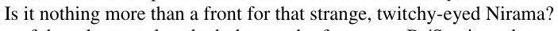
- **No single roster character (rules/setting/general)** — entry/section: Yara Grugara: "You little monster, you're in my shot!" Source: *01:09:03 - Cularin's Militia Exposed!* (SWRPG d20 Revised Core), scan p.2
  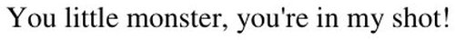
- **No single roster character (rules/setting/general)** — entry/section: Broof Yurdel: "Broof is a Gungan of few words." Source: *01:09:03 - Cularin's Militia Exposed!* (SWRPG d20 Revised Core), scan p.2
  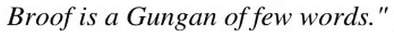

## scan p.3 (scan page 3)

Page contents: Broof on Thaere, war (hand-read)

- **No single roster character (rules/setting/general)** — entry/section: Broof Yurdel: "Broof: Wesa protectin' Cularin from da bombad Navy of Daere." Source: *01:09:03 - Cularin's Militia Exposed!* (SWRPG d20 Revised Core), scan p.3
  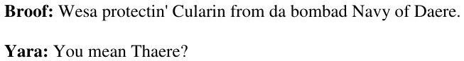
- **No single roster character (rules/setting/general)** — entry/section: Broof Yurdel: "Broof: Dat's what meesa said. Daere." Source: *01:09:03 - Cularin's Militia Exposed!* (SWRPG d20 Revised Core), scan p.3
  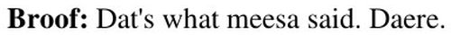
- **No single roster character (rules/setting/general)** — entry/section: Broof Yurdel: "Deysa tinkin' wesa dumb. Wesa not dumb. Deysa makin' da bombad big mistake, if deysa underestimate Cularin." Source: *01:09:03 - Cularin's Militia Exposed!* (SWRPG d20 Revised Core), scan p.3
  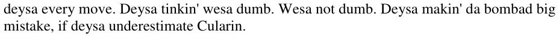
- **No single roster character (rules/setting/general)** — entry/section: Broof Yurdel: "Broof: Wesa defending Cularin! When yousa bein' attacked, yousa fight back or die. Dat's war." Source: *01:09:03 - Cularin's Militia Exposed!* (SWRPG d20 Revised Core), scan p.3
  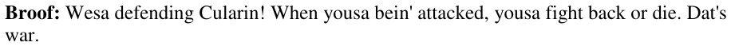
- **No single roster character (rules/setting/general)** — entry/section: Broof Yurdel: "Broof: Yousa not been watching da Coruscant newsfeeds? Bombad big war happenin'!" Source: *01:09:03 - Cularin's Militia Exposed!* (SWRPG d20 Revised Core), scan p.3
  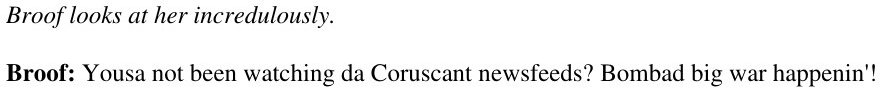

## scan p.4 (scan page 4)

Page contents: Official position; donations; Nim'Ri (hand-read)

- **No single roster character (rules/setting/general)** — entry/section: Yara Grugara: "Yara: Of course not. Yara Grugara would never serve as a mouthpiece for something she did not believe in, just to further her own career. Really." Source: *01:09:03 - Cularin's Militia Exposed!* (SWRPG d20 Revised Core), scan p.4
  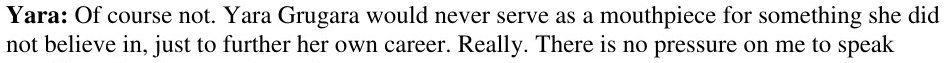
- **No single roster character (rules/setting/general)** — entry/section: Broof Yurdel: "Broof: Um . . . wesa not askin' dat." Source: *01:09:03 - Cularin's Militia Exposed!* (SWRPG d20 Revised Core), scan p.4
  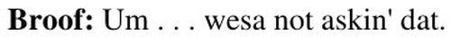
- **No single roster character (rules/setting/general)** — entry/section: Nim'Ri: "Nim'Ri -- hissen a good being, lots of lovin' for Cularin. Dat's two questions." Source: *01:09:03 - Cularin's Militia Exposed!* (SWRPG d20 Revised Core), scan p.4
  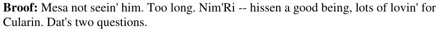

## scan p.5 (scan page 5)

Page contents: LF intro line only (image) (hand-read)

