# Owner Material 037 — Star Wars D20 Drive folder (Core, Revised Core and Saga Edition): Living Force Campaign/Articles/Year 3/02:06:03 - Friendship in the Order.pdf [Star Wars Roleplaying Game Revised Core (d20, 2002)]

- **Source:** Wizards of the Coast Star Wars Roleplaying Game books, web enhancements, Living Force campaign modules and articles (2000–2010), from the owner's "Star Wars D20" Drive folder (only the three edition subfolders; "General" was not read, as instructed). Secondary source (licensed Legends reference). Scan OCR'd on the box; the scan stays box-only and is **not** published.
- **Method:** every scanned page was OCR'd and machine-screened sentence by sentence for power-relevant statements (fights, kills, defeats, Force feats, rankings, superweapons) that name a character on our roster; each kept sentence is quoted verbatim from the OCR text and has a crop of the printed passage directly under it. Pages with nothing power-relevant are still listed with what is on them.
- **Citation:** "*02:06:03 - Friendship in the Order* (SWRPG d20 Revised Core), p.X" by printed page ("scan p.X" where no printed number applies). **Weight:** Licensed RPG material: a secondary source. Narrative text sums up Legends lore; game statistics are rules for players, not canon power levels, and rank lowest.

## scan p.1 (scan page 1)

Page contents: Archive project; interview: living Force, attachment, Dariana (hand-read)

- **No single roster character (rules/setting/general)** — entry/section: Lanius: "ML: These are difficult times for everyone. If anything, that makes it more necessary for us to record what we know, as well as what we feel." Source: *02:06:03 - Friendship in the Order* (SWRPG d20 Revised Core), scan p.1
  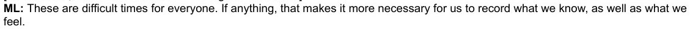
- **No single roster character (rules/setting/general)** — entry/section: Lanius: "If my atypicality has anything to do with my being here, on this wonderful planet with all these wonderful Padawans, then I cannot help but believe that my own intuition has served me unfailingly well." Source: *02:06:03 - Friendship in the Order* (SWRPG d20 Revised Core), scan p.1
  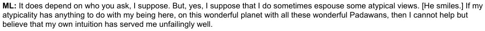
- **No single roster character (rules/setting/general)** — entry/section: Lanius: "ML: You choose interesting words. "Harmful" attachments. That presupposes that there is such a thing as a "harmless" attachment, which I'm not sure I agree with." Source: *02:06:03 - Friendship in the Order* (SWRPG d20 Revised Core), scan p.1
  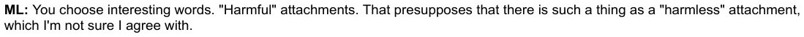
- **No single roster character (rules/setting/general)** — entry/section: Lanius: "But attachments weaken our resolve to do what is best for all living beings and cause us to think more of our individual selves." Source: *02:06:03 - Friendship in the Order* (SWRPG d20 Revised Core), scan p.1
  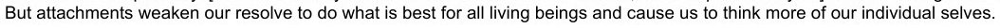
- **No single roster character (rules/setting/general)** — entry/section: Lanius: "ML: It is. We are all important, because we are all part of the Force." Source: *02:06:03 - Friendship in the Order* (SWRPG d20 Revised Core), scan p.1
  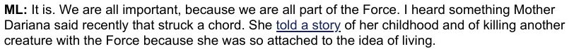

## scan p.2 (scan page 2)

Page contents: Life and death; friends; emotions; box; white-cloud parable (hand-read)

- **No single roster character (rules/setting/general)** — entry/section: Lanius: "ML: Life and death are both the will of the Force. Sometimes, self-preservation is right. Other times, the death of one may better serve the many." Source: *02:06:03 - Friendship in the Order* (SWRPG d20 Revised Core), scan p.2
  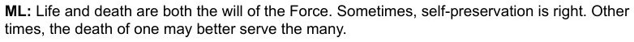
- **No single roster character (rules/setting/general)** — entry/section: Lanius: "ML: Every Jedi -- every Master, every Knight, and every Padawan -- is my friend." Source: *02:06:03 - Friendship in the Order* (SWRPG d20 Revised Core), scan p.2
  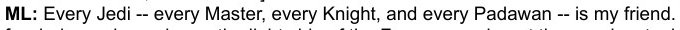
- **No single roster character (rules/setting/general)** — entry/section: Lanius: "We are not emotionless creatures. We feel. Being a Jedi does not rob us of the emotions with which we were born. We are simply no longer dominated by them." Source: *02:06:03 - Friendship in the Order* (SWRPG d20 Revised Core), scan p.2
  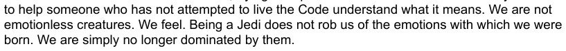
- **No single roster character (rules/setting/general)** — entry/section: Lanius: "Yes. I love my friends. The Jedi are my friends. Many non-Jedi are my friends. I love all of them equally, or as equally as a flawed being is able to do so." Source: *02:06:03 - Friendship in the Order* (SWRPG d20 Revised Core), scan p.2
  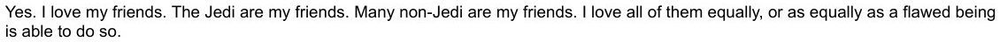
- **No single roster character (rules/setting/general)** — entry/section: Lanius: "the attachment to one person, one thing, at the expense of any other." Source: *02:06:03 - Friendship in the Order* (SWRPG d20 Revised Core), scan p.2
  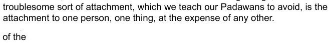
- **No single roster character (rules/setting/general)** — entry/section: Lanius: "ML: No, I speak as though you were Jedi. Why did he never find it?" Source: *02:06:03 - Friendship in the Order* (SWRPG d20 Revised Core), scan p.2
  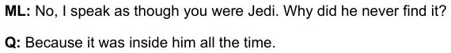
- **No single roster character (rules/setting/general)** — entry/section: Lanius: "ML: Whatever the Force is, wherever it comes from, I can guarantee you that it is not a swirling white cloud inside of any single individual." Source: *02:06:03 - Friendship in the Order* (SWRPG d20 Revised Core), scan p.2
  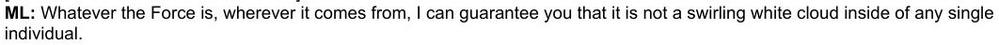
- **No single roster character (rules/setting/general)** — entry/section: Lanius: "Ironically, his attachment was to the Force itself, and for it, he gave up what could have been a productive life to chase a dream across a galaxy." Source: *02:06:03 - Friendship in the Order* (SWRPG d20 Revised Core), scan p.2
  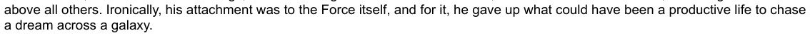

## scan p.3 (scan page 3)

Page contents: Closing lines (image) (hand-read)

