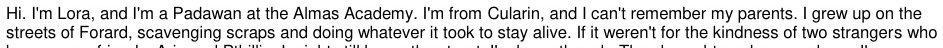
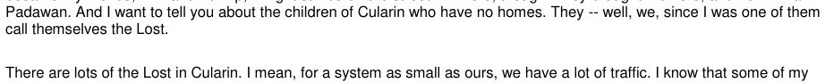
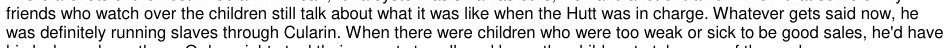
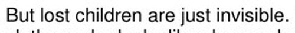
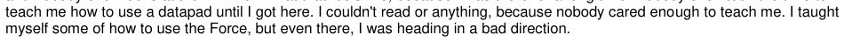
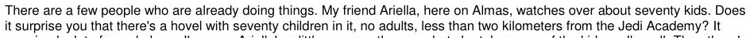
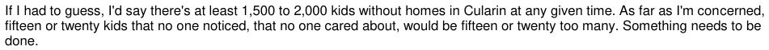
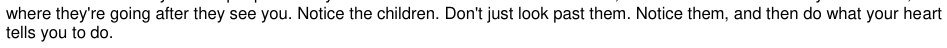

# Owner Material 037 — Star Wars D20 Drive folder (Core, Revised Core and Saga Edition): Living Force Campaign/Articles/Year 3/02:13:03 - The Lost.pdf [Star Wars Roleplaying Game Revised Core (d20, 2002)]

- **Source:** Wizards of the Coast Star Wars Roleplaying Game books, web enhancements, Living Force campaign modules and articles (2000–2010), from the owner's "Star Wars D20" Drive folder (only the three edition subfolders; "General" was not read, as instructed). Secondary source (licensed Legends reference). Scan OCR'd on the box; the scan stays box-only and is **not** published.
- **Method:** every scanned page was OCR'd and machine-screened sentence by sentence for power-relevant statements (fights, kills, defeats, Force feats, rankings, superweapons) that name a character on our roster; each kept sentence is quoted verbatim from the OCR text and has a crop of the printed passage directly under it. Pages with nothing power-relevant are still listed with what is on them.
- **Citation:** "*02:13:03 - The Lost* (SWRPG d20 Revised Core), p.X" by printed page ("scan p.X" where no printed number applies). **Weight:** Licensed RPG material: a secondary source. Narrative text sums up Legends lore; game statistics are rules for players, not canon power levels, and rank lowest.

## scan p.1 (scan page 1)

Page contents: Lora intro; the Lost; holo report (hand-read)

- **No single roster character (rules/setting/general)** — entry/section: Lora Nadad: "I'm from Cularin, and I can't remember my parents. I grew up on the streets of Forard, scavenging scraps and doing whatever it took to stay alive." Source: *02:13:03 - The Lost* (SWRPG d20 Revised Core), scan p.1
  
- **No single roster character (rules/setting/general)** — entry/section: Lora Nadad: "They -- well, we, since I was one of them -call themselves the Lost." Source: *02:13:03 - The Lost* (SWRPG d20 Revised Core), scan p.1
  
- **No single roster character (rules/setting/general)** — entry/section: Lora Nadad: "Whatever gets said now, he was definitely running slaves through Cularin." Source: *02:13:03 - The Lost* (SWRPG d20 Revised Core), scan p.1
  
- **No single roster character (rules/setting/general)** — entry/section: Lora Nadad: "But lost children are just invisible." Source: *02:13:03 - The Lost* (SWRPG d20 Revised Core), scan p.1
  
- **No single roster character (rules/setting/general)** — entry/section: Lora Nadad: "I taught myself some of how to use the Force, but even there, I was heading in a bad direction." Source: *02:13:03 - The Lost* (SWRPG d20 Revised Core), scan p.1
  
- **No single roster character (rules/setting/general)** — entry/section: Lora Nadad: "You know what happens to kids that no one cares about? They stop caring, too." Source: *02:13:03 - The Lost* (SWRPG d20 Revised Core), scan p.1
  

## scan p.2 (scan page 2)

Page contents: Watchers; numbers; plea; stat block (hand-read)

- **No single roster character (rules/setting/general)** — entry/section: Lora Nadad: "Does it surprise you that there's a hovel with seventy children in it, no adults, less than two kilometers from the Jedi Academy?" Source: *02:13:03 - The Lost* (SWRPG d20 Revised Core), scan p.2
  
- **No single roster character (rules/setting/general)** — entry/section: Lora Nadad: "As far as I'm concerned, fifteen or twenty kids that no one noticed, that no one cared about, would be fifteen or twenty too many. Something needs to be done." Source: *02:13:03 - The Lost* (SWRPG d20 Revised Core), scan p.2
  
- **No single roster character (rules/setting/general)** — entry/section: Lora Nadad: "Notice the children. Don't just look past them. Notice them, and then do what your heart tells you to do." Source: *02:13:03 - The Lost* (SWRPG d20 Revised Core), scan p.2
  

### Stat block notes (game mechanics, not feats)

- Lora Nadad: Lora Nadad: Human Female Soldier 1/Force Adept 5/Jedi Guardian 3; Init +4; Def 22; VP/WP 69/12; Atk +11/+6 melee (2d8/19-20 lightsaber) or (2d4+4 combat gloves, +1d8 imbued), +11/+5 ranged (3d6 blaster pistol); SQ Force Weapon +1d8, deflect; SV Fort +9, Ref +10, Will +6; FP 3; DSP 0; Rep +1; Str 10, Dex 18, Con 12, Int 14, Wis 13, Cha 14; Affect Mind +9, Enhance Ability +13, Move Object +14, Heal Self +11; Feats incl. Improved Martial Arts, Martial Artist, Weapon Finesse (unarmed, lightsaber); Alter, Control, Mind Trick, Sense (Source: *02:13:03 - The Lost* (SWRPG d20 Revised Core), scan p.2)
