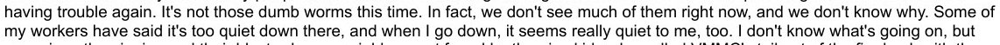
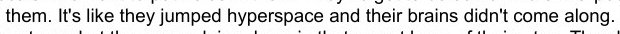
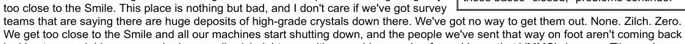
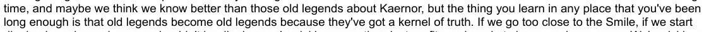
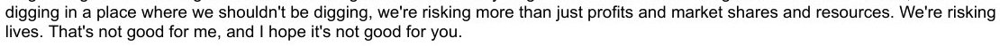
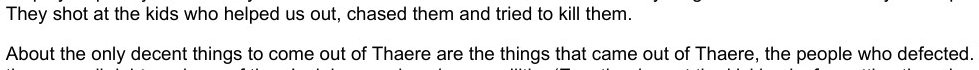
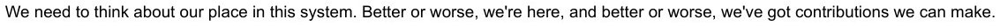

# Owner Material 037 — Star Wars D20 Drive folder (Core, Revised Core and Saga Edition): Living Force Campaign/Articles/Year 3/03:06:03 - Tilnes Falling.pdf [Star Wars Roleplaying Game Revised Core (d20, 2002)]

- **Source:** Wizards of the Coast Star Wars Roleplaying Game books, web enhancements, Living Force campaign modules and articles (2000–2010), from the owner's "Star Wars D20" Drive folder (only the three edition subfolders; "General" was not read, as instructed). Secondary source (licensed Legends reference). Scan OCR'd on the box; the scan stays box-only and is **not** published.
- **Method:** every scanned page was OCR'd and machine-screened sentence by sentence for power-relevant statements (fights, kills, defeats, Force feats, rankings, superweapons) that name a character on our roster; each kept sentence is quoted verbatim from the OCR text and has a crop of the printed passage directly under it. Pages with nothing power-relevant are still listed with what is on them.
- **Citation:** "*03:06:03 - Tilnes Falling* (SWRPG d20 Revised Core), p.X" by printed page ("scan p.X" where no printed number applies). **Weight:** Licensed RPG material: a secondary source. Narrative text sums up Legends lore; game statistics are rules for players, not canon power levels, and rank lowest.

## scan p.1 (scan page 1)

Page contents: VMMC background; HB7 memo begins; box (hand-read)

- **No single roster character (rules/setting/general)** — entry/section: HB7: "Some of my workers have said it's too quiet down there, and when I go down, it seems really quiet to me, too." Source: *03:06:03 - Tilnes Falling* (SWRPG d20 Revised Core), scan p.1
  
- **No single roster character (rules/setting/general)** — entry/section: HB7: "It's like they jumped hyperspace and their brains didn't come along." Source: *03:06:03 - Tilnes Falling* (SWRPG d20 Revised Core), scan p.1
  

## scan p.2 (scan page 2)

Page contents: Memo: the Smile; Thaereians; secrets; box (hand-read)

- **No single roster character (rules/setting/general)** — entry/section: HB7: "This place is nothing but bad, and I don't care if we've got survey teams that are saying there are huge deposits of high-grade crystals down there." Source: *03:06:03 - Tilnes Falling* (SWRPG d20 Revised Core), scan p.2
  
- **No single roster character (rules/setting/general)** — entry/section: HB7: "the thing you learn in any place that you've been long enough is that old legends become old legends because they've got a kernel of truth." Source: *03:06:03 - Tilnes Falling* (SWRPG d20 Revised Core), scan p.2
  
- **No single roster character (rules/setting/general)** — entry/section: HB7: "We're risking lives. That's not good for me, and I hope it's not good for you." Source: *03:06:03 - Tilnes Falling* (SWRPG d20 Revised Core), scan p.2
  
- **No single roster character (rules/setting/general)** — entry/section: HB7: "About the only decent things to come out of Thaere are the things that came out of Thaere, the people who defected." Source: *03:06:03 - Tilnes Falling* (SWRPG d20 Revised Core), scan p.2
  
- **No single roster character (rules/setting/general)** — entry/section: HB7: "We need to think about our place in this system. Better or worse, we're here, and better or worse, we've got contributions we can make." Source: *03:06:03 - Tilnes Falling* (SWRPG d20 Revised Core), scan p.2
  
