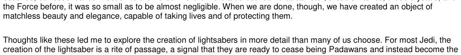
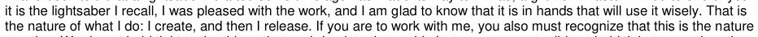
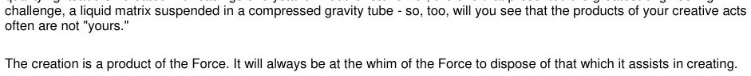

# Owner Material 037 — Star Wars D20 Drive folder (Core, Revised Core and Saga Edition): Living Force Campaign/Articles/Year 3/03:13:03 - Felanil Baaks, Jedi Artisan.pdf [Star Wars Roleplaying Game Revised Core (d20, 2002)]

- **Source:** Wizards of the Coast Star Wars Roleplaying Game books, web enhancements, Living Force campaign modules and articles (2000–2010), from the owner's "Star Wars D20" Drive folder (only the three edition subfolders; "General" was not read, as instructed). Secondary source (licensed Legends reference). Scan OCR'd on the box; the scan stays box-only and is **not** published.
- **Method:** every scanned page was OCR'd and machine-screened sentence by sentence for power-relevant statements (fights, kills, defeats, Force feats, rankings, superweapons) that name a character on our roster; each kept sentence is quoted verbatim from the OCR text and has a crop of the printed passage directly under it. Pages with nothing power-relevant are still listed with what is on them.
- **Citation:** "*03:13:03 - Felanil Baaks, Jedi Artisan* (SWRPG d20 Revised Core), p.X" by printed page ("scan p.X" where no printed number applies). **Weight:** Licensed RPG material: a secondary source. Narrative text sums up Legends lore; game statistics are rules for players, not canon power levels, and rank lowest.

## scan p.1 (scan page 1)

Page contents: Intro; lecture: artisan, Duro, Form Zero, pupils (hand-read)

- **Yoda** — entry/section: 03:13:03 - Felanil Baaks, Jedi Artisan: "Master Yoda once joked that|was a master of Form Zero -- of wielding the lightsaber without igniting it." Source: *03:13:03 - Felanil Baaks, Jedi Artisan* (SWRPG d20 Revised Core), scan p.1
  
- **No single roster character (rules/setting/general)** — entry/section: Felanil Baaks: "I am called Felanil Baaks. I am a crafter of lightsabers." Source: *03:13:03 - Felanil Baaks, Jedi Artisan* (SWRPG d20 Revised Core), scan p.1
  
- **No single roster character (rules/setting/general)** — entry/section: Felanil Baaks: "In fact, I find myself to be one of the most uninteresting topics possible!" Source: *03:13:03 - Felanil Baaks, Jedi Artisan* (SWRPG d20 Revised Core), scan p.1
  
- **No single roster character (rules/setting/general)** — entry/section: Felanil Baaks: "When we are done, though, we have created an object of matchless beauty and elegance, capable of taking lives and of protecting them." Source: *03:13:03 - Felanil Baaks, Jedi Artisan* (SWRPG d20 Revised Core), scan p.1
  
- **No single roster character (rules/setting/general)** — entry/section: Felanil Baaks: "Master Yoda once joked that I was a master of Form Zero -- of wielding the lightsaber without igniting it." Source: *03:13:03 - Felanil Baaks, Jedi Artisan* (SWRPG d20 Revised Core), scan p.1
  
- **No single roster character (rules/setting/general)** — entry/section: Felanil Baaks: "If you cannot wield a lightsaber without igniting it, then you should consider whether you are worthy to wield it at all." Source: *03:13:03 - Felanil Baaks, Jedi Artisan* (SWRPG d20 Revised Core), scan p.1
  
- **No single roster character (rules/setting/general)** — entry/section: Felanil Baaks: "You must understand when to ignite and when to ignore. That is Form Zero." Source: *03:13:03 - Felanil Baaks, Jedi Artisan* (SWRPG d20 Revised Core), scan p.1
  
- **No single roster character (rules/setting/general)** — entry/section: Felanil Baaks: "It is right to protect those who cannot protect themselves. I am proud to be a Jedi. I am proud to train other Jedi." Source: *03:13:03 - Felanil Baaks, Jedi Artisan* (SWRPG d20 Revised Core), scan p.1
  
- **No single roster character (rules/setting/general)** — entry/section: Felanil Baaks: "But I will not take a Padawan. I have never taken a Padawan, and I will never do so." Source: *03:13:03 - Felanil Baaks, Jedi Artisan* (SWRPG d20 Revised Core), scan p.1
  

## scan p.2 (scan page 2)

Page contents: Windu gift saber; release; stat block (hand-read)

- **No single roster character (rules/setting/general)** — entry/section: Felanil Baaks: "That is the nature of what I do: I create, and then I release." Source: *03:13:03 - Felanil Baaks, Jedi Artisan* (SWRPG d20 Revised Core), scan p.2
  
- **No single roster character (rules/setting/general)** — entry/section: Felanil Baaks: "The creation is a product of the Force. It will always be at the whim of the Force to dispose of that which it assists in creating." Source: *03:13:03 - Felanil Baaks, Jedi Artisan* (SWRPG d20 Revised Core), scan p.2
  

### Stat block notes (game mechanics, not feats)

- Felanil Baaks: Felanil Baaks: Male Duros Jedi Consular 7/Jedi Artisan 5/Jedi Instructor 1; Init +7; Def 23; VP/WP 75/10; Atk +13/+8 melee (4d8+2/19-20, +3 mastercraft lightsaber); SQ deflect, inspire confidence +1, material mastery, mastercraft lightsaber (+3); SV Fort +6, Ref +11, Will +13; FP 4; DSP 0; Rep +5; Str 8, Dex 16, Con 10, Int 19, Wis 14, Cha 10; Craft (lightsaber) +23, Repair +21; Feats: Force-Sensitive, Improved Initiative, Skill Emphasis Craft (lightsaber), Spacer, Weapon Finesse/Focus (lightsaber); Alter, Aware, Battle Meditation, Control, Knight/Lightsaber/Master Defense, Sense (Source: *03:13:03 - Felanil Baaks, Jedi Artisan* (SWRPG d20 Revised Core), scan p.2)
