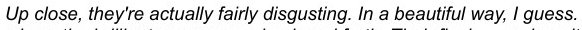
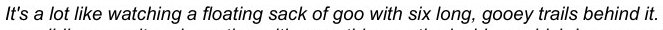
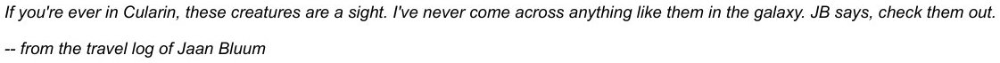

# Owner Material 037 — Star Wars D20 Drive folder (Core, Revised Core and Saga Edition): Living Force Campaign/Articles/Year 3/04:03:03 - Something to Mull Over.pdf [Star Wars Roleplaying Game Revised Core (d20, 2002)]

- **Source:** Wizards of the Coast Star Wars Roleplaying Game books, web enhancements, Living Force campaign modules and articles (2000–2010), from the owner's "Star Wars D20" Drive folder (only the three edition subfolders; "General" was not read, as instructed). Secondary source (licensed Legends reference). Scan OCR'd on the box; the scan stays box-only and is **not** published.
- **Method:** every scanned page was OCR'd and machine-screened sentence by sentence for power-relevant statements (fights, kills, defeats, Force feats, rankings, superweapons) that name a character on our roster; each kept sentence is quoted verbatim from the OCR text and has a crop of the printed passage directly under it. Pages with nothing power-relevant are still listed with what is on them.
- **Citation:** "*04:03:03 - Something to Mull Over* (SWRPG d20 Revised Core), p.X" by printed page ("scan p.X" where no printed number applies). **Weight:** Licensed RPG material: a secondary source. Narrative text sums up Legends lore; game statistics are rules for players, not canon power levels, and rank lowest.

## scan p.1 (scan page 1)

Page contents: Jaan Bluum log; cochlera biology; reproduction; box (hand-read)

- **No single roster character (rules/setting/general)** — entry/section: Jaan Bluum: "Up close, they're actually fairly disgusting. In a beautiful way, I guess." Source: *04:03:03 - Something to Mull Over* (SWRPG d20 Revised Core), scan p.1
  
- **No single roster character (rules/setting/general)** — entry/section: Jaan Bluum: "It's a lot like watching a floating sack of goo with six long, gooey trails behind it." Source: *04:03:03 - Something to Mull Over* (SWRPG d20 Revised Core), scan p.1
  
- **No single roster character (rules/setting/general)** — entry/section: Jaan Bluum: "If you're ever in Cularin, these creatures are a sight. I've never come across anything like them in the galaxy. JB says, check them out. -- from the travel log of Jaan Bluum" Source: *04:03:03 - Something to Mull Over* (SWRPG d20 Revised Core), scan p.1
  

## scan p.2 (scan page 2)

Page contents: GM notes; ichor capsule; stat block; species traits (hand-read)

### Stat block notes (game mechanics, not feats)

- Cochlera: Cochlera: Large airborne herd animal 2; Init +4; Def 15; Spd fly 24 m (good); VP/WP 9/19; Atk +4 melee (1d4+4 physical or 3d8 ionization, 6 slams); SV Fort +7, Ref +2, Will +2; Face/Reach 4x4 m/12 m; Str 19, Dex 14, Con 19, Int 1, Wis 15, Cha 4; CL B; Hide +10, Spot +9 (+1 per mull member); traits: Ionization, Camouflage, Current sense (blindsight), Energy vulnerability (stun: +8 DC, failure means a second save or explode) (Source: *04:03:03 - Something to Mull Over* (SWRPG d20 Revised Core), scan p.2)
- Cochlera ichor: Ichor capsule: Fort DC 15 or vomit 1d6+1 rounds (Heal Self at -5); on success, immune to both versions of Affect Mind and unable to use it for 1d4+1 minutes; Illusion unaffected (Source: *04:03:03 - Something to Mull Over* (SWRPG d20 Revised Core), scan p.2)
