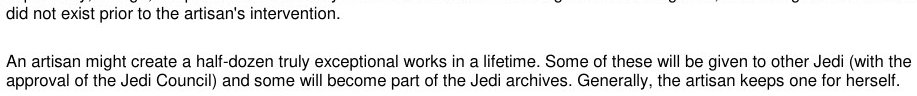

# Owner Material 037 — Star Wars D20 Drive folder (Core, Revised Core and Saga Edition): Living Force Campaign/Articles/Year 3/04:24:03 - Jedi Artisan Prestige Class.pdf [Star Wars Roleplaying Game Revised Core (d20, 2002)]

- **Source:** Wizards of the Coast Star Wars Roleplaying Game books, web enhancements, Living Force campaign modules and articles (2000–2010), from the owner's "Star Wars D20" Drive folder (only the three edition subfolders; "General" was not read, as instructed). Secondary source (licensed Legends reference). Scan OCR'd on the box; the scan stays box-only and is **not** published.
- **Method:** every scanned page was OCR'd and machine-screened sentence by sentence for power-relevant statements (fights, kills, defeats, Force feats, rankings, superweapons) that name a character on our roster; each kept sentence is quoted verbatim from the OCR text and has a crop of the printed passage directly under it. Pages with nothing power-relevant are still listed with what is on them.
- **Citation:** "*04:24:03 - Jedi Artisan Prestige Class* (SWRPG d20 Revised Core), p.X" by printed page ("scan p.X" where no printed number applies). **Weight:** Licensed RPG material: a secondary source. Narrative text sums up Legends lore; game statistics are rules for players, not canon power levels, and rank lowest.

## scan p.1 (scan page 1)

Page contents: Intro; class description; requirements; class skills (hand-read)

- **No single roster character (rules/setting/general)** — entry/section: Jedi artisan: "Whatever the artisan crafts, it must be an object that will ultimately be imbued with the Force." Source: *04:24:03 - Jedi Artisan Prestige Class* (SWRPG d20 Revised Core), scan p.1
  
- **No single roster character (rules/setting/general)** — entry/section: Jedi artisan: "An artisan might create a half-dozen truly exceptional works in a lifetime. Some of these will be given to other Jedi (with the approval of the Jedi Council) and some will become part of the Jedi archives. Generally, the artisan keeps one for herself." Source: *04:24:03 - Jedi Artisan Prestige Class* (SWRPG d20 Revised Core), scan p.1
  

## scan p.2 (scan page 2)

Page contents: Level table (crop); class features (hand-read)

### Stat block notes (game mechanics, not feats)

- Jedi Artisan (prestige class): Table (from image): 1st BAB 0 F0 R1 W2 Def+1 Rep+0 Skill Emphasis, mastercraft lightsaber +1, deflect (defense); 2nd 1/0/2/3 Def+2 Rep+1 Increase lightsaber damage; 3rd 2/1/2/3 Def+2 Rep+1 Lightsaber mastery, mastercraft lightsaber +2; 4th 3/1/2/4 Def+2 Rep+1 Material mastery, deflect (attack); 5th 3/1/3/4 Def+3 Rep+2 Mastercraft lightsaber +3 (Source: *04:24:03 - Jedi Artisan Prestige Class* (SWRPG d20 Revised Core), scan p.2)
