# Owner Material 037 — Star Wars D20 Drive folder (Core, Revised Core and Saga Edition): Living Force Campaign/Articles/Year 3/05:01:03 - Stories of Caarimon.pdf [Star Wars Roleplaying Game Revised Core (d20, 2002)]

- **Source:** Wizards of the Coast Star Wars Roleplaying Game books, web enhancements, Living Force campaign modules and articles (2000–2010), from the owner's "Star Wars D20" Drive folder (only the three edition subfolders; "General" was not read, as instructed). Secondary source (licensed Legends reference). Scan OCR'd on the box; the scan stays box-only and is **not** published.
- **Method:** every scanned page was OCR'd and machine-screened sentence by sentence for power-relevant statements (fights, kills, defeats, Force feats, rankings, superweapons) that name a character on our roster; each kept sentence is quoted verbatim from the OCR text and has a crop of the printed passage directly under it. Pages with nothing power-relevant are still listed with what is on them.
- **Citation:** "*05:01:03 - Stories of Caarimon* (SWRPG d20 Revised Core), p.X" by printed page ("scan p.X" where no printed number applies). **Weight:** Licensed RPG material: a secondary source. Narrative text sums up Legends lore; game statistics are rules for players, not canon power levels, and rank lowest.

## scan p.1 (scan page 1)

Page contents: Intro; Melanda's top story; Jaiteh (hand-read)

- **No single roster character (rules/setting/general)** — entry/section: Melanda Forswoth: "What do they eat? What do they drink? Do they read the right holonets? Do they wear the right clothes?" Source: *05:01:03 - Stories of Caarimon* (SWRPG d20 Revised Core), scan p.1
  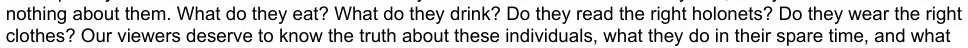
- **No single roster character (rules/setting/general)** — entry/section: Jaiteh: "Jaiteh: You're almost as perky as she is. But not quite." Source: *05:01:03 - Stories of Caarimon* (SWRPG d20 Revised Core), scan p.1
  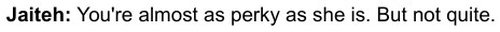

## scan p.2 (scan page 2)

Page contents: Jaiteh's rumors; Rodians; box (hand-read)

- **No single roster character (rules/setting/general)** — entry/section: Jaiteh: "I've heard that it's a small world, as befits a small people." Source: *05:01:03 - Stories of Caarimon* (SWRPG d20 Revised Core), scan p.2
  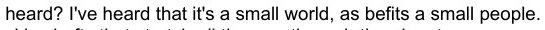
- **No single roster character (rules/setting/general)** — entry/section: Jaiteh: "I tried doing business with them once, and I never got any closer to Caarimon than an account they siphon their funds through on Coruscant. They can keep their planet, for all I care." Source: *05:01:03 - Stories of Caarimon* (SWRPG d20 Revised Core), scan p.2
  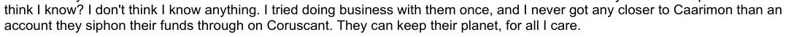

## scan p.3 (scan page 3)

Page contents: Nerrowr; Falsswon; Yara sign-off (hand-read)

- **No single roster character (rules/setting/general)** — entry/section: Nerrowr: "Nerrowr: I sometimes say "grunt" just in case the idiot who's talking to me is relying on a simple-minded translator. It can be very informative." Source: *05:01:03 - Stories of Caarimon* (SWRPG d20 Revised Core), scan p.3
  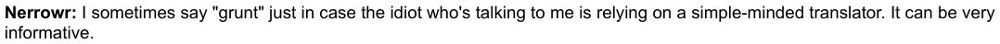
- **No single roster character (rules/setting/general)** — entry/section: Falsswon: "Small on a large, empty world means one must develop ways to make oneself feel larger." Source: *05:01:03 - Stories of Caarimon* (SWRPG d20 Revised Core), scan p.3
  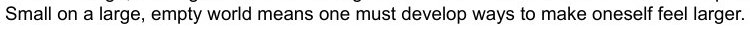
- **No single roster character (rules/setting/general)** — entry/section: Falsswon: "Falsswon: Culture? The Caarites have no culture of their own. They take the cultures of others." Source: *05:01:03 - Stories of Caarimon* (SWRPG d20 Revised Core), scan p.3
  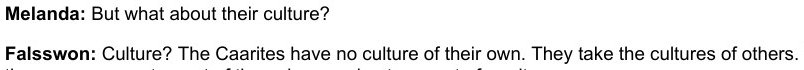
- **No single roster character (rules/setting/general)** — entry/section: Falsswon: "See how they followed the model of the Trade Federation, but have yet to get their charter revoked? It is because they know how to work with local politicians, rather than against them." Source: *05:01:03 - Stories of Caarimon* (SWRPG d20 Revised Core), scan p.3
  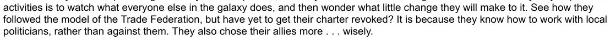
- **No single roster character (rules/setting/general)** — entry/section: Falsswon: "You are a blithering dribble who has been let wander too far from her society page, Melanda Forswoth." Source: *05:01:03 - Stories of Caarimon* (SWRPG d20 Revised Core), scan p.3
  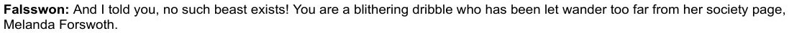
- **No single roster character (rules/setting/general)** — entry/section: Yara Grugara: "That, my friends, is the last time Melanda Forswoth was seen." Source: *05:01:03 - Stories of Caarimon* (SWRPG d20 Revised Core), scan p.3
  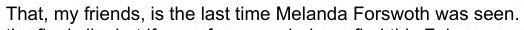
- **No single roster character (rules/setting/general)** — entry/section: Yara Grugara: "Falsswon -- "False One," how original, I wonder what his real name is?" Source: *05:01:03 - Stories of Caarimon* (SWRPG d20 Revised Core), scan p.3
  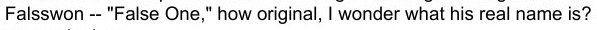
